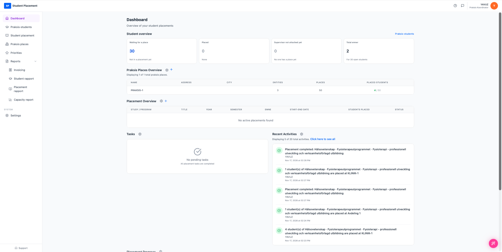
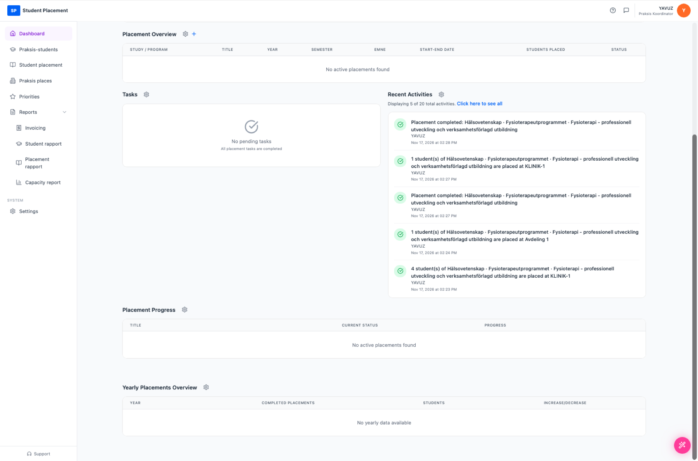
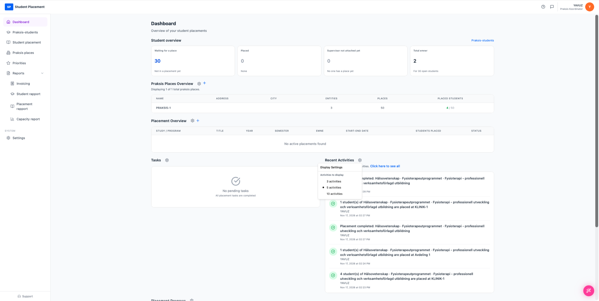
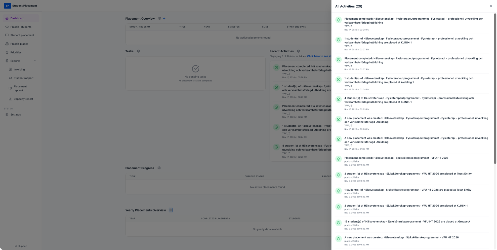

# Testscenario 00 — Instrumentpanel

:::info[Scenarioöversikt]

- **Sida:** Instrumentpanel
- **Roll:** Placeringskoordinator (PK)
- **Mål:** Lära känna instrumentpanelen — studentöversiktens kort, widgetarna och deras visningsinställningar.
- **Förutsättning:** Inloggad som PK.

:::

## Vad den här sidan är

**Instrumentpanelen** — *översikt över dina studentplaceringar* — är den första sidan efter inloggning. Överst
 finns **Studentöversikt**; under den finns widgetar som sammanfattar praktikställen, placeringar, uppgifter och
 aktiviteter.

Vilka widgetar som visas väljs under *Inställningar → Instrumentpanelselement* (se *Testscenario 03*).
 Studentöversikten visas alltid.

### Studentöversikt

| Kort | Visar |
|---|---|
| **Väntar på plats** | Studenter *som inte är i en placering ännu*. Klicka för att öppna dem i **Praksis-studenter** (fliken *Väntar*). |
| **Placerade** | Studenter som har en plats. Klicka för att öppna dem i **Praksis-studenter**. |
| **Handledare inte kopplad ännu** | Placerade studenter utan handledare. |
| **Totalt antal emnen** | Antal emnen för de öppna studenterna. |

Länken **Praksis-studenter** (uppe till höger i sektionen) öppnar sidan Praksis-studenter.

### Widgetar

| Widget | Visar |
|---|---|
| **Översikt över praktikställen** | Varje praktikställe med *adress, ort, enheter, platser* och *placerade studenter* (t.ex. *4 / 50*). **+** lägger till ett nytt praktikställe. |
| **Placeringsöversikt** | Aktiva placeringar med *studie / program, titel, år, termin, emne, start–slutdatum, placerade studenter* och *status*. **+** lägger till en ny placering. |
| **Uppgifter** | Placeringsuppgifter som återstår — *inga väntande uppgifter* när allt är klart. |
| **Senaste aktiviteter** | De senaste händelserna, t.ex. *placering skapad*, *N student(er) … är placerade på KLINIK-1*, *placering slutförd*, med vem som gjorde det och när. |
| **Placeringsförlopp** | Aktiva placeringar med *nuvarande status* och *förlopp*. |
| **Årlig placeringsöversikt** | Per år: *slutförda placeringar*, *studenter* och *ökning/minskning*. |

Varje widget har en **kugghjulsikon** med **Visningsinställningar**: hur många rader (eller uppgifter/aktiviteter)
 som ska visas — *3*, *5* eller *10* — och, för tabellerna, **Synliga kolumner** för att visa eller dölja kolumner.

---

## Steg

### 1. Öppna instrumentpanelen

Logga in, eller klicka på **Instrumentpanel** i sidofältet. Här visar studentöversikten *30 väntar på plats*,
 *0 placerade*, *0 handledare inte kopplad ännu* och *2 emnen totalt — för 30 öppna studenter*. Översikten över
 praktikställen visar **PRAKSIS-1** med *3 enheter*, *50 platser* och *4 / 50* placerade studenter.

<figure>

<figcaption>Instrumentpanel — studentöversikt och de första widgetarna</figcaption>

</figure>

Skrolla ned för att se **Placeringsförlopp** och **Årlig placeringsöversikt**.

<figure>

<figcaption>Instrumentpanel — placeringsförlopp och årlig placeringsöversikt</figcaption>

</figure>

### 2. Ändra vad en widget visar

Klicka på **kugghjulet** vid en widgetrubrik — här **Senaste aktiviteter**. Under **Visningsinställningar →
 Aktiviteter att visa** väljer du *3*, *5* eller *10 aktiviteter*. Tabellwidgetar har även **Synliga kolumner**.

<figure>

<figcaption>Visningsinställningar — hur många aktiviteter som visas</figcaption>

</figure>

### 3. Se alla aktiviteter

I **Senaste aktiviteter** (*visar 5 av 20 aktiviteter*) klickar du på **Klicka här för att se alla**. En panel
 **Alla aktiviteter (20)** öppnas till höger med hela listan. Stäng den med **×**.

<figure>

<figcaption>Alla aktiviteter — hela aktivitetslistan</figcaption>

</figure>

### 4. Gå till studenterna

Klicka på kortet **Väntar på plats**. **Praksis-studenter** öppnas med fliken **Väntar** vald (se
 *Testscenario 06*).

---

## Slutresultat

Koordinatorn kan snabbt läsa instrumentpanelen, justera vad varje widget visar, öppna hela aktivitetslistan och
 gå från studentkorten till Praksis-studenter.

## Anteckningar

-   **?**-ikonen i toppfältet öppnar det här hjälpcentret i en ny flik.
-   För att dölja eller visa hela widgetar, använd *Inställningar → Instrumentpanelselement* (*Testscenario 03*).

---

<ScenarioFeedback scenarioId="TS-00-dashboard" />
