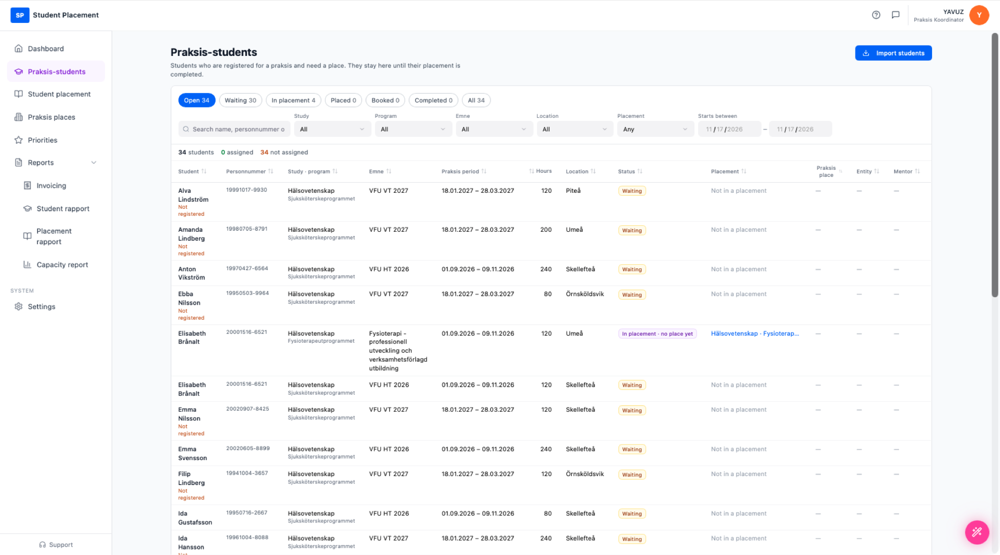
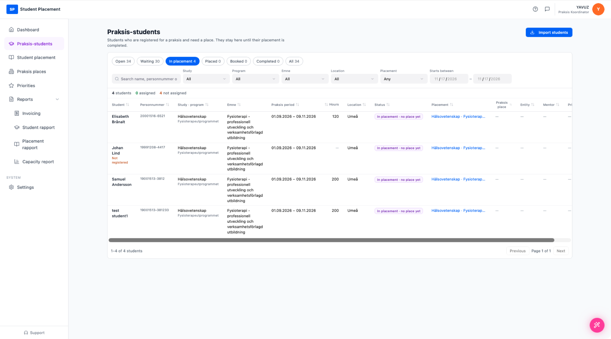
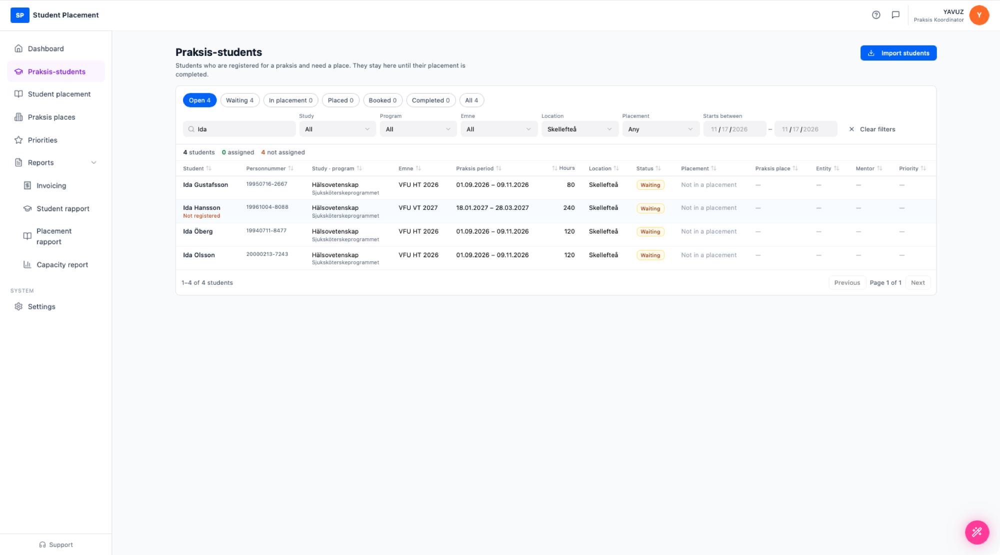
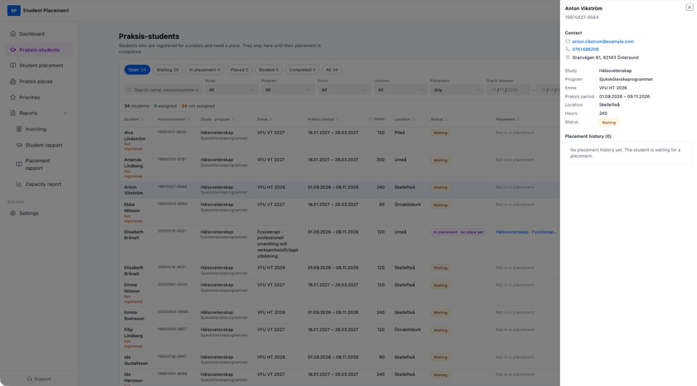
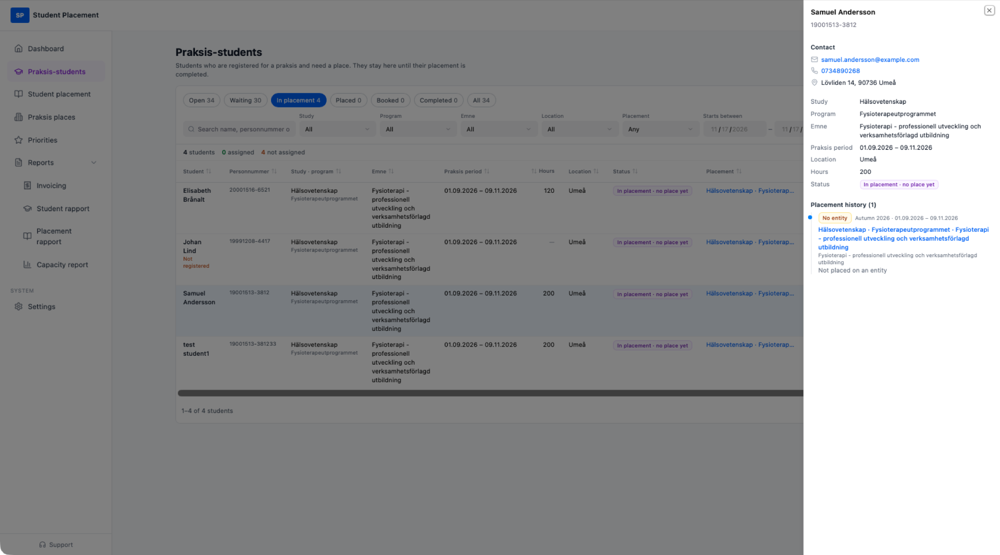
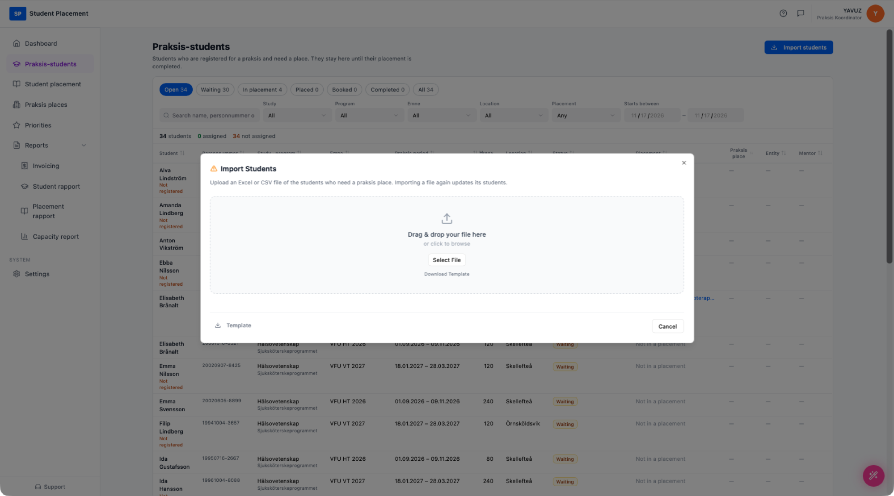

# Testscenario 06 — Praksis-studenter

:::info[Scenarioöversikt]

- **Sida:** Praksis-studenter
- **Roll:** Placeringskoordinator (PK)
- **Mål:** Hitta studenterna som behöver en praktikplats, begränsa listan med statusflikarna, sökning och filter, öppna en students detaljer och placeringshistorik, och se hur studenter importeras.
- **Förutsättning:** Inloggad som PK, med studenter redan importerade. Den här genomgången använder de befintliga studenterna i **Hälsovetenskap** (34 öppna studenter).

:::

## Vad den här sidan är

**Praksis-studenter** visar *studenter som är registrerade för en praktik och behöver en plats. De ligger
 kvar här tills deras placering är slutförd.* Sidan är startpunkten för placeringsarbetsflödet — steg 1,
 **Studenter från Praksis-studenter**, hämtar studenterna som väntar på ett emne från den här listan
 (se *Testscenario 03b — Arbetsflöden*).

Sidan har fyra delar:

- **Statusflikar** med löpande antal — **Öppna**, **Väntar**, **I placering**, **Placerade**, **Bokade**,
  **Slutförda** och **Alla**. **Öppna** (standard) visar alla studenter vars placering inte är slutförd.
- **Sökning och filter** — en sökruta (*namn, personnummer eller e-post*), **Studie**, **Program**, **Emne**,
  **Ort**, **Placering** (*Alla*, *Inte i en placering*, *I en placering*) och ett datumintervall
  **Startar mellan**.
- En **sammanfattningsrad** — antal studenter, hur många som är **tilldelade** (*har praktikplats*) och hur
  många som **inte är tilldelade** (*ingen praktikplats ännu*).
- **Studenttabellen** — Student, Personnummer, Studie · program, Emne, Praktikperiod, Timmar, Ort, Status,
  Placering, Praktikplats, Enhet, Handledare och Prioritet. Alla kolumnrubriker kan klickas för att sortera.

Studenter markerade **Inte registrerad** under namnet importerades med *Registered* satt till *No* i
 importfilen.

---

## Steg

### 1. Öppna Praksis-studenter

Klicka på **Praksis-studenter** i sidofältet. Fliken **Öppna** är vald och visar alla öppna studenter — här
 *34 studenter, 0 tilldelade, 34 inte tilldelade*. Studenter som inte är i en placering har status
 **Väntar** och *Inte i en placering*.

<figure>

<figcaption>Praksis-studenter — fliken Öppna med statusflikar, filter och studenttabellen</figcaption>

</figure>

### 2. Byt statusflik

Klicka på **I placering**. Listan visar bara studenterna som har tagits in i en placering — här 4 studenter
 med status **I placering · ingen plats ännu**. Kolumnen **Placering** visar placeringen som en länk
 (*Hälsovetenskap · Fysioterapeutprogrammet · …*); Praktikplats, Enhet och Handledare är tomma tills en
 plats har tilldelats.

<figure>

<figcaption>I placering — studenter i en placering som ännu inte har praktikplats</figcaption>

</figure>

### 3. Sök och filtrera

Gå tillbaka till **Öppna**. Skriv `Ida` i sökrutan och välj **Skellefteå** under **Ort**. Listan begränsas
 till de 4 matchande studenterna, och antalen på statusflikarna uppdateras efter sökningen och filtren
 (*Öppna 4*, *Väntar 4*). En knapp **Rensa filter** visas — klicka på den för att återställa sökningen och
 alla filter.

<figure>

<figcaption>Sökning ”Ida” + Ort Skellefteå — 4 studenter; Rensa filter återställer</figcaption>

</figure>

### 4. Öppna en students detaljer

Klicka på en studentrad — här **Anton Vikström**. En sidopanel öppnas med studentens **Kontakt**-uppgifter
 (e-post, telefon, adress), **Studie**, **Program**, **Emne**, **Praktikperiod**, **Ort**, **Timmar** och
 **Status**. Nedanför visas **Placeringshistorik** — för en student som väntar står det *ingen
 placeringshistorik ännu; studenten väntar på en placering*.

<figure>

<figcaption>Studentdetaljer — kontakt, studieuppgifter och tom placeringshistorik</figcaption>

</figure>

### 5. Se placeringshistoriken

Stäng panelen (**×**), byt till **I placering** och klicka på **Samuel Andersson**. **Placeringshistorik
 (1)** visar placeringen han är i — termin och datum (*Autumn 2026 · 01.09.2026 – 09.11.2026*),
 placeringen som en länk och märket **Ingen enhet** med *inte placerad på en enhet*, eftersom ingen
 praktikplats har tilldelats ännu.

<figure>

<figcaption>Placeringshistorik — en placering, ännu inte placerad på en enhet</figcaption>

</figure>

### 6. Importera studenter

Klicka på **Importera studenter** (uppe till höger). Dialogen **Importera studenter** förklarar att du laddar
 upp en Excel- eller CSV-fil med studenterna som behöver praktikplats, och att *en ny import av samma fil
 uppdaterar studenterna i den*. Dra en fil till uppladdningsytan eller klicka på **Välj fil**. Klicka på
 **Mall** (eller **Ladda ner mall**) för att få en Excel-fil med de förväntade kolumnerna:

| Obligatoriska | Valfria |
|---|---|
| First name, Last name, Personnummer, Email, Program, Start date | Phone, Address, Study, Program code, Emne code, Emne, End date, Hours, Location, Registered |

Klicka på **Avbryt** för att stänga dialogen utan att importera.

<figure>

<figcaption>Importera studenter — ladda upp en Excel/CSV-fil eller ladda ner mallen</figcaption>

</figure>

---

## Slutresultat

Koordinatorn ser snabbt vilka studenter som fortfarande behöver praktikplats, kan begränsa listan med
 status, sökning och filter, slå upp en students kontaktuppgifter och placeringshistorik, och vet hur nya
 studenter tas in med en importfil.

## Anteckningar

-   En ny import av en fil **uppdaterar** studenterna i den — du behöver inte ta bort dem först.
-   Studenterna ligger kvar på den här sidan tills placeringen är **Slutförd**; använd fliken **Alla** för att se alla studenter.
-   Kolumnnamnen i mallen är på engelska och ska användas som de står.

---

<ScenarioFeedback scenarioId="TS-06-praksis-students" />
