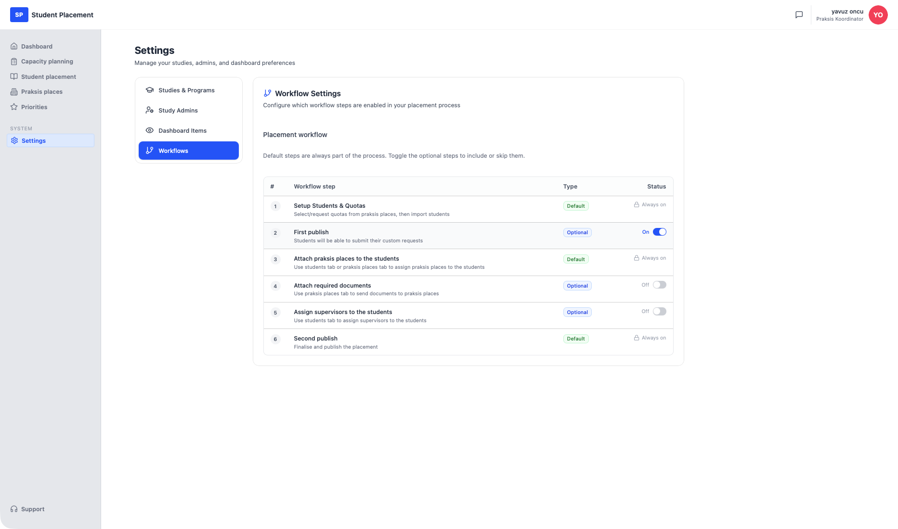
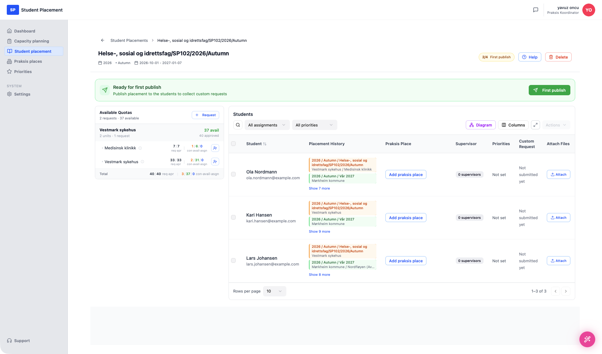
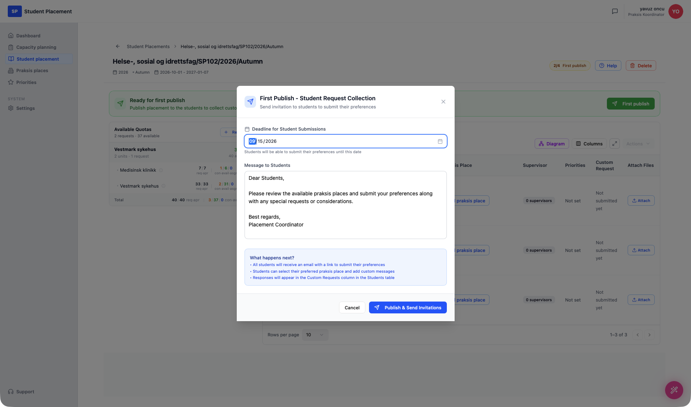
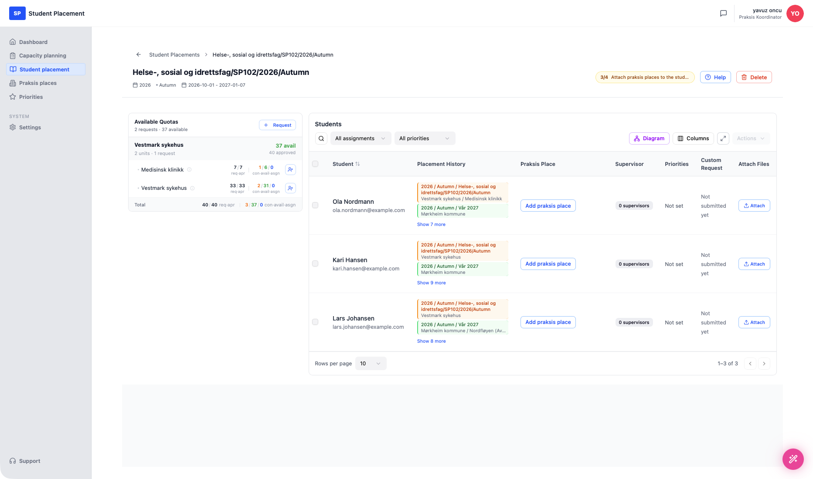

# Student plassering - Samla in studentönskemål

:::info[Scenarioöversikt]

- **Sida:** Inställningar → Arbetsflöden, sedan Student plassering → *(en placering)*
- **Roll:** Placeringskoordinator (PK)
- **Mål:** Aktivera det valfria arbetsflödessteget **Första publicering** och publicera sedan en placering för första gången, så att studenterna får ett e-postmeddelande och kan skicka in sina egna **anpassade förfrågningar** (önskad praktikplats + ett meddelande).
- **Förutsättning:** En placering med studenter redan importerade. Den här genomgången använder **Helse-, sosial og idrettsfag/SP102/2026/Autumn**.

:::

## Vad det här valfria arbetsflödet är

Placeringsprocessen går igenom en fast uppsättning arbetsflödessteg. Vissa är **Standard** (alltid på) och vissa är **Valfritt** — du slår på dem efter behov. **Första publicering** är ett valfritt steg som ligger tidigt i processen, *innan* praktikplatser kopplas till studenter.

När det är aktiverat och utlöst skickar Första publicering varje importerad student en **e-postinbjudan** att logga in och **skicka in sina önskemål**: vilken praktikplats de vill ha och eventuella särskilda förfrågningar eller hänsyn. Deras svar kommer tillbaka i kolumnen **Anpassad förfrågan** i studenttabellen, så att koordinatorn kan ta hänsyn till dem vid tilldelning av platser. Det är mekanismen för att *samla in studentönskemål* före fördelningen.

---

## Steg

### 1. Aktivera "Första publicering" i Inställningar → Arbetsflöden

Öppna **Inställningar** i sidofältet och välj fliken **Arbetsflöden**. Tabellen **Placeringsarbetsflöde** listar varje steg med **Typ** (Standard / Valfritt) och **Status**. Standardsteg visar ett lås och *Alltid på*; valfria steg har en växlare.

<figure>

<figcaption>Arbetsflödesinställningar — "Första publicering" (steg 2) är Valfritt och Av</figcaption>

</figure>

Slå på **Första publicering**. En bekräftelse *"Arbetsflödesinställningen sparades"* visas och statusen växlar till **På**. Detta lägger till det valfria steget i arbetsflödet för alla placeringar.

<figure>

<figcaption>Första publicering är nu På — steget är en del av placeringsarbetsflödet</figcaption>

</figure>

### 2. Öppna placeringen

Skapa en ny placering och importera studenter. Eftersom Första publicering nu är aktiverat har placeringens arbetsflöde fått ett steg (förloppsetiketten visar **2/4**), och ett grönt banner visas: **"Redo för första publicering — publicera placeringen till studenterna för att samla in anpassade förfrågningar"** med en **Första publicering**-knapp.

Observera att kolumnen **Anpassad förfrågan** visar *"Inte inskickad än"* för varje student — inget har samlats in ännu.

<figure>

<figcaption>Placeringen är redo för first publish</figcaption>

</figure>

### 3. Första publicering — konfigurera inbjudan

Klicka på **Första publicering**. Dialogen **Första publicering – insamling av studentförfrågningar** öppnas:

- **Deadline för studentinlämningar** — datumet fram till vilket studenterna kan skicka in sina önskemål.
- **Meddelande till studenter** — en redigerbar e-posttext (förifylld med ett standardmeddelande).
- **Vad händer sedan?** — en sammanfattning som bekräftar att alla studenter får en e-postlänk, kan välja en önskad praktikplats och lägga till ett eget meddelande, och att svaren visas i kolumnen **Anpassade förfrågningar**.

Ange en deadline (här `09/15/2026`), justera meddelandet vid behov och klicka sedan på **Publicera och skicka inbjudningar**.

<figure>

<figcaption>Första publicering — ange deadline och meddelande, och skicka inbjudningarna</figcaption>

</figure>

---

## Slutresultat

Placeringen publiceras till studenterna. Förloppsetiketten går vidare till **3/4 — Koppla praktikplatser till studenterna**, och banneret "Redo för första publicering" är borte. Varje importerad student får nu ett e-postmeddelande med en länk för att skicka in sina önskemål; tills de svarar förblir kolumnen **Anpassad förfrågan** *"Inte inskickad än"*, och deras svar visas där allteftersom de kommer in.

<figure>

<figcaption>Efter first publish — inbjudningar skickade, väntar på studentinlämningar</figcaption>

</figure>

---

<ScenarioFeedback scenarioId="TS-11-collect-student-requests" />
