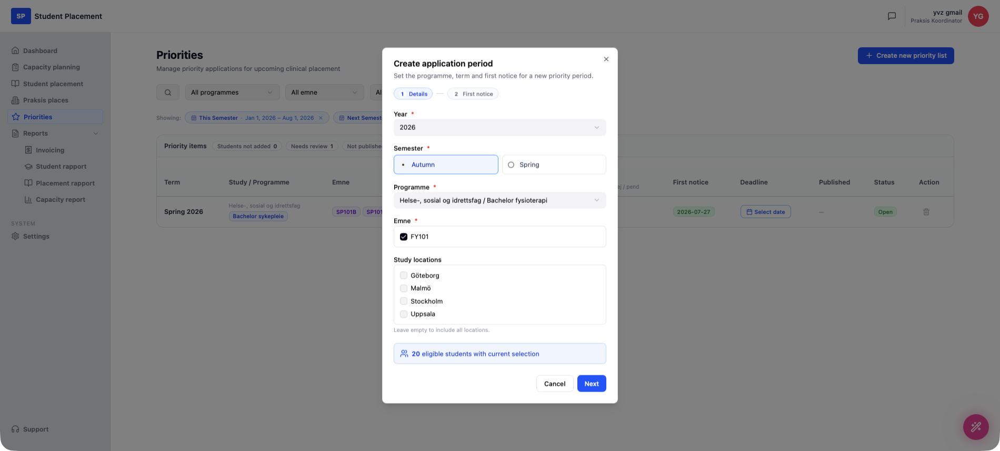
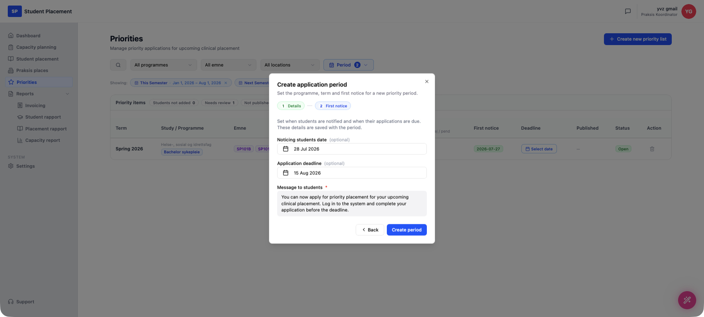

# Prioriteringar - Skapa ny prioriteringslista

:::info[Scenarioöversikt]

- **Sida:** Prioriteringar
- **Roll:** Placeringskoordinator (PK)
- **Mål:** Skapa en ny prioriteringsperiod för en termin/program, och ställ in dess första avisering, deadline och meddelande till studenterna.
- **Förutsättning:** Inloggad som PK. Sidan kan redan lista andra prioriteringsperioder — flödet är detsamma ändå.

:::

## Vad den här sidan är

**Prioriteringar** hanterar prioriteringsansökningar för kommande klinisk placering: för en given termin och program kan behöriga studenter bjudas in att skicka in en prioriteringsförfrågan (särskilda omständigheter som medicinska skäl eller barnomsorg som bör vägas in i var de placeras). Varje rad i tabellen är en **prioriteringsperiod** — en kombination av termin/program/emne — som visar dess studenter, inskickade förfrågningar (skickat / ej skickat / godkänt / avslaget / väntande), datum för första avisering, deadline, publiceringsstatus och öppet/stängt-läge. Allt börjar med att klicka på **Skapa ny prioritetslista**.

---

## Steg

### 1. Starta på Instrumentpanelen

Efter inloggning kommer du till **Instrumentpanelen**.

<figure>

<figcaption>Startpunkt — Instrumentpanelen</figcaption>

</figure>

### 2. Öppna Prioriteringar

Klicka på **Prioriteringar** i sidofältet. Sidan listar befintliga prioriteringsperioder som en tabell, med **Skapa ny prioritetslista** uppe till höger.

<figure>

<figcaption>Prioriteringar — befintliga perioder, innan en ny skapas</figcaption>

</figure>

### 3. Skapa ansökningsperiod — Detaljer

Klicka på **Skapa ny prioritetslista**. Dialogen öppnas på steg **1 · Detaljer**. Välj **År**, **Termin** (Höst/Vår), och ett **Program** (en utplattad Studie / program-lista) — här `Helse-, sosial og idrettsfag / Bachelor fysioterapi`. Om programmet har emner, välj minst ett — här `FY101`. **Studieorter** är valfritt (lämna tomt för att inkludera alla). En löpande räknare visar *"N behöriga studenter med nuvarande urval"* allteftersom du avgränsar kriterierna.

<figure>

<figcaption>Steg 1 · Detaljer — år, termin, program, emne och antal behöriga studenter</figcaption>

</figure>

### 4. Skapa ansökningsperiod — First notice

Klicka på **Nästa** för att komma till steg **2 · First notice**. Ställ in det (valfria) **Datum för avisering av studenter** — när studenterna får e-post om att ansöka — och den (valfria) **Sista ansökningsdag**, samt **Meddelande till studenter** (förifylld med en rimlig standardtext, redigerbar). Klicka på **Skapa period**.

<figure>

<figcaption>Steg 2 · First notice — aviseringsdatum, deadline och meddelande till studenterna</figcaption>

</figure>

---

## Slutresultat

Den nya perioden visas överst i Prioriteringar-tabellen — här **Höst 2026 / Bachelor fysioterapi / FY101** — med en gul **Importera studenter**-märkning i Studenter-kolumnen (inga studenter importerade ännu), avisering och deadline nyligen inställda, och status **Öppna**. Härifrån importerar koordinatorn studenter och går vidare till att samla in och publicera förfrågningar (se nästa scenario).

<figure>

<figcaption>Ny prioriteringsperiod skapad — Höst 2026 / Bachelor fysioterapi, väntar på studenter</figcaption>

</figure>

---

<ScenarioFeedback scenarioId="TS-12-priorities-create-list" />
