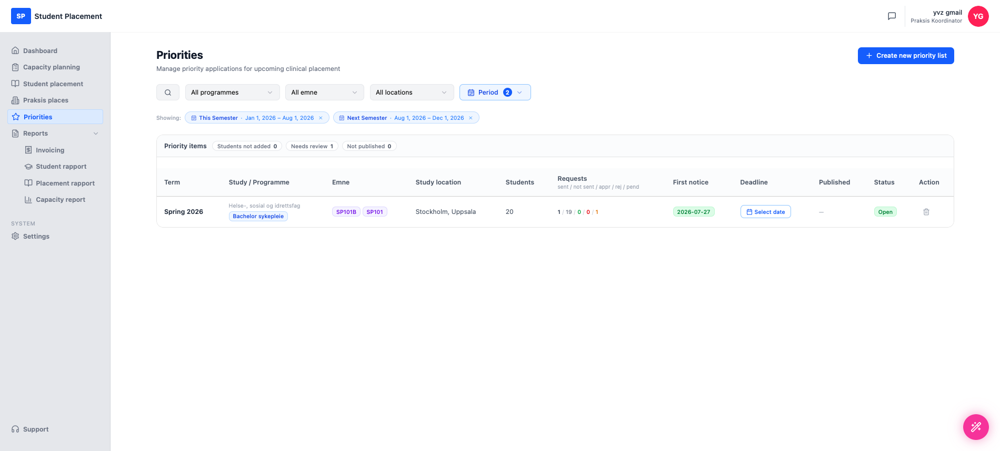

# Prioriteringar - Skapa ny prioriteringslista

:::info[Scenarioöversikt]

- **Sida:** Priorities
- **Roll:** Placeringskoordinator (PK)
- **Mål:** Skapa en ny prioriteringsperiod för en termin/program, och ställ in dess första avisering, deadline och meddelande till studenterna.
- **Förutsättning:** Inloggad som PK. Sidan kan redan lista andra prioriteringsperioder — flödet är detsamma ändå.

:::

## Vad den här sidan är

**Priorities** hanterar prioriteringsansökningar för kommande klinisk placering: för en given termin och program kan behöriga studenter bjudas in att skicka in en prioriteringsförfrågan (särskilda omständigheter som medicinska skäl eller barnomsorg som bör vägas in i var de placeras). Varje rad i tabellen är en **prioriteringsperiod** — en kombination av termin/program/emne — som visar dess studenter, inskickade förfrågningar (skickat / ej skickat / godkänt / avslaget / väntande), datum för första avisering, deadline, publiceringsstatus och öppet/stängt-läge. Allt börjar med att klicka på **Create new priority list**.

---

## Steg

### 1. Starta på Dashboard

Efter inloggning kommer du till **Dashboard**.

<figure>

<figcaption>Startpunkt — Dashboard</figcaption>

</figure>

### 2. Öppna Priorities

Klicka på **Priorities** i sidofältet. Sidan listar befintliga prioriteringsperioder som en tabell, med **Create new priority list** uppe till höger.

<figure>

<figcaption>Priorities — befintliga perioder, innan en ny skapas</figcaption>

</figure>

### 3. Skapa ansökningsperiod — Details

Klicka på **Create new priority list**. Dialogen öppnas på steg **1 · Details**. Välj **Year**, **Semester** (Autumn/Spring), och ett **Programme** (en utplattad Study / Programme-lista) — här `Helse-, sosial og idrettsfag / Bachelor fysioterapi`. Om programmet har emner, välj minst ett — här `FY101`. **Study locations** är valfritt (lämna tomt för att inkludera alla). En löpande räknare visar *"N eligible students with current selection"* allteftersom du avgränsar kriterierna.

<figure>

<figcaption>Steg 1 · Details — år, termin, program, emne och antal behöriga studenter</figcaption>

</figure>

### 4. Skapa ansökningsperiod — First notice

Klicka på **Next** för att komma till steg **2 · First notice**. Ställ in det (valfria) **Noticing students date** — när studenterna får e-post om att ansöka — och den (valfria) **Application deadline**, samt **Message to students** (förifylld med en rimlig standardtext, redigerbar). Klicka på **Create period**.

<figure>

<figcaption>Steg 2 · First notice — aviseringsdatum, deadline och meddelande till studenterna</figcaption>

</figure>

---

## Slutresultat

Den nya perioden visas överst i Priorities-tabellen — här **Autumn 2026 / Bachelor fysioterapi / FY101** — med en gul **Import students**-märkning i Students-kolumnen (inga studenter importerade ännu), avisering och deadline nyligen inställda, och status **Open**. Härifrån importerar koordinatorn studenter och går vidare till att samla in och publicera förfrågningar (se nästa scenario).

<figure>

<figcaption>Ny prioriteringsperiod skapad — Autumn 2026 / Bachelor fysioterapi, väntar på studenter</figcaption>

</figure>

---

<ScenarioFeedback scenarioId="TS-12-priorities-create-list" />
