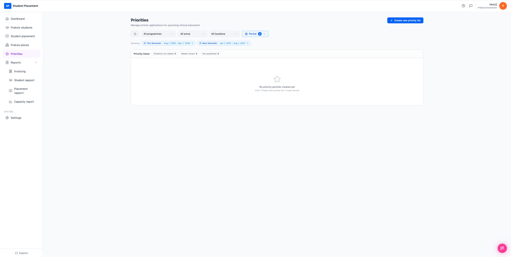
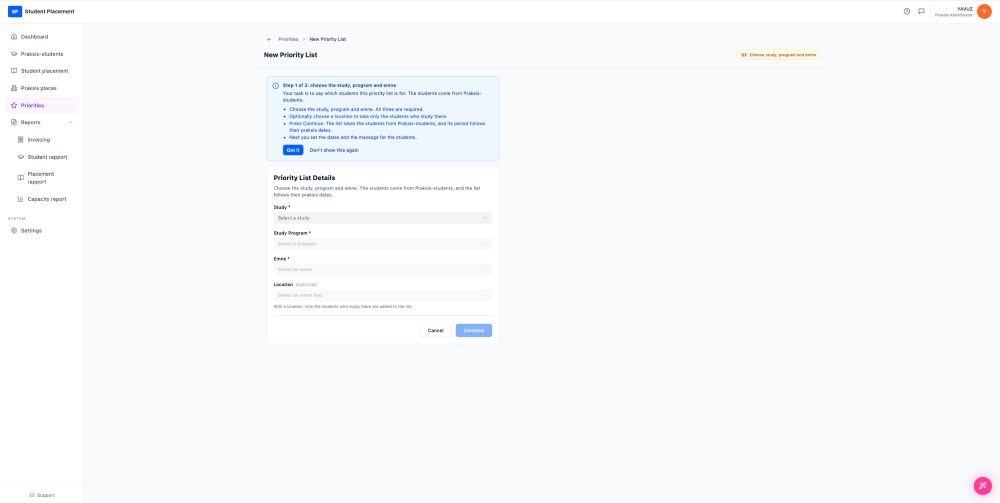
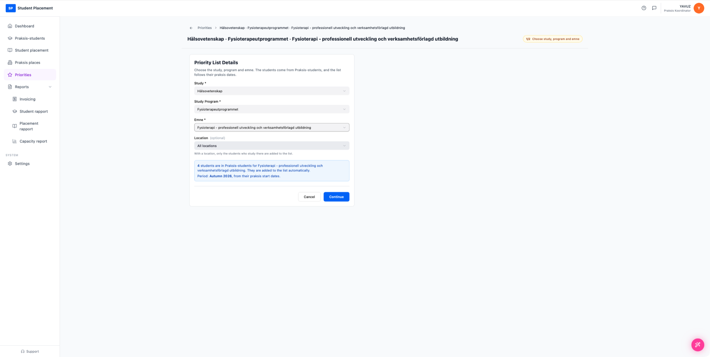
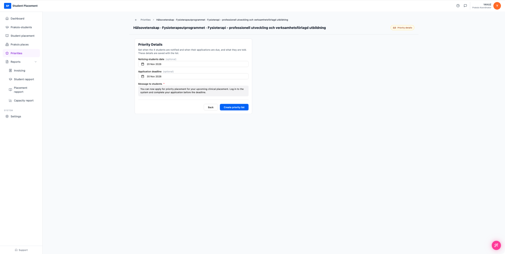
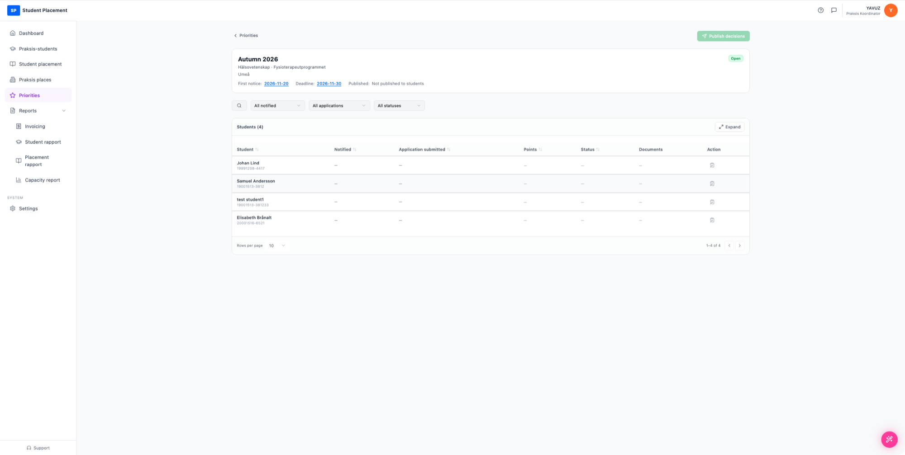
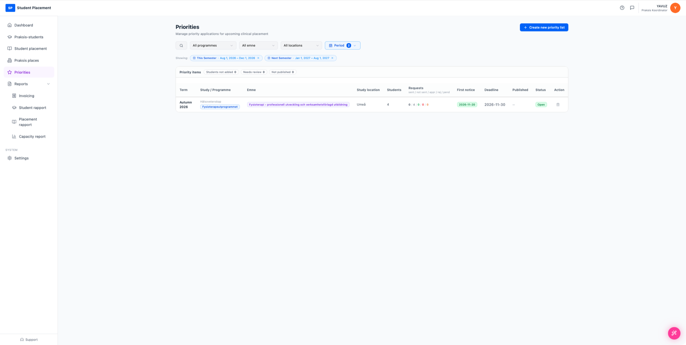

# Testscenario 12 — Prioriteringar - Skapa en prioriteringslista

:::info[Scenarioöversikt]

- **Sida:** Prioriteringar → Ny prioriteringslista
- **Roll:** Placeringskoordinator (PK)
- **Mål:** Skapa en prioriteringslista för ett emne så att studenterna kan ansöka om prioriterad placering — och lära känna sidan Prioriteringar.
- **Förutsättning:** Inloggad som PK. Studenter för emnet finns i *Praksis-studenter* (se *Testscenario 06*). Den här genomgången använder **Hälsovetenskap → Fysioterapeutprogrammet → Fysioterapi - professionell utveckling och verksamhetsförlagd utbildning** (4 studenter).

:::

## Vad den här sidan är

**Prioriteringar** — *hantera prioriteringsansökningar för kommande praktik* — är där studenterna kan be om att
 bli prioriterade vid placeringen. Varje **prioriteringslista** hör till en studie, ett program och ett emne.
 Studenterna kommer från **Praksis-studenter**, och perioden följer deras praktikdatum.

### Verktygsfält

| Kontroll | Vad den gör |
|---|---|
| **Skapa ny prioriteringslista** | Startar en ny lista (2 steg). |
| **Sök** (förstoringsglas) | Söker bland listorna. |
| **Alla program** / **Alla emnen** / **Alla orter** | Begränsar listan. |
| **Period** | Väljer vilka tidsperioder som visas; de aktiva visas som brickor under **Visar:** (standard *This Semester* och *Next Semester*). |
| **Prioriteringsposter** | Tre räknare — **Studenter inte tillagda**, **Behöver granskas**, **Inte publicerade**. Klicka på en för att bara visa de listorna; **Rensa filter** återställer. |

### Kolumner

| Kolumn | Innehåll |
|---|---|
| **Termin** | t.ex. *Autumn 2026*. |
| **Studie / Program** | Studien och programmet. |
| **Emne** | Listans emne. |
| **Studieort** | Studenternas ort (t.ex. *Umeå*). |
| **Studenter** | Antal studenter på listan. |
| **Ansökningar** | *skickade / inte skickade / godkända / avslagna / väntande*. |
| **Första avisering** | När studenterna får besked — klicka för att ändra datumet. |
| **Sista dag** | När ansökningarna ska vara inne — klicka för att ändra datumet. |
| **Publicerad** | Om besluten är publicerade till studenterna (*—* om inte ännu). |
| **Status** | t.ex. **Öppen**. |
| **Åtgärd** | Papperskorgsikon för att ta bort listan. |

---

## Steg

### 1. Öppna Prioriteringar

Klicka på **Prioriteringar** i sidofältet. Om ingen lista finns ännu säger sidan att inga prioriteringsperioder
 har skapats och att du kan börja med **Skapa ny prioriteringslista**.

<figure>

<figcaption>Prioriteringar — tom, med Skapa ny prioriteringslista uppe till höger</figcaption>

</figure>

### 2. Steg 1 av 2 — välj studie, program och emne

Klicka på **Skapa ny prioriteringslista**. Sidan **Ny prioriteringslista** öppnas i **1/2 Välj studie, program
 och emne**. Informationsrutan förklarar att du anger vilka studenter listan gäller och att studenterna kommer
 från Praksis-studenter. Stäng den med **Uppfattat**.

<figure>

<figcaption>Steg 1 av 2 — uppgifter för prioriteringslistan</figcaption>

</figure>

Välj **Studie** `Hälsovetenskap`, **Studieprogram** `Fysioterapeutprogrammet` och **Emne** `Fysioterapi -
 professionell utveckling och verksamhetsförlagd utbildning`. **Ort** (valfritt) står kvar på *Alla orter* — med
 en ort läggs bara studenterna som studerar där till på listan. Formuläret visar nu att 4 studenter i
 Praksis-studenter läggs till automatiskt och att perioden är *Autumn 2026*, utifrån deras praktikstartdatum.
 Klicka på **Fortsätt**.

<figure>

<figcaption>4 studenter läggs till automatiskt — period Autumn 2026</figcaption>

</figure>

:::note[Inga studenter?]

Om inga studenter för emnet finns i Praksis-studenter säger formuläret att inga studenter väntar och att du
 först måste importera studenter i Praksis-studenter; **Fortsätt** förblir inaktiverad.

:::

### 3. Steg 2 av 2 — prioriteringsuppgifter

I **2/2 Prioriteringsuppgifter** anger du när de 4 studenterna aviseras, när ansökningarna ska vara inne och
 vad de får för besked:

- **Datum för avisering av studenter** (valfritt) — välj ett datum i kalendern, här **20 nov. 2026**. Datum
  bakåt i tiden kan inte väljas.
- **Sista ansökningsdag** (valfritt) — här **30 nov. 2026**. Den måste vara efter aviseringsdatumet.
- **Meddelande till studenterna** * — förifyllt med en standardtext om att studenterna nu kan ansöka om
  prioriterad placering och måste slutföra ansökan före sista dag. Ändra vid behov.

Båda datumen kan även sättas senare. **Tillbaka** går till steg 1. Klicka på **Skapa prioriteringslista**.

<figure>

<figcaption>Steg 2 av 2 — datum och meddelande till studenterna</figcaption>

</figure>

### 4. Den nya prioriteringslistan

Meddelandet *ansökningsperiod skapad* visas och listan öppnas: **Autumn 2026 · Hälsovetenskap ·
 Fysioterapeutprogrammet · Umeå**, *Första avisering: 2026-11-20*, *Sista dag: 2026-11-30*, *Publicerad: inte
 publicerad till studenterna*, status **Öppen**, och tabellen **Studenter (4)** med kolumnerna *Student,
 Aviserad, Ansökan skickad, Poäng, Status, Dokument, Åtgärd*. **Publicera beslut** är inaktiverad — beslut kan
 publiceras efter datumet för första avisering.

<figure>

<figcaption>Den nya prioriteringslistan — 4 studenter, inte publicerad ännu</figcaption>

</figure>

### 5. Tillbaka på sidan Prioriteringar

Klicka på **Prioriteringar** (uppe till vänster) för att gå tillbaka. Den nya listan visas som en rad:
 *Autumn 2026 · Hälsovetenskap / Fysioterapeutprogrammet · Fysioterapi - professionell … · Umeå · 4 studenter ·
 ansökningar 0 / 4 / 0 / 0 / 0 · Första avisering 2026-11-20 · Sista dag 2026-11-30 · Öppen*.

<figure>

<figcaption>Sidan Prioriteringar med den nya listan</figcaption>

</figure>

---

## Slutresultat

Det finns en prioriteringslista för emnet, med de 4 studenterna, ett datum för första avisering, en sista
 ansökningsdag och ett meddelande till studenterna. Den är öppen och inte publicerad ännu.

## Anteckningar

-   Insamling av ansökningar och publicering av beslut beskrivs i *Testscenario 13*.

---

<ScenarioFeedback scenarioId="TS-12-priorities-create-list" />
