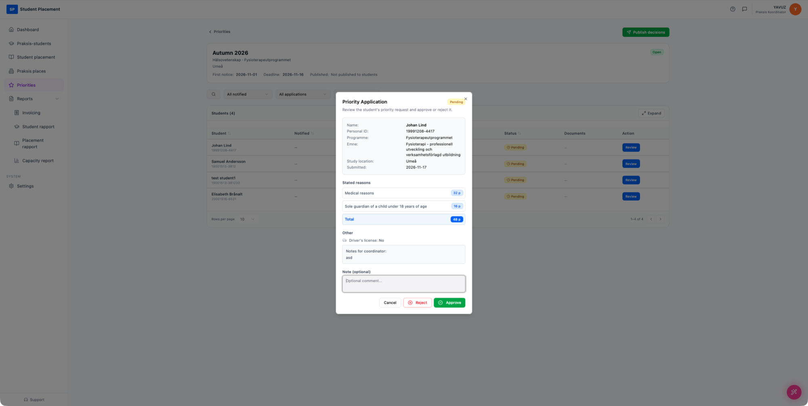
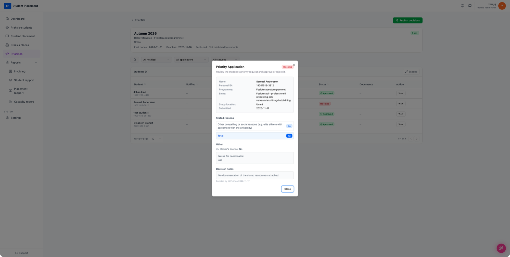
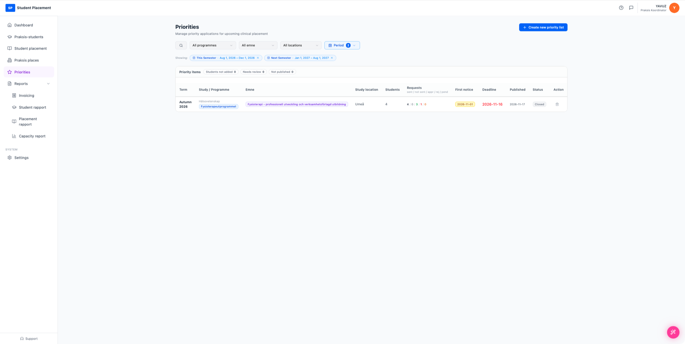

# Testscenario 13 — Prioriteringar - Granska och publicera beslut

:::info[Scenarioöversikt]

- **Sida:** Prioriteringar → *prioriteringslista*
- **Roll:** Placeringskoordinator (PK)
- **Mål:** Granska studenternas prioriteringsansökningar, godkänna eller avslå var och en och publicera besluten till studenterna.
- **Förutsättning:** En prioriteringslista finns (se *Testscenario 12*) och studenterna har skickat in ansökningar. Den här genomgången använder listan **Autumn 2026 · Hälsovetenskap · Fysioterapeutprogrammet · Umeå** med 4 inskickade ansökningar.

:::

## Vad den här sidan är

När studenterna har ansökt syns det på sidan **Prioriteringar**: kolumnen **Ansökningar** räknar *skickade /
 inte skickade / godkända / avslagna / väntande*, och räknarna **Behöver granskas** och **Inte publicerade** går
 upp.

Klicka på en lista för att öppna den. Rubriken visar termin, studie · program, ort, **Första avisering**,
 **Sista dag**, **Publicerad** och status (**Öppen** eller **Stängd**), med **Publicera beslut** uppe till höger.
 Nedanför finns tabellen **Studenter**:

| Kolumn | Innehåll |
|---|---|
| **Student** | Namn och personnummer. |
| **Aviserad** | När studenten aviserades. |
| **Ansökan skickad** | Datum för ansökan (*—* om ingen). |
| **Poäng** | Summan av prioritetspoängen för de angivna skälen (t.ex. *48 pts*). |
| **Status** | **Väntande**, **Godkänd** eller **Avslagen**. |
| **Dokument** | Filer bifogade till ansökan. |
| **Åtgärd** | **Granska** medan den väntar; **Visa** när den är avgjord. |

Filtren **Alla aviserade** (*Aviserade / Inte aviserade*), **Alla ansökningar** (*Skickade / Inte skickade*)
 och **Alla statusar** (*Väntande / Godkända / Avslagna*), sökningen och **Expandera** hjälper vid långa listor.

---

## Steg

### 1. Hitta listan som behöver granskas

Öppna **Prioriteringar**. Listan visar *4 / 0 / 0 / 0 / 4* — 4 ansökningar skickade, alla 4 väntande — och
 räknarna **Behöver granskas 1** och **Inte publicerade 1**.

<figure>

<figcaption>Prioriteringar — 4 ansökningar skickade, 4 väntande</figcaption>

</figure>

### 2. Öppna prioriteringslistan

Klicka på raden. Listan är **Öppen** och *inte publicerad till studenterna*. Alla 4 studenter har skickat in
 (*2026-11-17*); **Johan Lind** har *48 pts*, de andra *1 pts*. Varje rad visar **Väntande** och knappen
 **Granska**.

<figure>

<figcaption>Prioriteringslistan — 4 väntande ansökningar</figcaption>

</figure>

### 3. Granska och godkänn en ansökan

Klicka på **Granska** vid **Johan Lind**. Fönstret **Prioriteringsansökan** (*Väntande*) visar:

- studentens uppgifter — namn, personnummer, program, emne, studieort, inskickat datum;
- **Angivna skäl** med poäng — här *Medical reasons 32 p* och *Sole guardian of a child under 18 years of age
  16 p*, **Totalt 48 p**;
- **Övrigt** — t.ex. *Driver's license: No* och studentens **Anteckningar till koordinatorn**;
- **Anteckning (valfritt)** för din egen kommentar.

Skriv en anteckning — här `Medical documentation checked.` — och klicka på **Godkänn**. Meddelandet *ansökan
 godkänd* visas och statusen blir **Godkänd**.

<figure>

<figcaption>Prioriteringsansökan — angivna skäl, poäng och knapparna Godkänn / Avslå</figcaption>

</figure>

### 4. Avslå en ansökan

Klicka på **Granska** vid **Samuel Andersson** (*Other compelling or social reasons … 1 p*) och klicka på
 **Avslå**. Ett obligatoriskt fält **Skäl till avslag** visas. Skriv skälet — här `No documentation of the
 stated reason was attached.` — och klicka på **Bekräfta avslag** (**Tillbaka** går tillbaka till granskningen).
 Meddelandet *ansökan avslagen* visas och statusen blir **Avslagen**.

<figure>

<figcaption>Avslag kräver ett skäl</figcaption>

</figure>

### 5. Avgör de återstående ansökningarna

Granska och godkänn **test student1** och **Elisabeth Brånalt** på samma sätt. Alla ansökningar är nu avgjorda
 — 3 **Godkända**, 1 **Avslagen** — och varje rad visar **Visa**.

<figure>

<figcaption>Alla avgjorda — 3 godkända, 1 avslagen</figcaption>

</figure>

**Visa** öppnar ansökan skrivskyddad, med **Beslutsanteckningar** och vem som avgjorde den och när (*Decided by
 YAVUZ on 2026-11-17*).

<figure>

<figcaption>Visa — beslutsanteckningen och vem som avgjorde</figcaption>

</figure>

### 6. Publicera besluten

Klicka på **Publicera beslut** (uppe till höger). Besluten publiceras direkt — meddelandet *beslut publicerade*
 visas. Listan är nu **Stängd**, *publicerad 2026-11-17*, och uppe till höger står **Beslut publicerade
 2026-11-17** med **Öppna för redigering**.

<figure>

<figcaption>Beslut publicerade — listan är stängd</figcaption>

</figure>

:::warning

**Publicera beslut** publicerar direkt, utan bekräftelse — även om vissa ansökningar fortfarande är
 **Väntande**. Avgör alla ansökningar först. Om du publicerade för tidigt klickar du på **Öppna för
 redigering**: listan blir **Öppen** och *inte publicerad till studenterna* igen, så att du kan granska resten
 och publicera på nytt.

:::

Tillbaka på **Prioriteringar** visar raden *4 / 0 / 3 / 1 / 0*, **Publicerad 2026-11-17** och **Stängd**, och
 räknarna är tillbaka på 0.

<figure>

<figcaption>Prioriteringar — 3 godkända, 1 avslagen, publicerad och stängd</figcaption>

</figure>

---

## Slutresultat

Alla 4 ansökningar är avgjorda (3 godkända, 1 avslagen) och besluten är publicerade till studenterna.
 Prioriteringslistan är **Stängd**.

## Anteckningar

-   **Publicera beslut** är inaktiverad fram till datumet för första avisering.
-   **Öppna för redigering** låter dig ändra beslut efter publicering; publicera igen när du är klar.

---

<ScenarioFeedback scenarioId="TS-13-priorities-collect-and-publish" />
