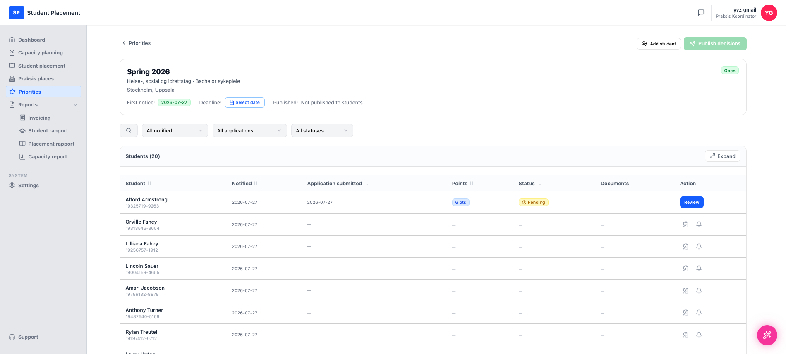
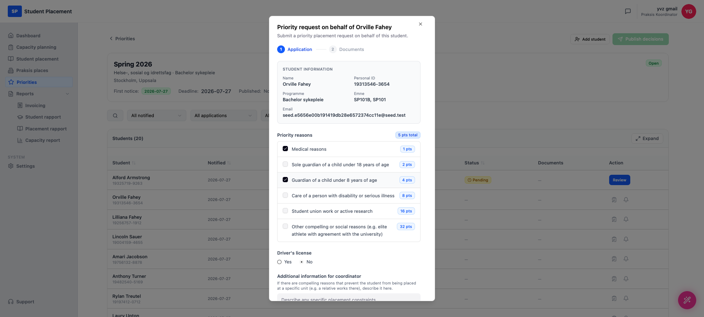
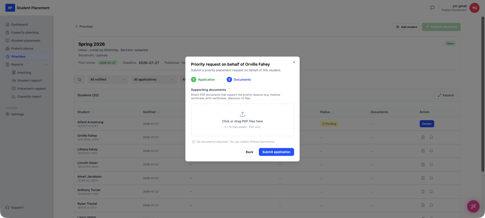
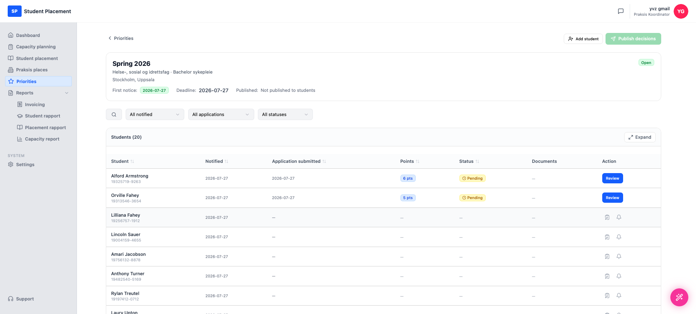
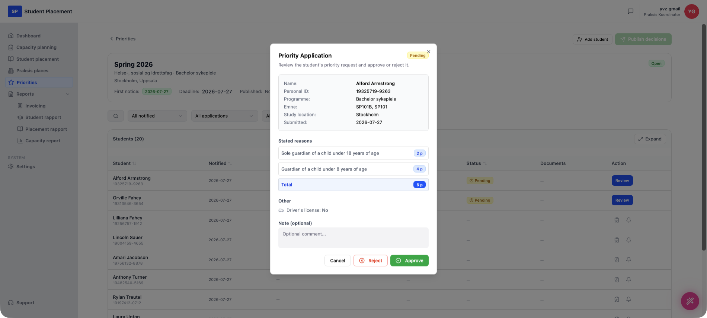
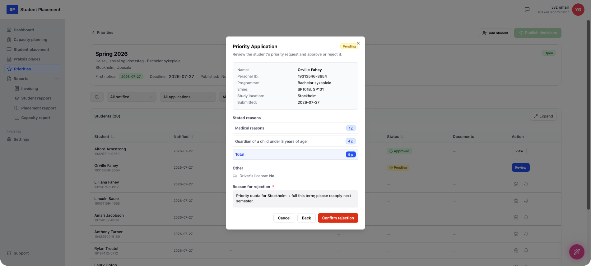
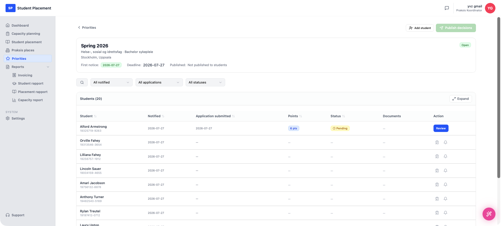

# Prioriteringar - Samla in och publicera

:::info[Scenarioöversikt]

- **Sida:** Priorities → *(en prioriteringsperiod)*
- **Roll:** Placeringskoordinator (PK)
- **Mål:** Samla in studenternas prioriteringsförfrågningar efter att den första aviseringen skickats, granska och godkänn eller avslå var och en, och publicera sedan besluten när deadline har passerat.
- **Förutsättning:** En prioriteringsperiod med studenter redan importerade. Den här genomgången använder den befintliga perioden **Spring 2026 / Bachelor sykepleie (SP101B, SP101)**, som redan har fått sin första avisering skickad.

:::

## Vad den här sidan är

Att öppna en prioriteringsperiod från **Priorities**-listan visar dess detaljvy: periodens datum för första avisering, deadline och publiceringsstatus högst upp, och en tabell över varje importerad student med deras aviserade datum, inskickat datum, poäng, status och tillgängliga åtgärder. På **datumet för första avisering** skickar systemet ett e-postmeddelande till varje student i listan med en länk för att logga in och skicka in sin egen prioriteringsförfrågan — de skäl som gäller för dem (medicinska, barnomsorg, vårdansvar osv.), om de har körkort, eventuella placeringsbegränsningar, och stödjande PDF-dokument. När en förfrågan har skickats in visas den här som **Pending**, redo för koordinatorn att **Review** och **Approve** eller **Reject**. När alla beslut är fattade och deadline har passerat klickar koordinatorn på **Publish decisions** — studenterna får då ytterligare ett e-postmeddelande med utfallet av sin förfrågan.

I demonstrationssyfte — eftersom riktiga studenter normalt skickar in det här formuläret själva — kan koordinatorn fylla i det **på en students vägnar** med pennikonen i kolumnen Action, bredvid en klockikon som skickar om den första aviseringen.

---

## Steg

### 1. Starta på Dashboard

Efter inloggning kommer du till **Dashboard**.

<figure>

<figcaption>Startpunkt — Dashboard</figcaption>

</figure>

### 2. Öppna en prioriteringsperiod

Klicka på **Priorities** i sidofältet, och klicka sedan på en periodrad — här **Spring 2026**. Dess första avisering hade redan skickats (**2026-07-27**), så studenttabellen visar en inskickad förfrågan (Alford Armstrong, **Pending**, 6 pts) och resten som fortfarande väntar på en inskickning, var och en med en pennikon (**Submit on behalf of student**) och en klockikon (**Resend first notice**).

<figure>

<figcaption>Spring 2026 — första avisering skickad, en väntande förfrågan, resten väntar på inskickning</figcaption>

</figure>

### 3. Fyll i en förfrågan på en students vägnar — Application

Klicka på pennikonen på en student som ännu inte skickat in — här **Orville Fahey**. Dialogen **Priority request on behalf of…** öppnas och visar studentens information (skrivskyddad), och låter dig sedan kryssa för tillämpliga **Priority reasons** (var och en med ett poängvärde som summeras löpande), ställa in **Driver's license**, och lägga till **Additional information for coordinator**.

<figure>

<figcaption>Skicka in på Orville Faheys vägnar — skäl valda, 5 pts totalt</figcaption>

</figure>

### 4. Fyll i en förfrågan på en students vägnar — Documents

Klicka på **Next: Documents** för att komma till det andra steget. Stödjande PDF-dokument kan bifogas här (dra-och-släpp eller klicka), eller så kan förfrågan skickas in utan några. Klicka på **Submit application**.

<figure>

<figcaption>Documents-steget — valfria PDF-bilagor, sedan inskickning</figcaption>

</figure>

### 5. Förfrågan visas nu som Pending

Orville Faheys rad uppdateras omedelbart: inskickat datum, **5 pts**, status **Pending**, med en **Review**-knapp istället för pennikonen.

<figure>

<figcaption>Orville Faheys förfrågan inskickad — nu Pending med en Review-knapp</figcaption>

</figure>

### 6. Granska och godkänn en förfrågan

Klicka på **Review** på en väntande förfrågan — här Alford Armstrongs. Dialogen visar studentens uppgifter, angivna skäl med poäng och totalsumma, körkort, och eventuella placeringsbegränsningar, samt en valfri **Note**. Klicka på **Approve**.

<figure>

<figcaption>Granskar Alford Armstrongs förfrågan — 6 pts totalt, redo att godkännas</figcaption>

</figure>

### 7. Granska och avslå en förfrågan

Klicka på **Review** på en annan väntande förfrågan — här Orville Faheys. Klicka på **Reject**; ett fält för **Reason for rejection** visas och är obligatoriskt. Ange skälet och klicka på **Confirm rejection**.

<figure>

<figcaption>Avslår Orville Faheys förfrågan med ett obligatoriskt skäl</figcaption>

</figure>

Båda besluten gäller omedelbart — Alford Armstrongs rad visar **Approved** och Orville Faheys visar **Rejected**, var och en med en **View**-knapp så att det skrivskyddade beslutet kan granskas senare.

### 8. Publicera beslut när deadline har passerat

**Publish decisions** (uppe till höger) förblir inaktiverad — håll muspekaren över den för att se varför: *"Decisions can be published only after the first-notice deadline has passed."* När deadline-datumet har passerat blir knappen aktiv; att klicka på den öppnar en bekräftelse som förklarar att publicering stänger perioden och skickar e-post till varje student som skickat in en förfrågan med utfallet, varefter perioden fortfarande kan **återöppnas för redigering** vid behov.

<figure>

<figcaption>Publish decisions — inaktiverad tills deadline för första aviseringen har passerat</figcaption>

</figure>

---

## Slutresultat

Studenterna aviserades via e-post på datumet för första avisering, skickade in (eller fick inskickat på sina vägnar) sina prioriteringsförfrågningar, och koordinatorn granskade var och en — godkände Alford Armstrong och avslog Orville Fahey med ett angivet skäl. När deadline passerar aviserar publiceringen av besluten varje student via e-post om utfallet.

---

<ScenarioFeedback scenarioId="TS-13-priorities-collect-and-publish" />
