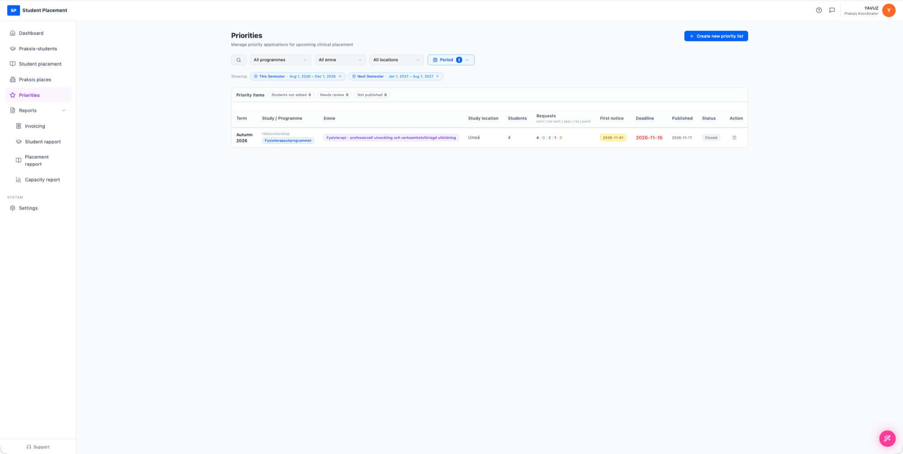
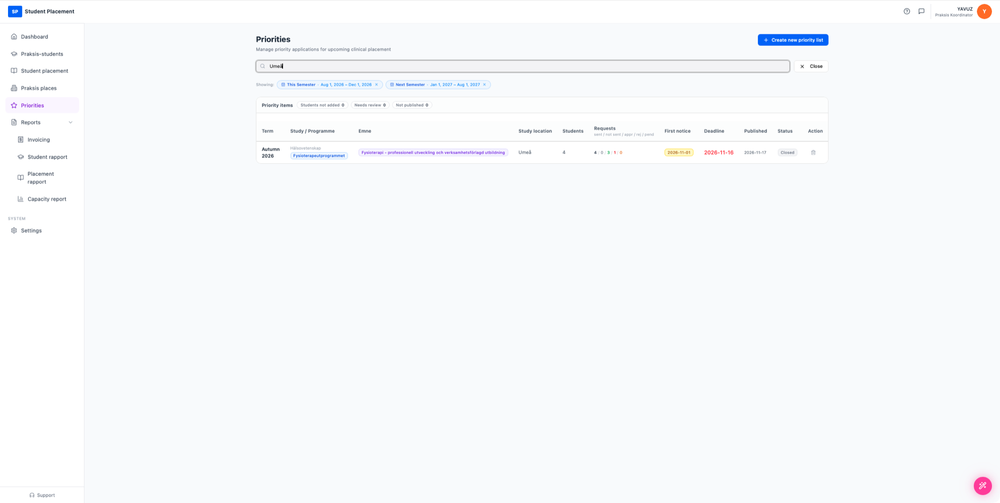
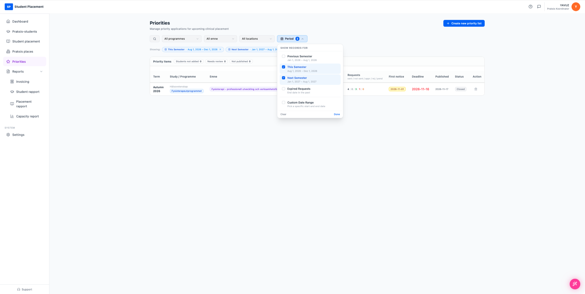
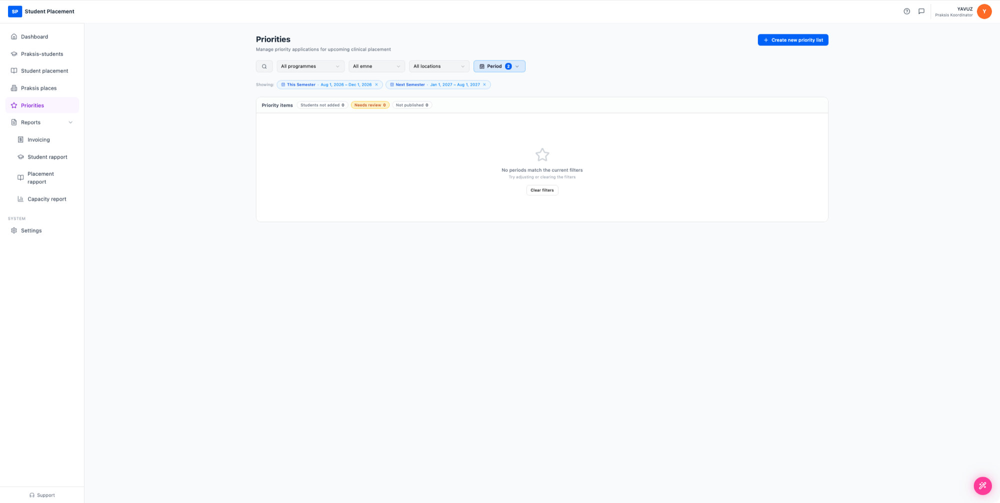

# Testscenario 13b — Prioriteringar - Översikt

:::info[Scenarioöversikt]

- **Sida:** Prioriteringar
- **Roll:** Placeringskoordinator (PK)
- **Mål:** Använda sidan Prioriteringar som översikt — läsa kolumnerna, hitta listor med sökning och filter och snabbt se vilka listor som behöver uppmärksamhet.
- **Förutsättning:** Minst en prioriteringslista finns (se *Testscenario 12* och *13*). Den här genomgången använder listan **Autumn 2026 · Fysioterapeutprogrammet · Umeå**, där besluten är publicerade.

:::

## Vad den här sidan är

**Prioriteringar** — *hantera prioriteringsansökningar för kommande praktik* — visar alla prioriteringslistor i
 de valda perioderna, en rad per lista. Den visar hur långt varje lista har kommit: hur många studenter som har
 ansökt, hur många ansökningar som är avgjorda och om besluten är publicerade.

### Verktygsfält

| Kontroll | Vad den gör |
|---|---|
| **Skapa ny prioriteringslista** | Startar en ny lista — se *Testscenario 12*. |
| **Sök** (förstoringsglas) | Sök på termin, program, emne eller ort. **Stäng** ger tillbaka filtren. |
| **Alla program** / **Alla emnen** / **Alla orter** | Begränsar raderna. Menyerna visar bara program, emnen och orter som har en prioriteringslista. |
| **Period** | **Visa poster för** *föregående termin*, *denna termin*, *nästa termin*, *utgångna* (slutdatum passerat) eller *anpassat datumintervall*. De aktiva perioderna visas som brickor under **Visar:** — klicka på **×** på en bricka för att ta bort den. |

### Prioriteringsposter

Tre räknare visar hur många listor som behöver uppmärksamhet:

| Räknare | Betydelse |
|---|---|
| **Studenter inte tillagda** | Listor där studenter inte har lagts till. |
| **Behöver granskas** | Listor med ansökningar som fortfarande väntar på beslut. |
| **Inte publicerade** | Listor där besluten ännu inte är publicerade till studenterna. |

Klicka på en räknare för att bara visa de listorna; klicka på **Rensa filter** för att visa alla igen.

### Kolumner

| Kolumn | Innehåll |
|---|---|
| **Termin** | t.ex. *Autumn 2026*. |
| **Studie / Program** | Studien och programmet. |
| **Emne** | Listans emne. |
| **Studieort** | t.ex. *Umeå*. |
| **Studenter** | Antal studenter på listan. |
| **Ansökningar** | *skickade / inte skickade / godkända / avslagna / väntande*. |
| **Första avisering** / **Sista dag** | Datumen — klicka på ett datum för att ändra det. |
| **Publicerad** | Datumet då besluten publicerades (*inte publicerad* eller *—* fram till dess). |
| **Status** | **Öppen** medan ansökningarna hanteras, **Stängd** när besluten har publicerats. |
| **Åtgärd** | Papperskorgsikon för att ta bort listan. |

---

## Steg

### 1. Öppna Prioriteringar

Klicka på **Prioriteringar** i sidofältet. Listan från *Testscenario 13* visar *4 studenter*, ansökningar
 *4 / 0 / 3 / 1 / 0* (4 skickade, 3 godkända, 1 avslagen), *Första avisering 2026-11-01*, *Sista dag
 2026-11-16*, *Publicerad 2026-11-17* och status **Stängd**. Alla tre räknarna är **0** — inget behöver
 uppmärksamhet.

<figure>

<figcaption>Prioriteringar — en lista, avgjord och publicerad</figcaption>

</figure>

Jämför med samma lista före granskningen: ansökningar *4 / 0 / 0 / 0 / 4* (4 väntande), *inte publicerad*,
 status **Öppen**, och räknarna **Behöver granskas 1** och **Inte publicerade 1**.

<figure>

<figcaption>Före granskning — Behöver granskas 1 och Inte publicerade 1</figcaption>

</figure>

### 2. Sök

Klicka på **förstoringsglaset** och skriv till exempel `Umeå`. Raderna filtreras på termin, program, emne eller
 ort. Klicka på **Stäng** för att få tillbaka filtren.

<figure>

<figcaption>Sök på termin, program, emne eller ort</figcaption>

</figure>

### 3. Välj period

Klicka på **Period**. Markera perioderna som ska visas — *föregående termin*, *denna termin*, *nästa termin*,
 *utgångna* eller *anpassat datumintervall* — och klicka på **Klar**. **Rensa** tar bort alla perioder.

<figure>

<figcaption>Period — välj vilka terminer som visas</figcaption>

</figure>

### 4. Filtrera med en räknare

Klicka på **Behöver granskas**. Räknaren markeras och bara listor som behöver granskas visas — här inga: inga
 perioder matchar de aktuella filtren. Klicka på **Rensa filter** för att visa alla listor igen.

<figure>

<figcaption>Behöver granskas — inga listor behöver granskas</figcaption>

</figure>

---

## Slutresultat

Koordinatorn ser alla prioriteringslistor och hur långt de har kommit på en sida, hittar en lista med sökning,
 filter och period, och använder räknarna för att se listor som fortfarande behöver granskas eller publiceras.

---

<ScenarioFeedback scenarioId="TS-13b-priorities-overview" />
