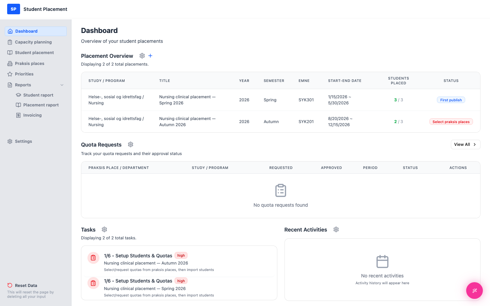
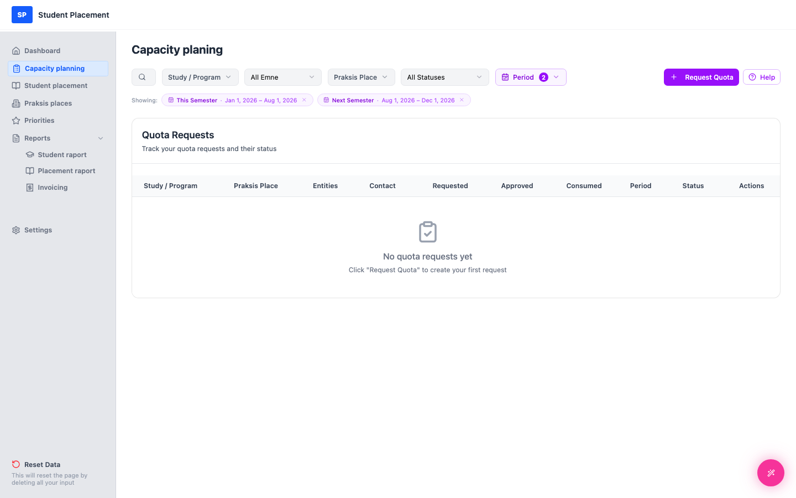
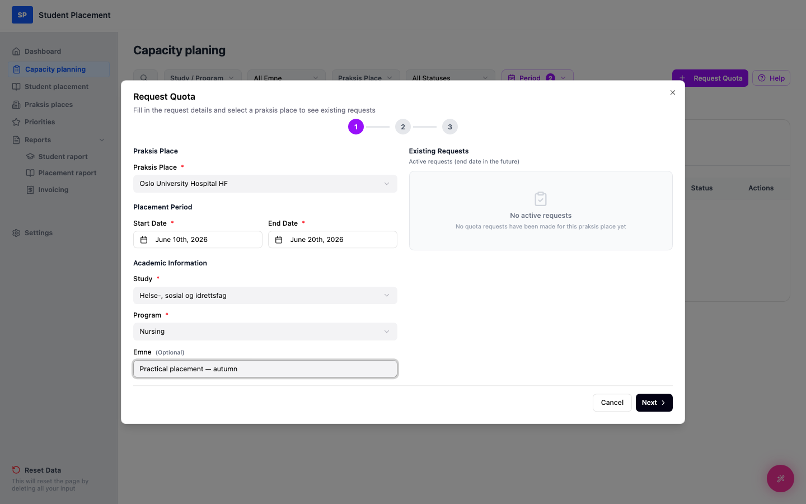
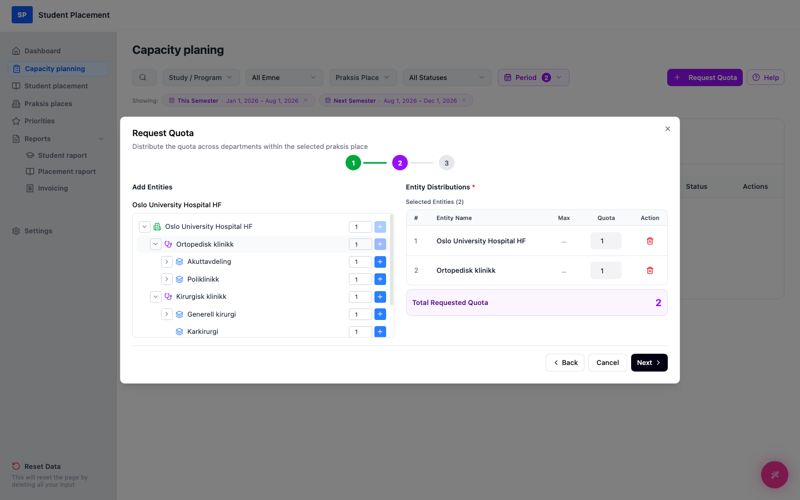
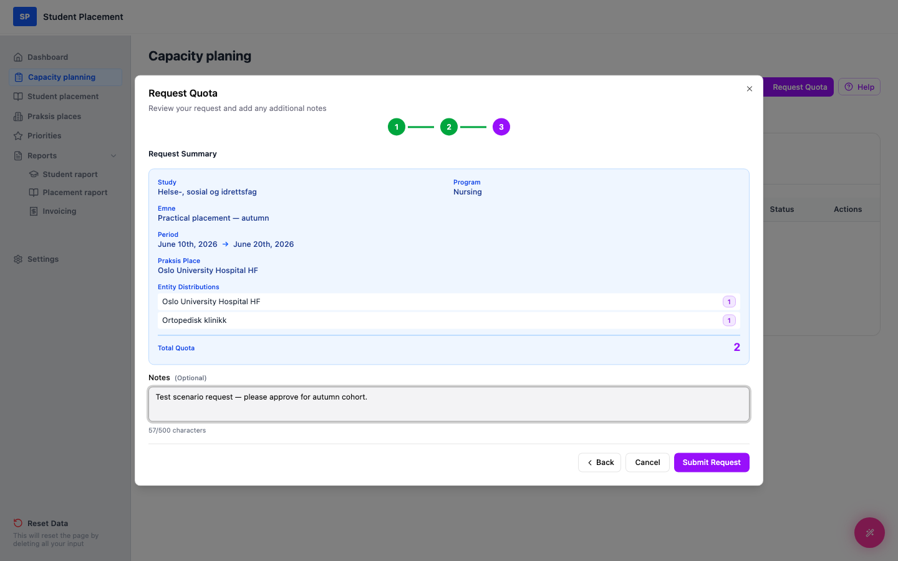
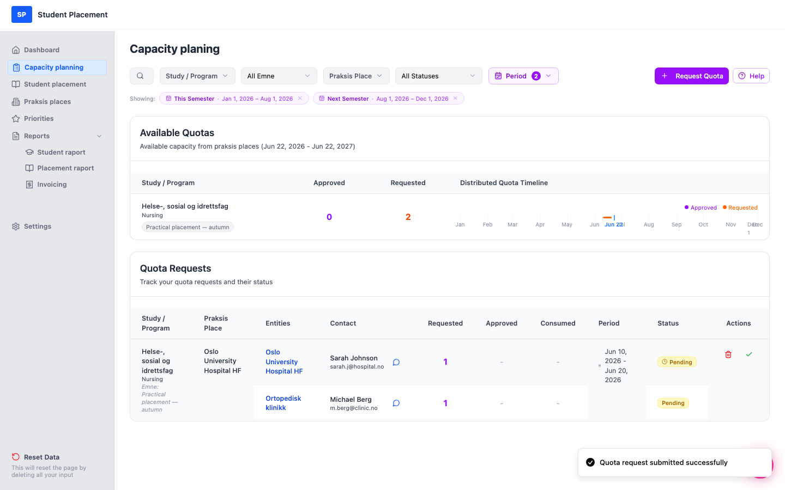

# Testscenario 06 — Kvotförfrågan - Skapa

:::info[Scenarioöversikt]

- **Sida:** Kapacitetsplanering
- **Roll:** Placeringskoordinator (PK)
- **Mål:** Skapa en ny kvotförfrågan från ett tomt utgångsläge och bekräfta att den visas i förfrågningslistan.
- **Förutsättning:** Inloggad som koordinator. Inga kvotförfrågningar finns ännu (tom miljö).

:::

## Vad den här sidan är

**Kapacitetsplanering** är där koordinatorn ber praktikplatser (sjukhus/kliniker)
 om studentkapacitet. Listan **Kvotförfrågningar** följer varje förfrågan du gör och dess status
 (`Väntande → Godkänd/Avslagen → Uppfylld`). Du startar en ny förfrågan via knappen
 **Begär kvot** (uppe till höger).

---

## Steg

### 1. Börja på Instrumentpanelen

Efter inloggningen hamnar du på **Instrumentpanelen**. Widgeten **Kvotförfrågningar** visar
 *"Inga kvotförfrågningar hittades"* — miljön är tom och redo för scenariot.

<figure>

<figcaption>Utgångspunkt — Instrumentpanelen</figcaption>

</figure>

### 2. Öppna Kapacitetsplanering från sidofältet

Klicka på **Kapacitetsplanering** i vänstra sidofältet. Sidan öppnas med en tom lista:
 *"Inga kvotförfrågningar än — klicka på ”Begär kvot” för att skapa din första förfrågan."*

<figure>

<figcaption>Kapacitetsplanering — tomt utgångsläge (efter klick i sidofältet)</figcaption>

</figure>

### 3. Steg 1 i guiden — Förfrågningsuppgifter

Klicka på **Begär kvot** (uppe till höger) för att öppna guiden med tre steg. Obligatoriska fält är markerade med `*`.

1.  Välj en **Praktikplats** (t.ex. *Oslo University Hospital HF*).
2.  Välj ett **Startdatum** och ett **Slutdatum** *(slutdatumet måste vara efter startdatumet)*.
3.  Välj en **Studie** och därefter ett **Program** (programalternativen beror på studien).
4.  Ange eventuellt ett **Emne** (kurs-/ämnesnamn).
5.  Klicka på **Nästa**.

<figure>

<figcaption>Guiden steg 1 — Förfrågningsdetaljer</figcaption>

</figure>

### 4. Steg 2 i guiden — Entity Distribution

6.  Ange en kvot i trädet **Lägg till enheter** och klicka på det blå **+** bredvid en avdelning.
7.  Lägg till minst en enhet; tillagda enheter visas till höger med en löpande **Total begärd kvot**.
8.  Klicka på **Nästa**.

<figure>

<figcaption>Guiden steg 2 — Enhetsfördelning</figcaption>

</figure>

### 5. Steg 3 i guiden — Sammanfattning och anteckningar

9.  Granska **Sammanfattning av förfrågan**.
10.  Lägg eventuellt till **Anteckningar** till kontaktpersonen på praktikplatsen.
11.  Klicka på **Skicka förfrågan**.

<figure>

<figcaption>Guiden steg 3 — Sammanfattning och anteckningar</figcaption>

</figure>

---

## Slutresultat

En toast med *"Kvotförfrågan skickades in"* visas, och den nya förfrågan syns i
 listan **Kvotförfrågningar** med status Väntande. Dess kapacitet återspeglas också
 i sektionen **Tillgängliga kvoter** högst upp.

<figure>

<figcaption>Slutsida — den nya förfrågan visas i listan</figcaption>

</figure>

---

<ScenarioFeedback scenarioId="TS-06-create-quota-request" />
