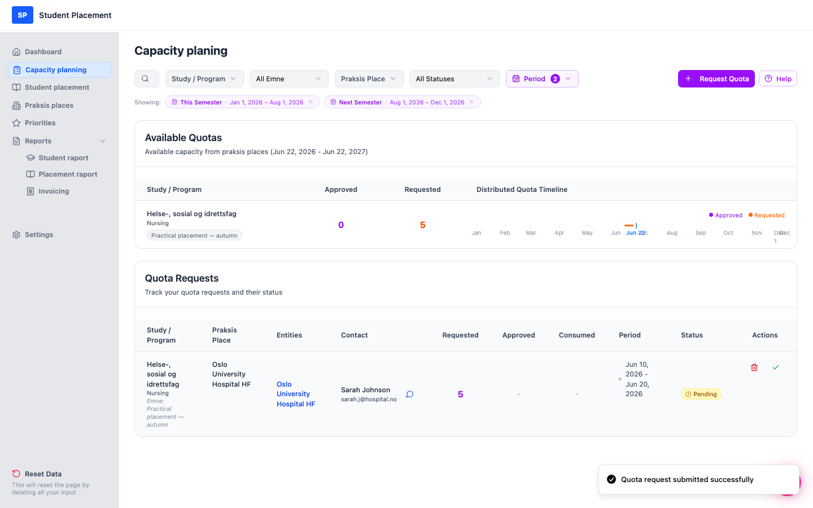
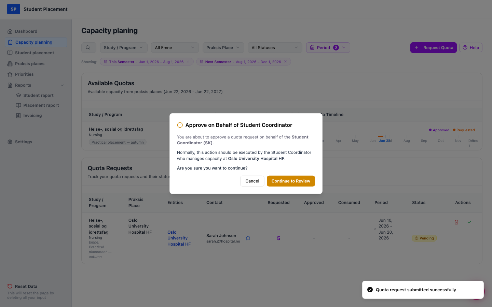
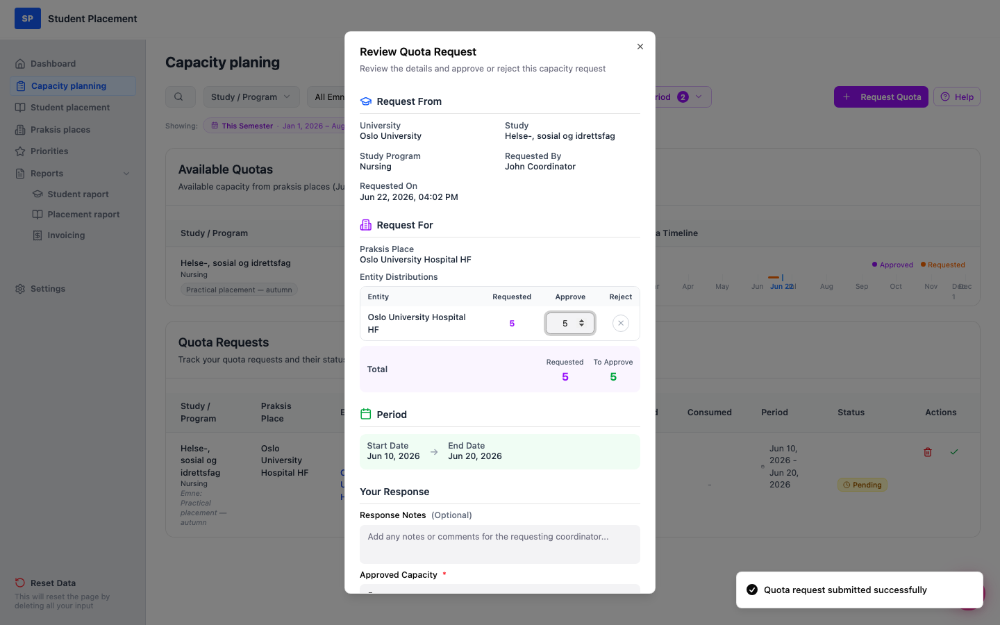

# Testscenario 07 — Kvotförfrågan - Godkänn som PK

:::info[Scenarioöversikt]

- **Sida:** Kapacitetsplanering
- **Roll:** Placeringskoordinator (PK), som godkänner å studentkoordinatorns (SK) vägnar
- **Mål:** Godkänn en väntande kvotförfrågan med den gröna bock-åtgärden, och **ändra den godkända kvoten** så att den skiljer sig från det som begärdes.
- **Förutsättning:** Minst en kvotförfrågan med status Väntande finns. (Skapa en först med *Testscenario 06*.) Det här scenariot använder en förfrågan om **5** platser.

:::

## Vad detta omfattar

En väntande förfrågan godkänns normalt av studentkoordinatorn (SK) på praktikplatsen. För testning
 kan koordinatorn (PK) godkänna den direkt från listan **Kvotförfrågningar** med den gröna
 ✓-åtgärden. Under granskningen kan du **sänka den godkända kvoten per enhet** — det
 godkända antalet kan vara mindre än (men inte större än) det begärda antalet.

---

## Steg

### 1. Hitta den väntande förfrågan och klicka på den gröna bocken

Leta upp förfrågan med status Väntande på **Kapacitetsplanering**.
 Klicka på den gröna ✓ (*"Godkänn på SK:s vägnar"*) i kolumnen **Åtgärder**.

<figure>

<figcaption>Den väntande förfrågan — grön ✓ i kolumnen Åtgärder (Begärd = 5)</figcaption>

</figure>

### 2. Bekräfta godkännandevarningen

En varning förklarar att du godkänner å SK:s vägnar. Klicka på **Fortsätt till granskning**.

<figure>

<figcaption>Varning — "Godkänn på studentkoordinatorns vägnar"</figcaption>

</figure>

### 3. Granska förfrågan

Modalen **Granska kvotförfrågan** visar förfrågningsdetaljerna och en enhetstabell med det
 **Begärd**-antalet och ett redigerbart **Godkänn**-fält per enhet.

<figure>

<figcaption>Granskningsmodal — Begärd 5, Godkänn förifyllt till 5</figcaption>

</figure>

### 4. Ändra den godkända kvoten

Ändra värdet i fältet **Godkänn** — här från **5** ner till **3**. Totalsumman
 **Att godkänna** uppdateras till **3**. *(Godkännandevärdet kan inte överstiga det begärda antalet.)*
 Klicka därefter på **Godkänn förfrågan**.

<figure>

<figcaption>Godkänd kvot ändrad: Begärd 5 → Att godkänna 3</figcaption>

</figure>

---

## Slutresultat

Ett meddelande med *"Kvotförfrågan uppdaterades"* visas nere till höger och förfrågans status blir
 Godkänd, med **Begärd 5 / Godkänd 3**. Sektionen
 **Tillgängliga kvoter** återspeglar den godkända kapaciteten (Godkänd = 3).

<figure>

<figcaption>Slutsida — förfrågan Godkänd med Begärd 5 / Godkänd 3</figcaption>

</figure>

---

<ScenarioFeedback scenarioId="TS-07-approve-quota-request" />
