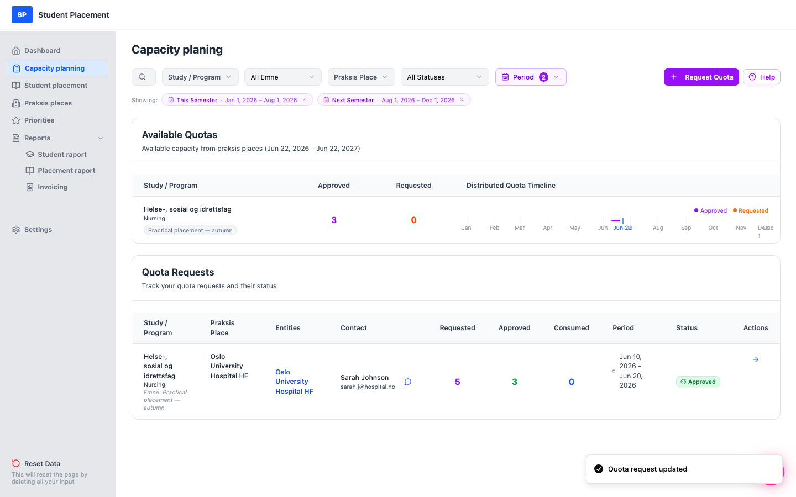

# Testscenario 07 — Kvotförfrågan - Godkänn som PK

:::info[Scenarioöversikt]

- **Sida:** Capacity planning
- **Roll:** Placeringskoordinator (PK), som godkänner å studentkoordinatorns (SK) vägnar
- **Mål:** Godkänn en väntande kvotförfrågan med den gröna bock-åtgärden, och **ändra den godkända kvoten** så att den skiljer sig från det som begärdes.
- **Förutsättning:** Minst en kvotförfrågan med status Pending finns. (Skapa en först med *Testscenario 06*.) Det här scenariot använder en förfrågan om **5** platser.

:::

## Vad detta omfattar

En väntande förfrågan godkänns normalt av studentkoordinatorn (SK) på praktikplatsen. För testning
 kan koordinatorn (PK) godkänna den direkt från listan **Quota Requests** med den gröna
 ✓-åtgärden. Under granskningen kan du **sänka den godkända kvoten per enhet** — det
 godkända antalet kan vara mindre än (men inte större än) det begärda antalet.

---

## Steg

### 1. Hitta den väntande förfrågan och klicka på den gröna bocken

Leta upp förfrågan med status Pending på **Capacity planning**.
 Klicka på den gröna ✓ (*"Approve on behalf of SK"*) i kolumnen **Actions**.

<figure>

<figcaption>Den väntande förfrågan — grön ✓ i kolumnen Actions (Requested = 5)</figcaption>

</figure>

### 2. Bekräfta godkännandevarningen

En varning förklarar att du godkänner å SK:s vägnar. Klicka på **Continue to Review**.

<figure>

<figcaption>Varning — "Approve on Behalf of Student Coordinator"</figcaption>

</figure>

### 3. Granska förfrågan

Modalen **Review Quota Request** visar förfrågningsdetaljerna och en enhetstabell med det
 **Requested**-antalet och ett redigerbart **Approve**-fält per enhet.

<figure>

<figcaption>Granskningsmodal — Requested 5, Approve förifyllt till 5</figcaption>

</figure>

### 4. Ändra den godkända kvoten

Ändra värdet i fältet **Approve** — här från **5** ner till **3**. Totalsumman
 **To Approve** uppdateras till **3**. *(Godkännandevärdet kan inte överstiga det begärda antalet.)*
 Klicka därefter på **Approve Request**.

<figure>

<figcaption>Godkänd kvot ändrad: Requested 5 → To Approve 3</figcaption>

</figure>

---

## Slutresultat

En toast med *"Quota request updated"* visas och förfrågans status blir
 Approved, med **Requested 5 / Approved 3**. Sektionen
 **Available Quotas** återspeglar den godkända kapaciteten (Approved = 3).

<figure>

<figcaption>Slutsida — förfrågan Approved med Requested 5 / Approved 3</figcaption>

</figure>

---

<ScenarioFeedback scenarioId="TS-07-approve-quota-request" />
