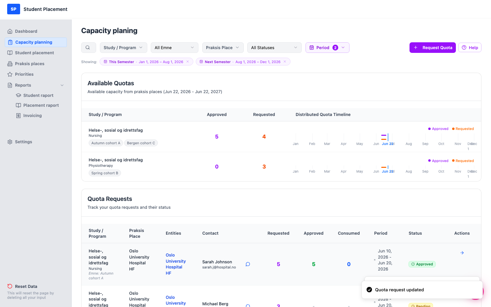
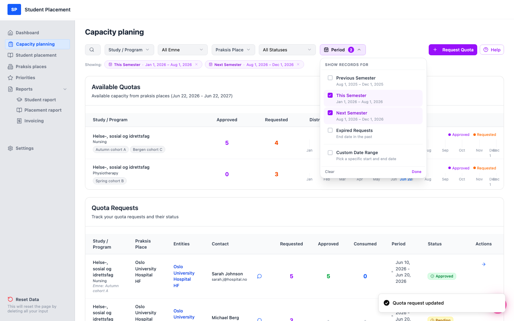
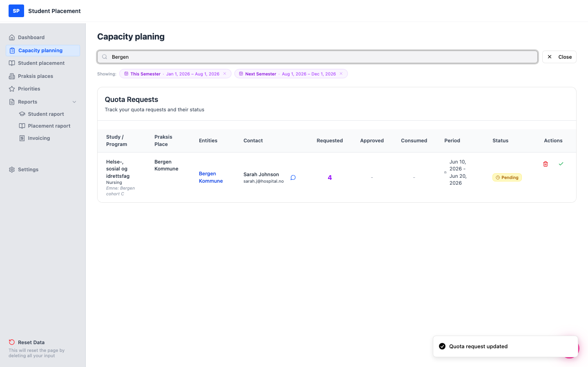
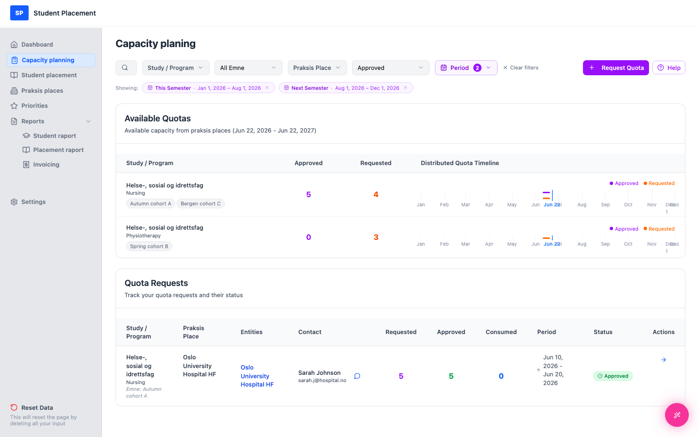
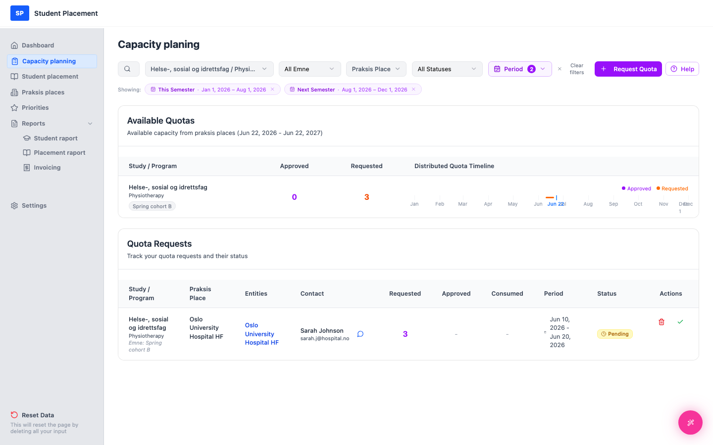
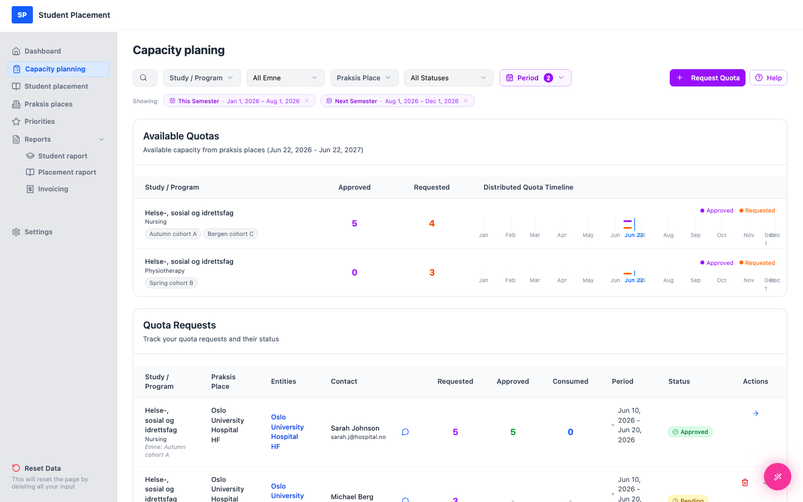

# Testscenario 08 — Kvotförfrågan - Sök och filter

:::info[Scenarioöversikt]

- **Sida:** Kapacitetsplanering
- **Roll:** Placeringskoordinator (PK)
- **Mål:** Använd sökrutan och filterkontrollerna för att avgränsa listan Kvotförfrågningar, och rensa dem sedan.
- **Förutsättning:** Några kvotförfrågningar finns fördelade över olika program, platser och statusar. Det här scenariot använder tre:

:::

| Förfrågan | Praktikplats | Program | Status |
|---|---|---|---|
| Autumn cohort A | Oslo University Hospital HF | Nursing | Godkänd |
| Spring cohort B | Oslo University Hospital HF | Physiotherapy | Väntande |
| Bergen cohort C | Bergen Kommune | Nursing | Väntande |

## Kontrollerna

-   **Period** — begränsa listan till en eller flera terminer, utgångna förfrågningar eller ett anpassat datumintervall. **Tillämpas som standard** (se nedan).
-   **Sök** (förstoringsglasikonen) — fritextsökning i studie-, program- och praktikplatsnamn.
-   **Studie / program** — välj en studie och gå sedan vidare till ett specifikt program.
-   **Alla emner** — filtrera på kurs-/ämneskod.
-   **Praktikplats** — välj en plats och eventuellt en specifik enhet.
-   **Alla statusar** — Väntande / Godkänd / Avslagen / Uppfylld.
-   **Rensa filter** — visas så snart något rullgardinsfilter är aktivt; återställer dem alla (ändrar inte Period).
---

## Steg

### 1. Notera standardvalet för period

Sidan startar **inte** ofiltrerad. Som standard är filtret **Period** förinställt på
 **Denna termin** + **Nästa termin** — vilket visas av siffran **2** på Period-knappen och de två
 chippen under verktygsfältet (*"Visar: Denna termin · … · Nästa termin · …"*). Förfrågningar vars datum
 ligger utanför båda terminerna döljs tills du ändrar detta.

<figure>

<figcaption>Standardläge — Period = Denna termin + Nästa termin (siffran "2", två chip)</figcaption>

</figure>

### 2. Öppna Period-filtret

Klicka på knappen **Period** för att öppna det. De två standardterminerna är förbockade. Härifrån kan du:

-   Växla **Föregående/denna/nästa termin** eller **Utgångna förfrågningar** (flerval).
-   Byta till **Anpassat datumintervall** och välja ett specifikt från/till-datum.
-   Använda **Rensa** för att ta bort alla periodbegränsningar (visa alla perioder), eller **Klar** för att tillämpa.

Du kan också ta bort en period direkt genom att klicka på **×** på dess chip under verktygsfältet.

<figure>

<figcaption>Period-rullgardinsmenyn — Denna termin och Nästa termin förbockade som standard</figcaption>

</figure>

### 3. Sök på namn

Klicka på **förstoringsglasikonen** för att öppna sökrutan och skriv sedan ett sökord — här `Bergen`.
 Listan avgränsas till förfrågningar vars studie, program eller praktikplats matchar. Klicka på **Stäng** för att avsluta sökningen.

<figure>

<figcaption>Sökning "Bergen" → endast förfrågan för Bergen Kommune</figcaption>

</figure>

### 4. Filtrera på status

Öppna rullgardinsmenyn **Statusar** och välj **Godkänd**. Endast godkända förfrågningar återstår.

<figure>

<figcaption>Status = Godkänd → endast "Autumn cohort A"</figcaption>

</figure>

### 5. Filtrera på studie/program

Öppna **Studie / program**, håll muspekaren över studien (*Helse-, sosial og idrettsfag*) och välj sedan ett
 program — här **Physiotherapy**. Listan visar endast det programmets förfrågningar.

<figure>

<figcaption>Studie / program = Physiotherapy → endast "Spring cohort B"</figcaption>

</figure>

### 6. Rensa filter

Klicka på **Rensa filter** (eller **×**) för att återställa rullgardinsfiltren och återgå till listan
 (periodvalet ligger kvar som det är inställt).

<figure>

<figcaption>Filter rensade — listan återställd (standardperioden tillämpas fortfarande)</figcaption>

</figure>

---

<ScenarioFeedback scenarioId="TS-08-search-and-filters" />
