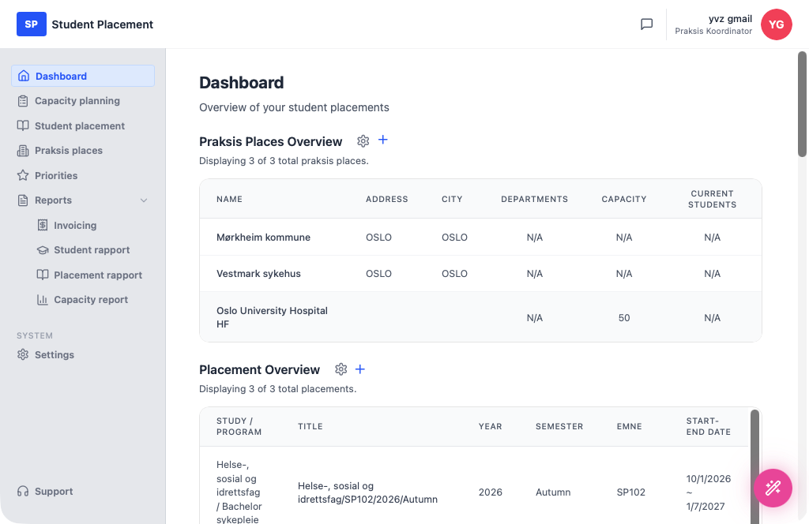
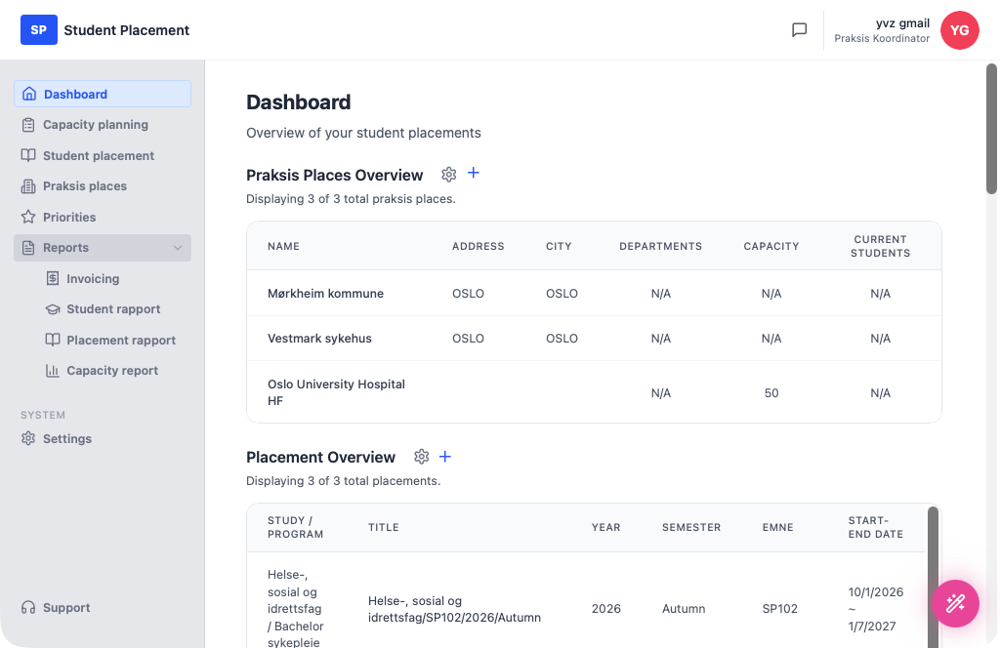
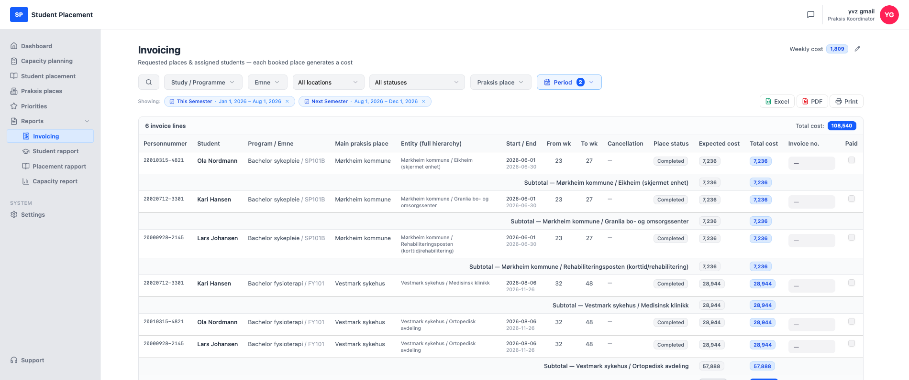
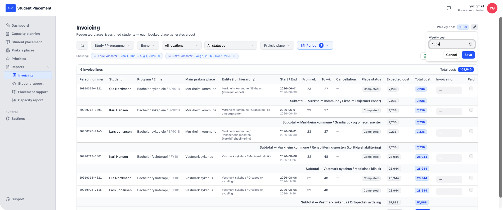
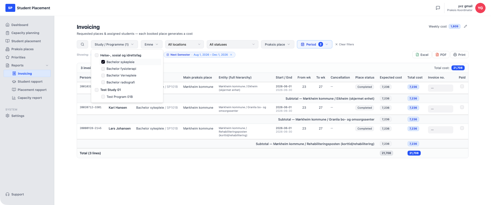
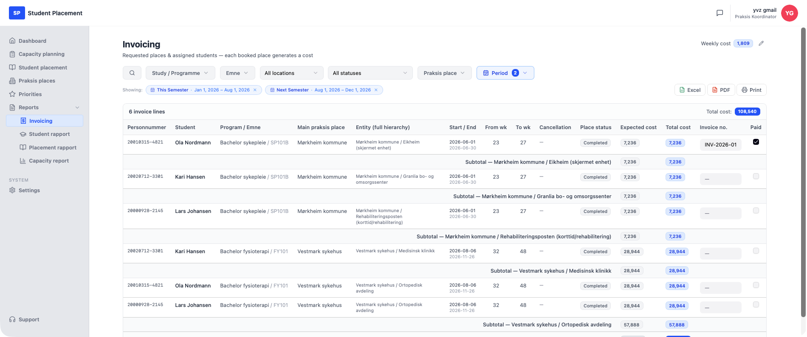

# Rapporter - Fakturering

:::info[Scenarioöversikt]

- **Sida:** Reports → Invoicing
- **Roll:** Placeringskoordinator (PK)
- **Mål:** Granska de automatiskt genererade fakturaraderna för tilldelade studenter, avgränsa dem med filter, justera veckokostnaden och registrera fakturanummer och betalstatus.
- **Förutsättning:** Inloggad som PK, med studenter redan tilldelade praktikplatser. Den här genomgången använder de befintliga placeringarna **Bachelor sykepleie / SP101B** och **Bachelor fysioterapi / FY101**.

:::

## Vad den här sidan är

**Invoicing** är den första posten under **Reports** i sidofältet (bredvid **Student rapport**, **Placement rapport** och **Capacity report**). Den genererar en fakturarad per student som har tilldelats en praktikplats — det är tilldelningen av en plats som genererar en kostnad, så studenter som bara är förfrågade men ännu inte tilldelade visas inte.

Varje rad visar studenten, program/emne, den tilldelade praktikplatsen med hela entitetshierarkin, start-/slutdatum och motsvarande ISO-veckointervall. Utifrån veckointervallet beräknar sidan en **Expected cost** som `(till vecka − från vecka − 1) × veckokostnad`; **Total cost** är samma belopp, om inte placeringen avbokades utan extra kostnad — då blir den noll. Raderna grupperas per entitet med en delsumma per grupp, och en totalsumma längst ner. **Veckokostnaden** som används i beräkningen är ett enda redigerbart värde (pennikon uppe till höger) som gäller för hela rapporten.

Utöver siffrorna har varje rad två redigerbara fält — **Invoice no.** och en **Paid**-kryssruta — så att koordinatorn kan följa faktureringsstatus direkt i rapporten. Verktygsfältet erbjuder samma uppsättning filter som på andra ställen (Study/Programme, Emne, plats, status, praktikplats, period), samt knapparna **Excel**, **PDF** och **Print** för att dela rapporten utanför appen.

Som standard är rapporten avgränsad till innevarande och nästa termin — summorna som visas speglar därför bara det tidsspannet, inte alla fakturor som någonsin genererats. Använd filtret **Period** för att utöka, ändra eller ta bort denna avgränsning och se andra tidsperioder, inklusive tidigare terminer.

---

## Steg

### 1. Starta på Dashboard

Efter inloggning kommer du till **Dashboard**.

<figure>

<figcaption>Startpunkt — Dashboard</figcaption>

</figure>

### 2. Öppna Reports → Invoicing

Klicka på **Reports** i sidofältet för att expandera det, så att **Invoicing**, **Student rapport**, **Placement rapport** och **Capacity report** visas. Klicka på **Invoicing**.

<figure>

<figcaption>Reports expanderat — Invoicing är den första rapporten</figcaption>

</figure>

### 3. Granska fakturaraderna

Rapporten öppnas och visar varje tilldelad student som en rad, grupperad per entitet med en **Subtotal**-rad efter varje grupp. Rubrikfältet visar antal rader och totalsumman **Total cost**; här **6 invoice lines** totalt **108,540**.

<figure>

<figcaption>Invoicing — alla tilldelade studenter, grupperade per entitet med delsummor</figcaption>

</figure>

### 4. Justera veckokostnaden

Klicka på pennikonen bredvid **Weekly cost** (uppe till höger). En liten redigerare öppnas med aktuellt värde — här `1809`. Ändra det och klicka på **Save** för att räkna om alla Expected/Total cost-värden och delsummor på sidan, eller **Cancel** för att lämna det oförändrat.

<figure>

<figcaption>Weekly cost — redigerbart värde som används i alla kostnadsberäkningar</figcaption>

</figure>

### 5. Filtrera på Study / Programme

Klicka på **Study / Programme** och kryssa för ett program — här **Bachelor sykepleie**. Tabellen avgränsas till det programmets rader, antal rader och totalsumma uppdateras (**3 invoice lines**, **21,708**), och knapptexten visar det aktiva antalet `(1)`. Samma mönster gäller för filtren **Emne**, **Location**, **Status** och **Praksis place**, samt för **Period** vid filtrering på datumperiod.

<figure>

<figcaption>Study / Programme-filter — avgränsat till Bachelor sykepleie</figcaption>

</figure>

### 6. Registrera fakturanummer och markera en rad som betald

Rensa filtret och skriv sedan in ett fakturanummer i fältet **Invoice no.** på en rad — här `INV-2026-0142` — och kryssa i **Paid**-rutan. Båda fälten sparas per rad allteftersom du redigerar dem.

<figure>

<figcaption>Invoice no. ifyllt och Paid ikryssad för första raden</figcaption>

</figure>

---

## Slutresultat

Den första fakturaraden har nu fakturanummer **INV-2026-0142** och är markerad **Paid**, medan rapporten som helhet när som helst kan filtreras, exporteras till **Excel**/**PDF**, eller skrivas ut för att delas med ekonomiavdelningen.

---

<ScenarioFeedback scenarioId="TS-14-invoicing-report" />
