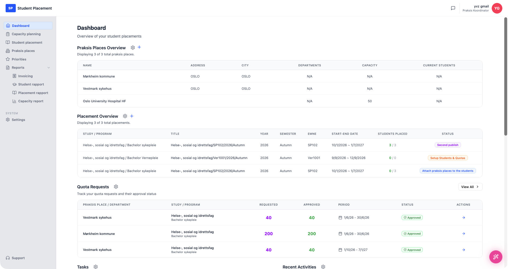
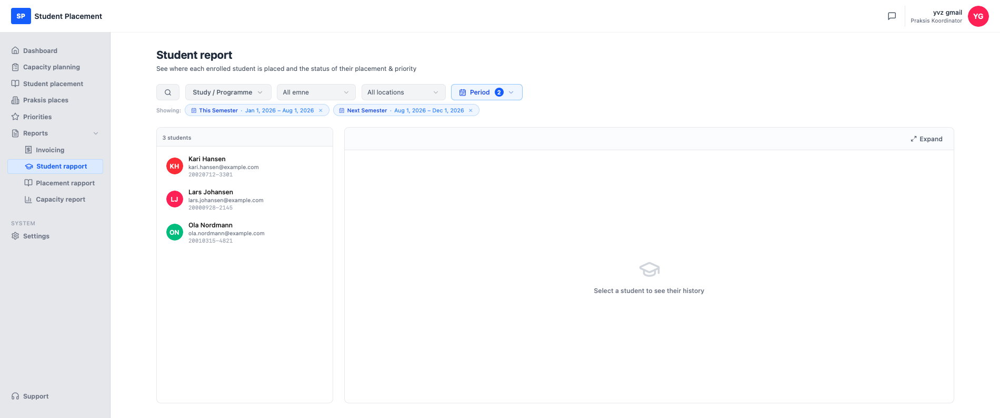
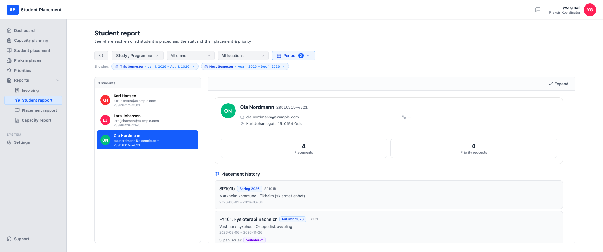
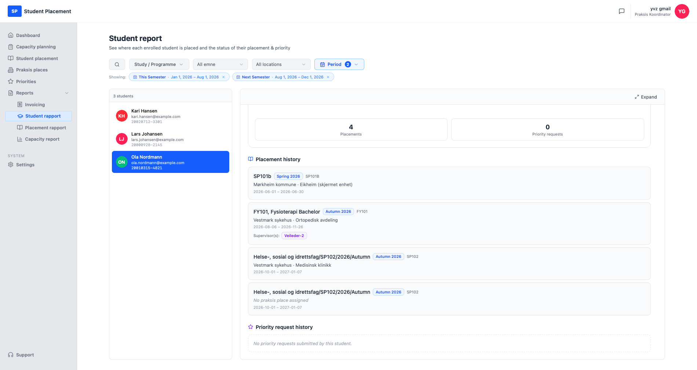
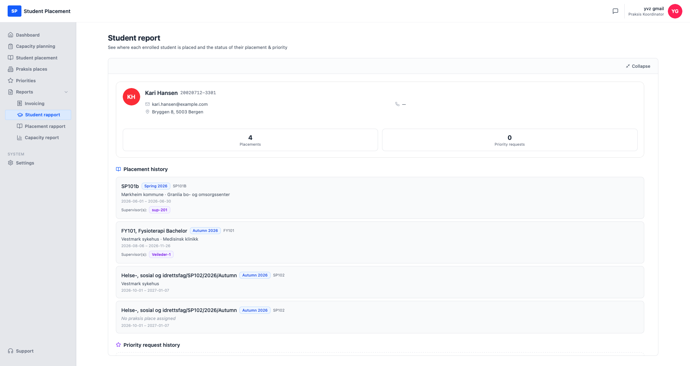
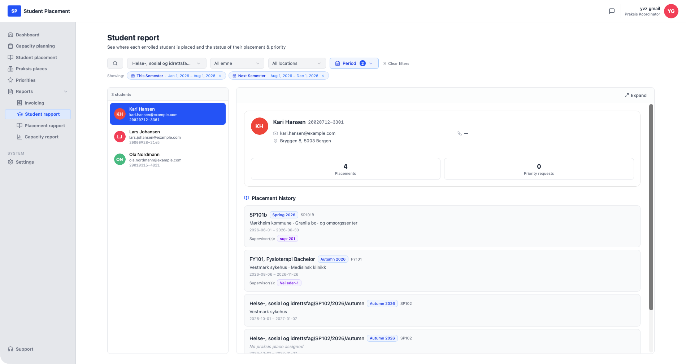

# Rapporter - Studentrapport

:::info[Scenarioöversikt]

- **Sida:** Rapporter → Studentrapport
- **Roll:** Placeringskoordinator (PK)
- **Mål:** Bläddra bland inskrivna studenter, avgränsa listan med filter, välj en student för att se hela placerings- och prioriteringshistoriken, och expandera profilen till full bredd.
- **Förutsättning:** Inloggad som PK, med inskrivna studenter som har placeringshistorik. Den här genomgången använder de befintliga studenterna **Kari Hansen**, **Lars Johansen** och **Ola Nordmann**.

:::

## Vad den här sidan är

**Studentrapport** är den andra posten under **Rapporter** i sidofältet (bredvid **Fakturering**, **Placeringsrapport** och **Kapacitetsrapport**). Det är en master/detalj-vy: en filtrerbar lista över inskrivna studenter till vänster, och den valda studentens fullständiga profil till höger.

Filterfältet avgränsar studentlistan på **Studie / program** (en kaskadmeny — välj ett studium, sedan eventuellt ett av dess program), **Emne**, **Plats** och **Period**; ett sökfält matchar också på namn, e-post eller personnummer. Att välja en student till vänster laddar deras profil till höger: ett identitetskort (namn, personnummer, e-post, telefon, adress, samt märke för körkort om tillämpligt) med räknare för **Placeringar** och **Prioritetsförfrågningar**, följt av en **Placeringshistorik**-sektion (ett kort per placering, med termin, emne/ämne, tilldelad praktikplats och entitet, start-/slutdatum och handledare) och en **Historik för prioritetsförfrågningar**-sektion (ett kort per inskickad förfrågan, med målsemester, poäng, status och beslutsdetaljer) — båda sektionerna visar en enkel text som tomt-tillstånd när det inte finns något att visa ännu. En **Visa**-knapp uppe till höger i detaljpanelen döljer studentlistan och verktygsfältet så att profilen kan granskas i full bredd; **Dölj** återställer den delade vyn.

Som standard är rapporten avgränsad till innevarande och nästa termin — studentlistan visar därför bara studenter med en placering eller prioriteringsförfrågan inom det tidsspannet. Använd filtret **Period** för att utöka, ändra eller ta bort denna avgränsning och få med andra studenter, inklusive tidigare terminer.

---

## Steg

### 1. Starta på Instrumentpanelen

Efter inloggning kommer du till **Instrumentpanelen**.

<figure>

<figcaption>Startpunkt — Instrumentpanelen</figcaption>

</figure>

### 2. Öppna Rapporter → Studentrapport

Klicka på **Rapporter** i sidofältet för att expandera det, och klicka sedan på **Studentrapport**. Sidan öppnas med filterfältet och en lista över inskrivna studenter till vänster; ingen student är vald ännu, så den högra panelen visar *"Välj en student för att se historiken."*

<figure>

<figcaption>Studentrapport — studentlista och filterfält, inget valt</figcaption>

</figure>

### 3. Välj en student

Klicka på en student i listan — här **Ola Nordmann**. Deras profil laddas till höger: identitetskort med kontaktuppgifter, sedan **4 placeringar** och **0 prioritetsförfrågningar**, följt av början på **Placeringshistorik**.

<figure>

<figcaption>Ola Nordmann vald — identitetskort och början på placeringshistoriken</figcaption>

</figure>

### 4. Granska hela historiken

Skrolla i profilpanelen för att se alla placeringsposter — inklusive de som ännu inte har någon tilldelad praktikplats — och sektionen **Historik för prioritetsförfrågningar** nedanför. För den här studenten står det *"Inga prioritetsförfrågningar har skickats in av den här studenten."*

<figure>

<figcaption>Återstående placeringsposter, samt tomt-tillståndet för Historik för prioritetsförfrågningar</figcaption>

</figure>

### 5. Expandera till full bredd

Klicka på **Visa** (uppe till höger i detaljpanelen). Studentlistan och verktygsfältet döljs, och profilen — här för **Kari Hansen** — fyller full bredd, vilket gör det enklare att läsa längre historik. Klicka på **Dölj** för att återgå till den delade vyn.

<figure>

<figcaption>Expanderad vy — Kari Hansens fullständiga placeringshistorik i full bredd</figcaption>

</figure>

### 6. Filtrera på Studie / program

Gå tillbaka till den delade vyn, klicka på **Studie / program**, och välj ett studium — här **Helse-, sosial og idrettsfag** — och sedan ett program, till exempel **Bachelor sykepleie**. Knapptexten uppdateras för att visa valet, och en **Rensa filter**-länk visas; studentlistan avgränsas till matchande studenter. Samma mönster gäller för **Emne**, **Plats** och **Period**.

<figure>

<figcaption>Studie / program-filter — avgränsat till Helse-, sosial og idrettsfag / Bachelor sykepleie</figcaption>

</figure>

---

## Slutresultat

Koordinatorn kan bläddra bland alla inskrivna studenter, avgränsa listan till dem de bryr sig om, och se en fullständig historik över placeringar och prioriteringsförfrågningar för den som är vald — expanderad till full bredd när det finns mycket att granska.

---

<ScenarioFeedback scenarioId="TS-15-student-report" />
