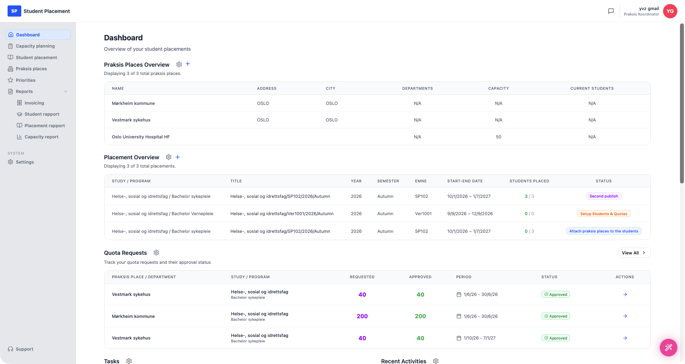
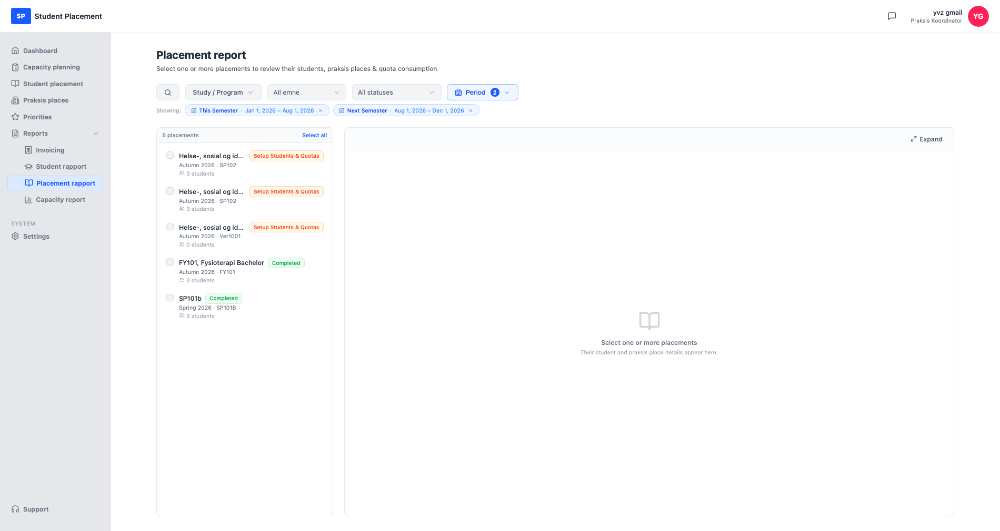
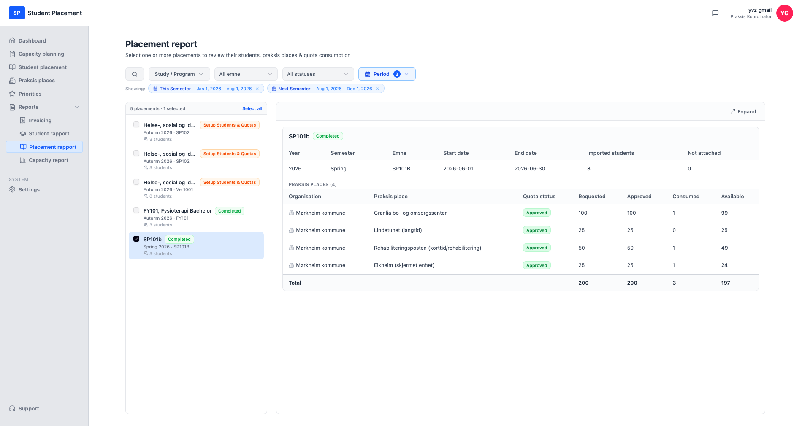
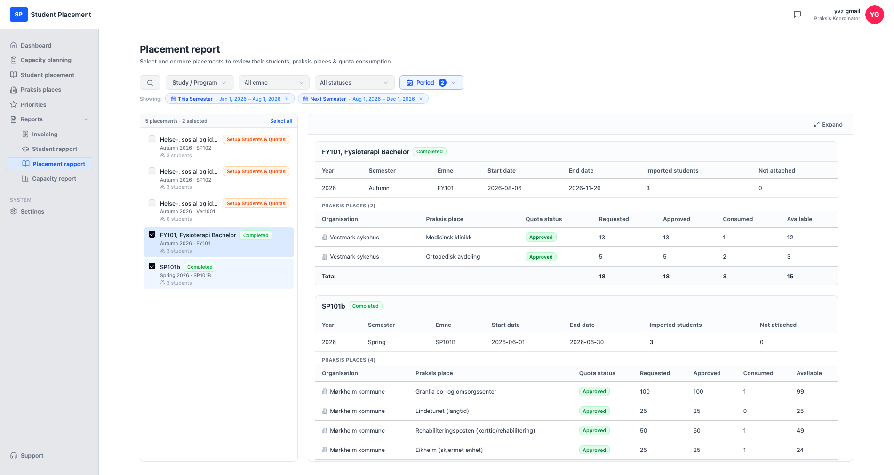
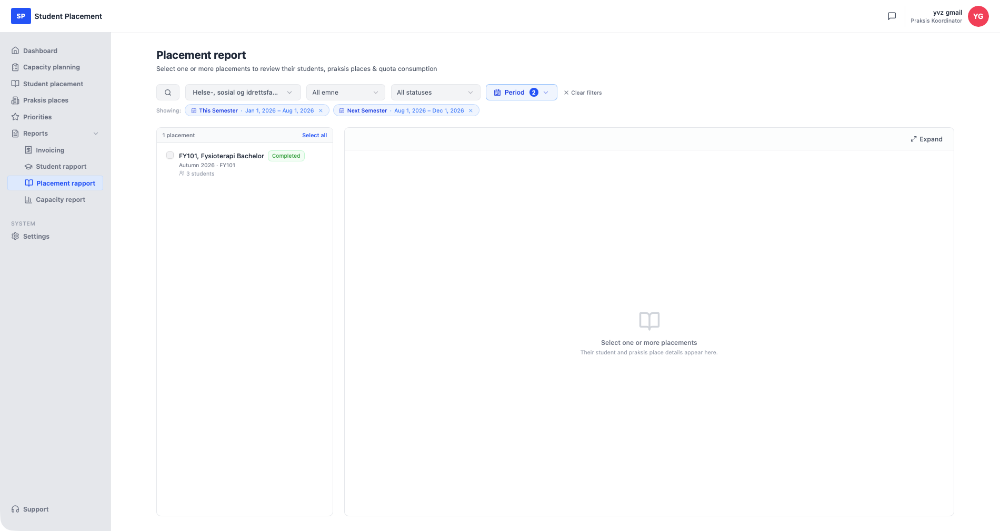
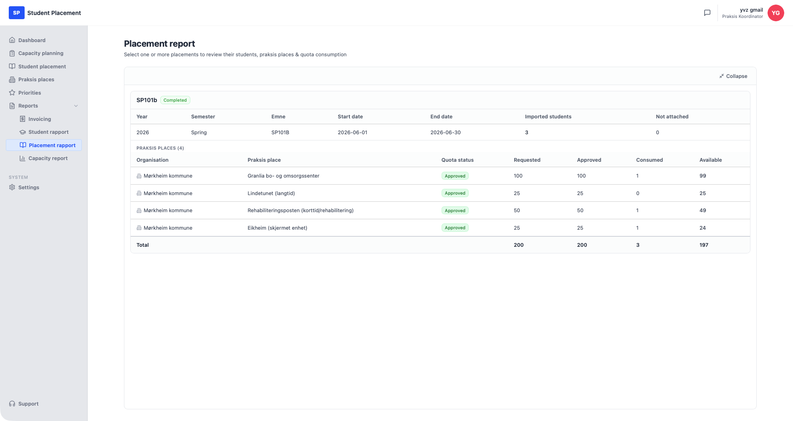

# Rapporter - Placeringsrapport

:::info[Scenarioöversikt]

- **Sida:** Rapporter → Placeringsrapport
- **Roll:** Placeringskoordinator (PK)
- **Mål:** Bläddra bland placeringar, välj en eller flera för att granska importerade studenter och kvotförbrukning på praktikplatser sida vid sida, avgränsa listan med filter, och expandera ett urval till full bredd.
- **Förutsättning:** Inloggad som PK, med placeringar som har importerade studenter och anslutna praktikplatser. Den här genomgången använder de befintliga placeringarna **SP101b** och **FY101, Fysioterapi Bachelor**.

:::

## Vad den här sidan är

**Placeringsrapport** är den tredje posten under **Rapporter** i sidofältet (bredvid **Fakturering**, **Studentrapport** och **Kapacitetsrapport**). Till skillnad från Studentrapport är detta en vy med **flerval**: kryssa för så många placeringar du vill till vänster, och var och en får sin egen sektion staplad i detaljpanelen till höger — så att du kan jämföra flera placeringar samtidigt istället för en i taget.

Filterfältet avgränsar placeringslistan på **Studie / program** (en kaskadmeny — välj ett studium, sedan eventuellt ett av dess program), **Emne**, **Status** (Utkast, Ladda upp studenter, Välj praktikplatser, Första publicering, Slutförd) och **Period**; ett sökfält matchar också på titel, emne eller termin. Varje placeringskort i listan visar titel, statusmärke, termin/emne och antal importerade studenter, med **Markera alla** / **Rensa alla** ovanför listan. För varje ikryssad placering visar detaljpanelen en sammanfattningsrad (År, Termin, Emne, Start-/slutdatum, Importerade studenter, Inte kopplad) följt av en **Praktikplatser**-tabell — en rad per ansluten entitet, med **Kvotstatus**, **Begärd**, **Godkänd**, **Förbrukad** och **Tillgänglig**, samt en **Totalt**-rad — eller ett tomt-tillstånd-meddelande om inga praktikplatser är anslutna ännu. En **Visa**-knapp uppe till höger i detaljpanelen döljer placeringslistan och verktygsfältet så att urvalet kan granskas i full bredd; **Dölj** återställer den delade vyn.

Som standard är rapporten avgränsad till innevarande och nästa termin — placeringslistan visar därför bara placeringar vars datum faller inom det tidsspannet. Använd filtret **Period** för att utöka, ändra eller ta bort denna avgränsning och få med andra placeringar, inklusive tidigare terminer.

---

## Steg

### 1. Starta på Instrumentpanelen

Efter inloggning kommer du till **Instrumentpanelen**.

<figure>

<figcaption>Startpunkt — Instrumentpanelen</figcaption>

</figure>

### 2. Öppna Rapporter → Placeringsrapport

Klicka på **Rapporter** i sidofältet för att expandera det, och klicka sedan på **Placeringsrapport**. Sidan öppnas med filterfältet och en kryssrutelista över placeringar till vänster; inget är valt ännu, så den högra panelen visar *"Välj en eller flera placeringar."*

<figure>

<figcaption>Placeringsrapport — placeringslista och filterfält, inget valt</figcaption>

</figure>

### 3. Välj en placering

Kryssa för en placering i listan — här **SP101b**. Dess sektion laddas till höger: sammanfattningsraden (**3** importerade studenter, **0** ej anslutna) följt av **Praktikplatser (4)** med siffror för begärd/godkänd/förbrukad/tillgänglig per entitet och en **Totalt**-rad (200 godkänt, 3 förbrukat, 197 tillgängligt).

<figure>

<figcaption>SP101b vald — placeringssammanfattning och kvottabell för praktikplatser</figcaption>

</figure>

### 4. Välj en andra placering att jämföra

Kryssa för ytterligare en placering — här **FY101, Fysioterapi Bachelor** — medan SP101b fortfarande är ikryssad. Dess sektion läggs till ovanför SP101b:s i detaljpanelen, så att båda placeringarnas kvottabeller visas tillsammans för jämförelse.

<figure>

<figcaption>FY101 och SP101b båda valda — deras sektioner staplas i detaljpanelen</figcaption>

</figure>

### 5. Filtrera på Studie / program

Rensa urvalet, klicka på **Studie / program**, och välj ett studium — här **Helse-, sosial og idrettsfag** — och sedan ett program, till exempel **Bachelor fysioterapi**. Knapptexten uppdateras, en **Rensa filter**-länk visas, och placeringslistan avgränsas (här till **1 placering**). Samma mönster gäller för **Emne**, **Status** och **Period**.

<figure>

<figcaption>Studie / program-filter — avgränsat till Helse-, sosial og idrettsfag / Bachelor fysioterapi</figcaption>

</figure>

### 6. Expandera till full bredd

Rensa filtret, välj en placering, och klicka sedan på **Visa** (uppe till höger i detaljpanelen). Placeringslistan och verktygsfältet döljs, och den/de valda sektionen/sektionerna fyller full bredd, vilket gör breda kvottabeller enklare att läsa. Klicka på **Dölj** för att återgå till den delade vyn.

<figure>

<figcaption>Expanderad vy — SP101b:s sammanfattning och kvottabell för praktikplatser i full bredd</figcaption>

</figure>

---

## Slutresultat

Koordinatorn kan kryssa för valfri kombination av placeringar och se antal importerade studenter och kvotförbrukning på praktikplatser sida vid sida — avgränsat till relevant studium, program, emne, status eller period, och expanderat till full bredd för en närmare titt.

---

<ScenarioFeedback scenarioId="TS-16-placement-report" />
