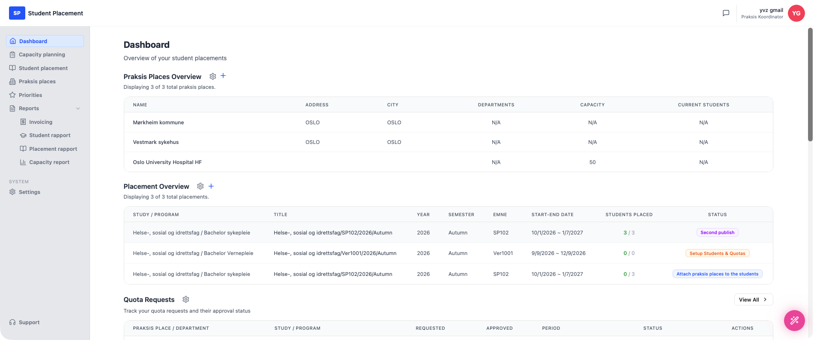
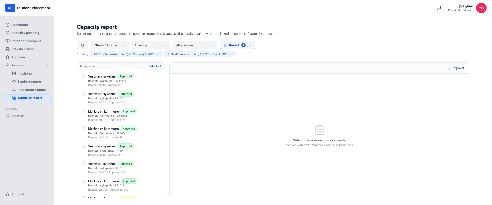
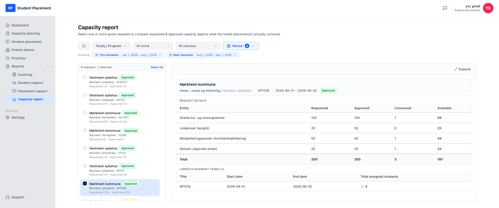
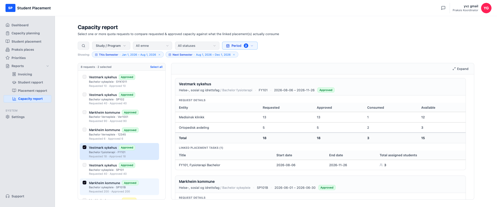
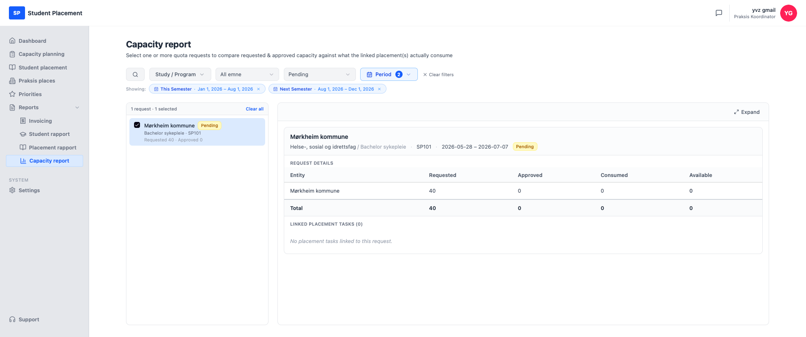
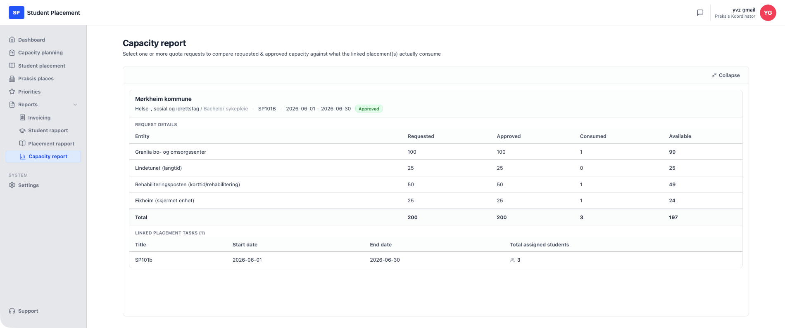

# Rapporter - Kapacitetsrapport

:::info[Scenarioöversikt]

- **Sida:** Reports → Capacity report
- **Roll:** Placeringskoordinator (PK)
- **Mål:** Bläddra bland kvotförfrågningar, välj en eller flera för att jämföra begärd vs. godkänd kapacitet mot vad de länkade placeringarna faktiskt förbrukar, filtrera listan på status, och expandera ett urval till full bredd.
- **Förutsättning:** Inloggad som PK, med kvotförfrågningar i olika statusar. Den här genomgången använder de befintliga förfrågningarna **Mørkheim kommune / SP101B** (Approved), **Vestmark sykehus / FY101** (Approved) och **Mørkheim kommune / SP101** (Pending).

:::

## Vad den här sidan är

**Capacity report** är den fjärde posten under **Reports** i sidofältet (bredvid **Invoicing**, **Student rapport** och **Placement rapport**). Liksom Placement rapport är detta en vy med **flerval**: kryssa för så många kvotförfrågningar du vill till vänster, och var och en får sin egen jämförelsesektion staplad i detaljpanelen till höger.

Filterfältet avgränsar förfrågningslistan på **Study / Program** (en kaskadmeny), **Emne**, **Status** (Pending, Approved, Rejected, Fulfilled) och **Period**; ett sökfält matchar också på praktikplats, studium, program eller emne. Varje förfrågningskort i listan visar praktikplatsens namn, ett statusmärke, program/emne, samt begärda/godkända summor, med **Select all** / **Clear all** ovanför listan. För varje ikryssad förfrågan visar detaljpanelen en rubrik (praktikplats, studium/program, emne, period, status) följt av en **Request details**-tabell — en rad per entitet, med **Requested**, **Approved**, **Consumed** och **Available**, samt en **Total**-rad — och en **Linked placement tasks**-tabell som visar vilka placeringar som drar på denna förfrågan, med start-/slutdatum och totalt antal tilldelade studenter, eller ett tomt-tillstånd-meddelande om inga är länkade ännu. En **Expand**-knapp uppe till höger i detaljpanelen döljer förfrågningslistan och verktygsfältet så att urvalet kan granskas i full bredd; **Collapse** återställer den delade vyn.

Som standard är rapporten avgränsad till innevarande och nästa termin — förfrågningslistan visar därför bara förfrågningar vars datum faller inom det tidsspannet. Använd filtret **Period** för att utöka, ändra eller ta bort denna avgränsning och få med andra förfrågningar, inklusive tidigare terminer.

---

## Steg

### 1. Starta på Dashboard

Efter inloggning kommer du till **Dashboard**.

<figure>

<figcaption>Startpunkt — Dashboard</figcaption>

</figure>

### 2. Öppna Reports → Capacity report

Klicka på **Reports** i sidofältet för att expandera det, och klicka sedan på **Capacity report**. Sidan öppnas med filterfältet och en kryssrutelista över kvotförfrågningar till vänster; inget är valt ännu, så den högra panelen visar *"Select one or more quota requests."*

<figure>

<figcaption>Capacity report — förfrågningslista och filterfält, inget valt</figcaption>

</figure>

### 3. Välj en förfrågan

Kryssa för en förfrågan i listan — här **Mørkheim kommune / SP101B**. Dess sektion laddas till höger: rubriken (studium/program, emne **SP101B**, period, **Approved**-märke) följt av **Request details** med siffror per entitet och en **Total**-rad (200 godkänt, 3 förbrukat, 197 tillgängligt), sedan **Linked placement tasks (1)** som visar placeringen **SP101b** med 3 tilldelade studenter.

<figure>

<figcaption>SP101B vald — förfrågningsdetaljer och länkad placeringsuppgift</figcaption>

</figure>

### 4. Välj en andra förfrågan att jämföra

Kryssa för ytterligare en förfrågan — här **Vestmark sykehus / FY101** — medan SP101B fortfarande är ikryssad. Dess sektion läggs till ovanför SP101B:s i detaljpanelen, så att båda förfrågningarnas kapacitetsjämförelser visas tillsammans.

<figure>

<figcaption>FY101 och SP101B båda valda — deras sektioner staplas i detaljpanelen</figcaption>

</figure>

### 5. Filtrera på Status

Rensa urvalet, klicka på statusrullgardinen, och välj **Pending**. Listan avgränsas till den enda matchande förfrågan — **Mørkheim kommune / SP101**, begärt 40 / godkänt 0. Att välja den visar ett **Pending**-märke, ett **Available** på 0 (inget godkänt ännu), och *"No placement tasks linked to this request"* eftersom inget har tilldelats mot den ännu. Samma mönster gäller för **Study / Program**, **Emne** och **Period**.

<figure>

<figcaption>Statusfilter — Pending-förfrågan utan godkänd kapacitet eller länkade placeringar ännu</figcaption>

</figure>

### 6. Expandera till full bredd

Rensa filtret, välj en förfrågan, och klicka sedan på **Expand** (uppe till höger i detaljpanelen). Förfrågningslistan och verktygsfältet döljs, och den/de valda sektionen/sektionerna fyller full bredd, vilket gör breda jämförelsetabeller enklare att läsa. Klicka på **Collapse** för att återgå till den delade vyn.

<figure>

<figcaption>Expanderad vy — SP101B:s förfrågningsdetaljer och länkade placeringsuppgift i full bredd</figcaption>

</figure>

---

## Slutresultat

Koordinatorn kan kryssa för valfri kombination av kvotförfrågningar och se begärd vs. godkänd vs. förbrukad kapacitet sida vid sida, tillsammans med vilka placeringar som drar på varje förfrågan — avgränsat på studium, program, emne, status eller period, och expanderat till full bredd för en närmare titt.

---

<ScenarioFeedback scenarioId="TS-17-capacity-report" />
