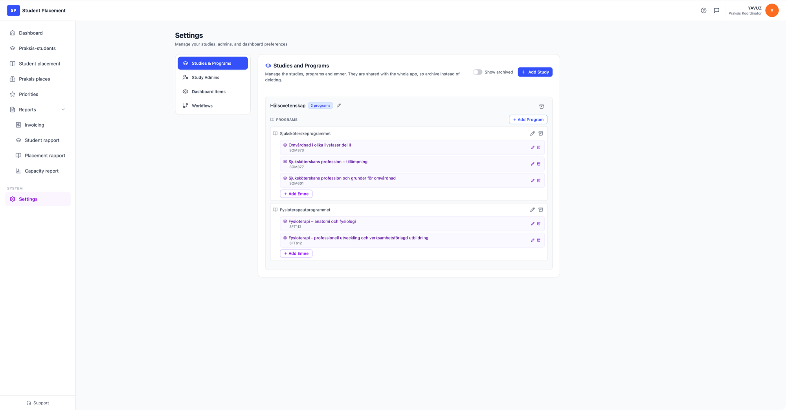
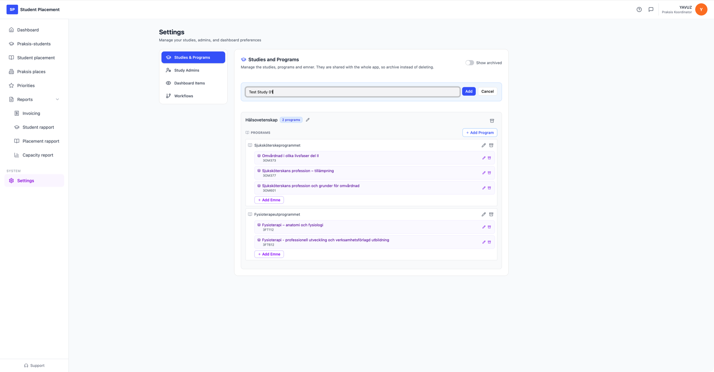
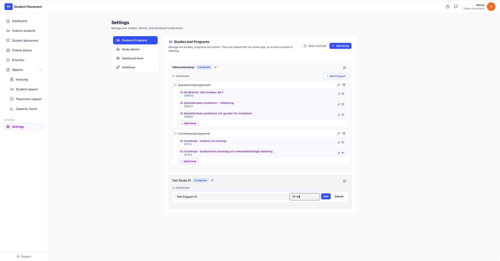
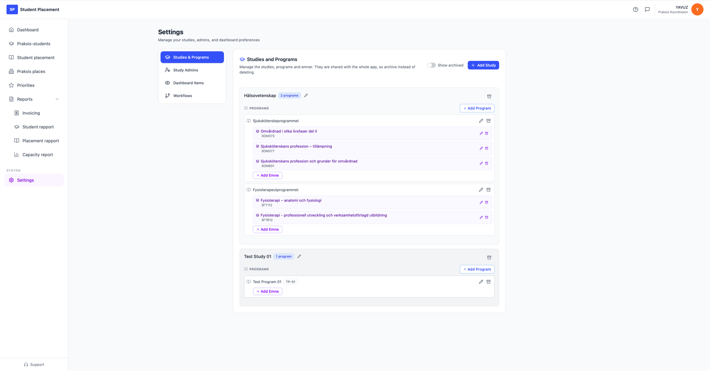
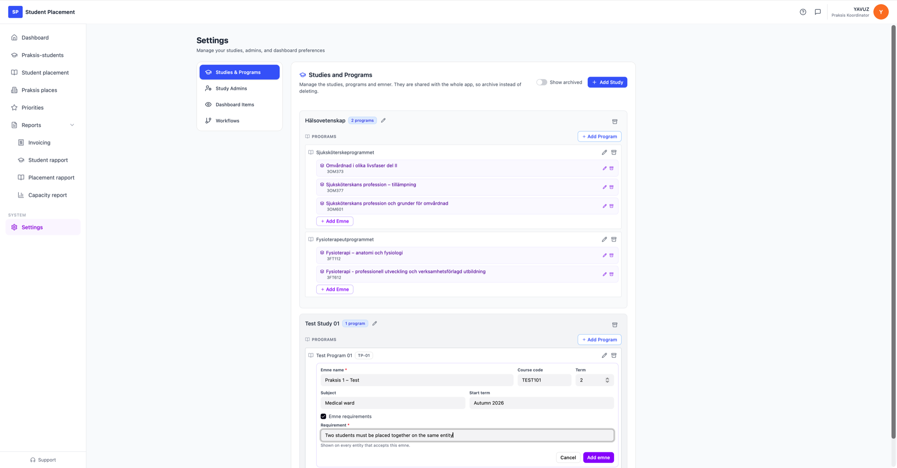
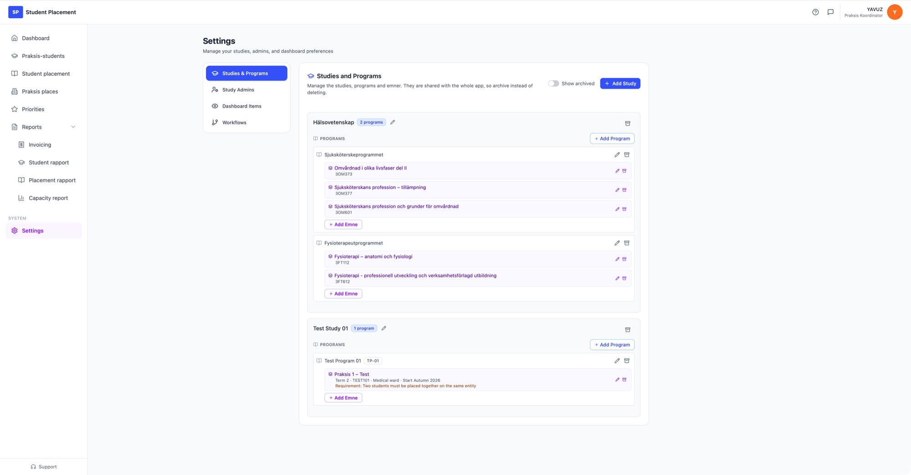
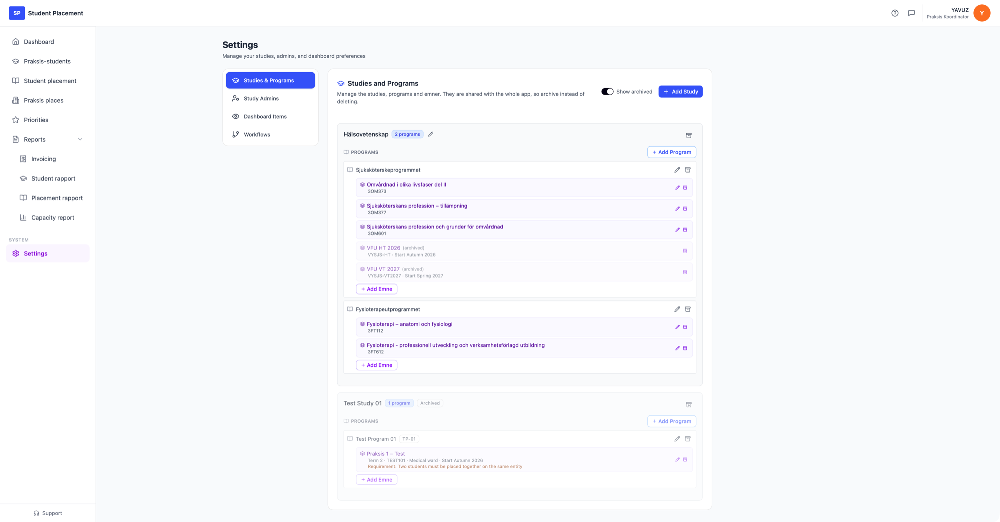

# Testscenario 01 — Inställningar - Studier och program

:::info[Scenarioöversikt]

- **Sida:** Inställningar → Studier och program
- **Roll:** Placeringskoordinator (PK)
- **Mål:** Skapa en studie, lägg till ett program med programkod i den, och lägg till ett emne med detaljer i programmet.
- **Förutsättning:** Inloggad som PK. Sidan kan redan innehålla studier — flödet är detsamma oavsett.

:::

## Vad den här sidan är

**Studier och program** är den första fliken på sidan Inställningar (bredvid **Studieadministratörer**, **Instrumentpanelselement** och **Arbetsflöden**), och det är här den akademiska strukturen definieras: en **studie** innehåller ett eller flera **program**, och varje program kan ha ett eller flera **emner**. Studier, program och emner delas med hela appen och **arkiveras därför i stället för att tas bort**: varje studie, program och emne har en redigeringsikon (penna) och en arkiveringsikon, och arkiverade objekt kan visas igen med reglaget **Visa arkiverade** och återställas.

---

## Steg

### 1. Börja på Instrumentpanelen

Efter inloggningen hamnar du på **Instrumentpanelen**.

<figure>

<figcaption>Utgångspunkt — Instrumentpanelen</figcaption>

</figure>

### 2. Öppna Inställningar → Studier och program

Klicka på **Inställningar** i sidofältet (under **System**). Inställningar öppnas som standard på fliken **Studier och program**. Varje studie visas som ett kort med en etikett för antal program; inuti kortet visar varje program sina emner med namn och kurskod.

<figure>

<figcaption>Studier och program — utgångsläge med befintliga studier</figcaption>

</figure>

### 3. Skapa en studie

Klicka på **Lägg till studie** (uppe till höger). Ett fält med platshållaren *"Ange studienamn (t.ex. Helse-, sosial og idrettsfag)"* visas på raden. Skriv studiens namn — här `Test Study 01` — och klicka på **Lägg till** (knappen är inaktiverad tills ett namn har angetts). Det nya studiekortet visas längst ned i listan med etiketten **0 program** och tipset *"Inga program har lagts till än. Klicka på ”Lägg till program” för att lägga till ett."*

<figure>

<figcaption>Lägg till studie — namnet ifyllt i fältet</figcaption>

</figure>

### 4. Lägg till ett program

Klicka på **Lägg till program** på det nya studiekortet. Två fält visas på raden: programnamnet (*"Ange programnamn (t.ex. Sjuksköterska)"*) och en **programkod** (*"Kod (t.ex. SYK-B)"*, högst 50 tecken). Ange `Test Program 01` och koden `TP-01`, och klicka på **Lägg till**.

<figure>

<figcaption>Lägg till program — namn och kod ifyllda på kortet Test Study 01</figcaption>

</figure>

### 5. Program tillagt

Studiens etikett visar nu **1 program**. Programraden visar koden som en tagg (**TP-01**), har egna ikoner för redigering (*Redigera programnamn och kod*) och arkivering, samt en **Lägg till emne**-knapp.

<figure>

<figcaption>Test Program 01 tillagt — etiketten visar 1 program</figcaption>

</figure>

### 6. Lägg till ett emne i programmet

Klicka på **Lägg till emne** på programraden. Formuläret **Lägg till emne** öppnas med dessa fält:

| Fält | Obligatoriskt | Exempel |
|---|---|---|
| **Emnenamn** | Ja | `Praksis 1 – Test` |
| **Kurskod** | Nej (högst 50 tecken) | `TEST101` |
| **Termin** — terminen i programmet | Nej (1–12) | `2` |
| **Ämnesområde** | Nej | `Medical ward` |
| **Starttermin** | Nej | `Autumn 2026` |
| **Emnekrav** (kryssruta) | Nej | — |

När du kryssar i **Emnekrav** visas fältet **Krav** (obligatoriskt så länge rutan är ikryssad, högst 300 tecken) — här `Two students must be placed together on the same entity`. Kravet *visas på varje enhet som tar emot det här emnet*. Fyll i formuläret och klicka på **Lägg till emne** (inaktiverad tills de obligatoriska fälten är ifyllda).

<figure>

<figcaption>Lägg till emne — alla fält ifyllda, med ett emnekrav</figcaption>

</figure>

---

## Slutresultat

Studien **Test Study 01** har nu **1 program** — **Test Program 01** (**TP-01**) med emnet **Praksis 1 – Test**. Emneraden visar detaljerna som *"Term 2 · TEST101 · Medical ward · Start Autumn 2026"* och, under dem, kravet i orange.

<figure>

<figcaption>Sluttillstånd — studie, program med kod, och ett emne med detaljer och ett krav</figcaption>

</figure>

## Arkivera och återställa (valfritt)

Studier, program och emner kan inte tas bort — de arkiveras i stället. Klicka på **arkiveringsikonen** på ett studiekort, en programrad eller en emnerad.

:::warning

Arkiveringen sker **omedelbart** — det finns ingen bekräftelsedialog. Om du arkiverar något av misstag återställer du det enligt beskrivningen nedan.

:::

Arkiverade objekt döljs i listan. Slå på reglaget **Visa arkiverade** (uppe till höger, bredvid **Lägg till studie**) för att visa dem igen: en arkiverad studie är nedtonad med etiketten **Arkiverad**, och ett arkiverat emne är märkt *(arkiverad)*. Klicka på **återställ**-ikonen på objektet för att få tillbaka det.

<figure>

<figcaption>Visa arkiverade påslaget — en arkiverad studie och två arkiverade emner</figcaption>

</figure>

---

<ScenarioFeedback scenarioId="TS-01-studies-and-programs" />
