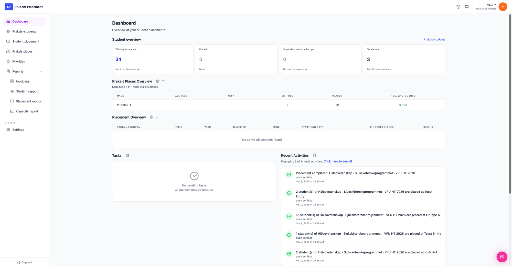

# Testscenario 02 — Inställningar - Studieadministratörer

:::info[Scenarioöversikt]

- **Sida:** Inställningar → Studieadministratörer
- **Roll:** Placeringskoordinator (PK)
- **Mål:** Skapa en studieadministratör och tilldela hen en studie och dess program.
- **Förutsättning:** Minst en studie med program finns (skapa en först med *Testscenario 01*). Sidan kan redan visa andra administratörer — flödet är detsamma oavsett.

:::

## Vad den här sidan är

**Studieadministratörer** (under Inställningar) är där du ger personer administrativt ansvar för en
 studie och ett eller flera av dess program. Varje administratör har ett namn, en e-postadress, en enda **studie** och en uppsättning
 **program** inom den studien.

---

## Steg

### 1. Börja på Instrumentpanelen

Efter inloggningen hamnar du på **Instrumentpanelen**.

<figure>

<figcaption>Utgångspunkt — Instrumentpanelen</figcaption>

</figure>

### 2. Öppna Inställningar → Studieadministratörer

Klicka på **Inställningar** i sidofältet och välj sedan fliken **Studieadministratörer**. Varje befintlig administratör visas som ett kort med namn, en etikett för **antal program**, e-post, studie och de program hen ansvarar för, samt ikoner för redigering (penna) och borttagning (papperskorg).

<figure>

<figcaption>Studieadministratörer — utgångsläge med en befintlig administratör</figcaption>

</figure>

### 3. Lägg till en administratör

Klicka på **Lägg till administratör** (uppe till höger). Ett formulär öppnas överst i listan:

1.  Ange administratörens **namn** (*"Ange administratörens namn (t.ex. Anne Larsen)"*) — här `Anne Larsen`.
2.  Ange administratörens **e-post** (*"Ange administratörens e-post (t.ex. anne.larsen@example.com)"*) — här `anne.larsen@example.com`.
3.  Välj en studie i listrutan **Välj en studie** — här *Hälsovetenskap*.
4.  När en studie är vald visas listan *"Välj program för den här administratören:"* med studiens program. Kryssa i de program administratören ska ansvara för — här **Sjuksköterskeprogrammet** och **Fysioterapeutprogrammet**.
5.  Klicka på **Lägg till**.

<figure>

<figcaption>Lägg till administratör — namn, e-post, studie och program valda</figcaption>

</figure>

---

## Slutresultat

Den nya administratören visas längst ned i listan med etiketten **2 program**, sin e-postadress, studien och de
 program som hen ansvarar för.

<figure>

<figcaption>Sluttillstånd — Anne Larsen skapad med 2 program</figcaption>

</figure>

## Redigera en administratör (valfritt)

Klicka på **pennikonen** på ett administratörskort. Kortet blir ett redigeringsformulär där du kan ändra
 **namn**, **studie** och ikryssade **program**. E-postadressen kan inte ändras här. Klicka på **Spara** för
 att tillämpa ändringarna eller **Avbryt** för att förkasta dem.

<figure>

<figcaption>Redigera administratör — namn, studie och program</figcaption>

</figure>

## Ta bort en administratör (valfritt)

Klicka på **papperskorgsikonen** på ett administratörskort. En bekräftelsedialog öppnas: *"Ta bort
 studieadministratör? Administratören ”Anne Larsen” tas bort permanent."* Klicka på **Ta bort** för att
 bekräfta eller **Avbryt** för att behålla administratören.

<figure>

<figcaption>Ta bort studieadministratör — bekräftelsedialog</figcaption>

</figure>

## Anteckningar

-   **Studieadministratörer kan bara se data för valda studier**

---

<ScenarioFeedback scenarioId="TS-02-study-admins" />
