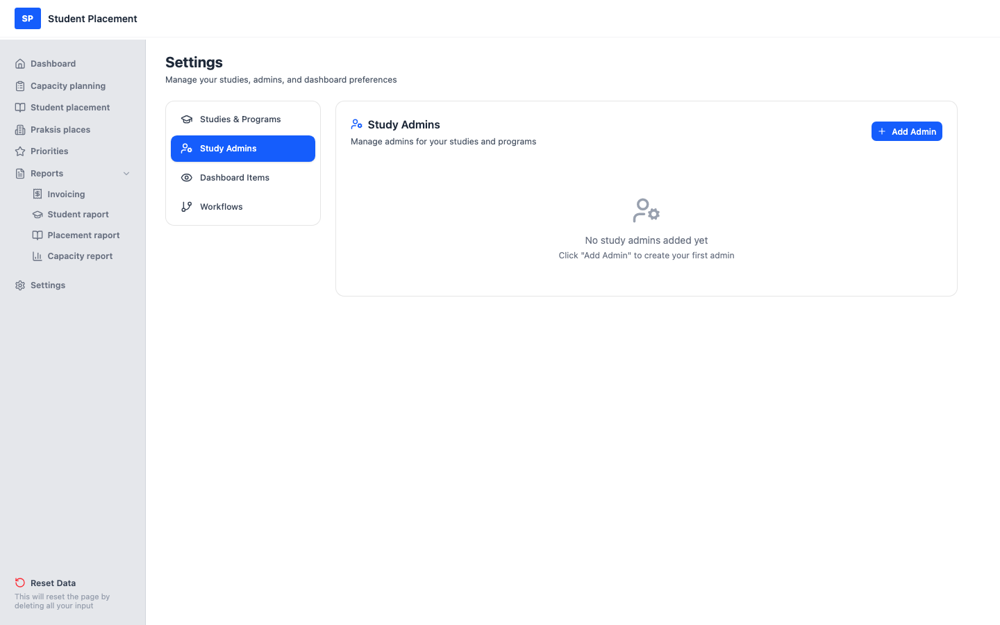
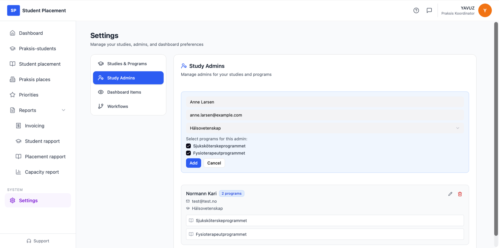
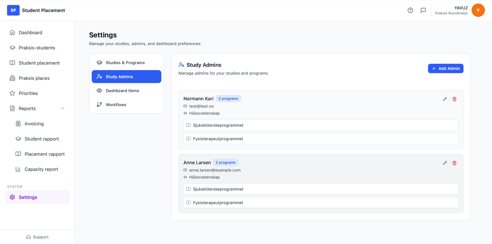

# Testscenario 02 — Inställningar - Studieadministratörer

:::info[Scenarioöversikt]

- **Sida:** Inställningar → Studieadministratörer
- **Roll:** Placeringskoordinator (PK)
- **Mål:** Skapa en studieadministratör från ett tomt utgångsläge och tilldela hen en studie och dess program.
- **Förutsättning:** Minst en studie med program finns (skapa en först med *Testscenario 01*). Inga studieadministratörer är definierade ännu.

:::

## Vad den här sidan är

**Studieadministratörer** (under Inställningar) är där du ger personer administrativt ansvar för en
 studie och ett eller flera av dess program. Varje administratör har ett namn, en e-postadress, en enda **studie** och en uppsättning
 **program** inom den studien.

---

## Steg

### 1. Börja på Instrumentpanelen

Efter inloggningen hamnar du på **Instrumentpanelen**.

<figure>

<figcaption>Utgångspunkt — Instrumentpanelen</figcaption>

</figure>

### 2. Öppna Inställningar → Studieadministratörer (tom)

Klicka på **Inställningar** i sidofältet och välj sedan **Studieadministratörer**. Sidan är tom:
 *"Inga studieadministratörer har lagts till än — klicka på ”Lägg till administratör” för att skapa din första administratör."*

<figure>

<figcaption>Studieadministratörer — tomt utgångsläge</figcaption>

</figure>

### 3. Lägg till en administratör

Klicka på **Lägg till administratör** (uppe till höger) och fyll i formuläret:

1.  Ange administratörens **namn** — här `Anne Larsen`.
2.  Ange administratörens **e-postadress** — här `anne.larsen@moso.no`.
3.  Välj en **studie** i rullgardinsmenyn (t.ex. *Helse-, sosial og idrettsfag*).
4.  Bocka för de **program** som administratören ansvarar för — här **Nursing** och **Physiotherapy**.
5.  Klicka på **Lägg till**.

<figure>

<figcaption>Lägg till administratör — namn, e-post, studie och program valda</figcaption>

</figure>

---

## Slutresultat

Den nya administratören visas i listan med en etikett för **antal program**, sin e-postadress, studien och de
 program som hen ansvarar för.

<figure>

<figcaption>Slutläge — Anne Larsen skapad med 2 program</figcaption>

</figure>

## Anteckningar

-   **Studieadministratörer kan bara se data för valda studier**

---

<ScenarioFeedback scenarioId="TS-02-study-admins" />
