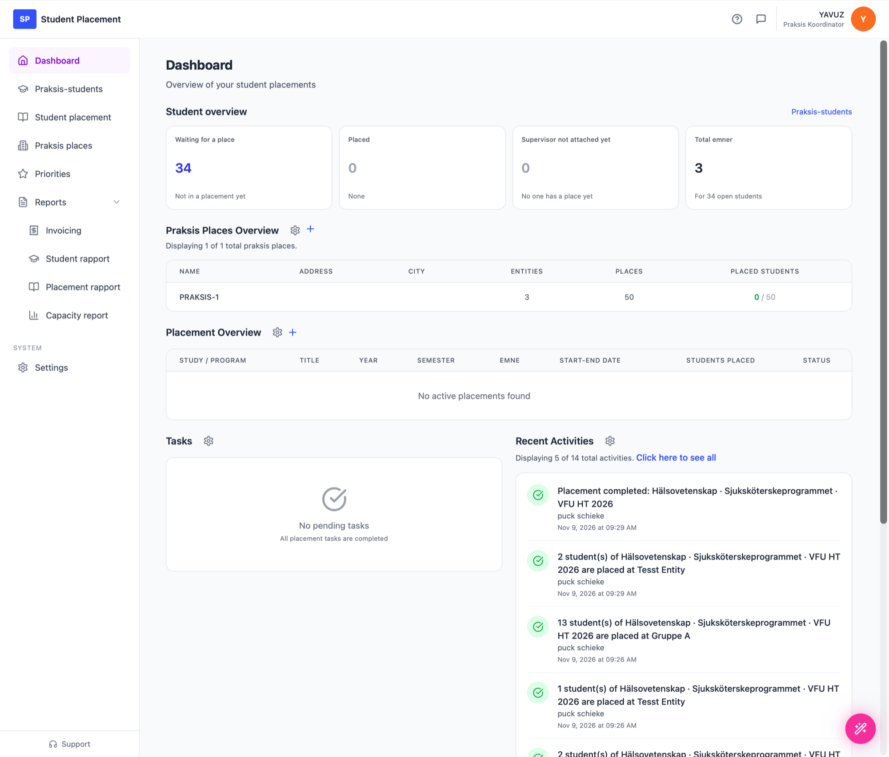
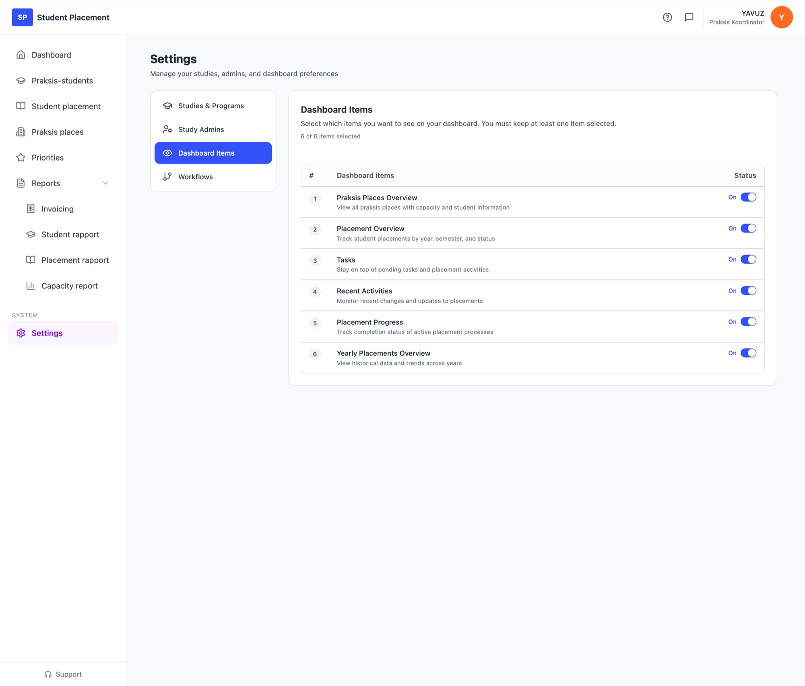
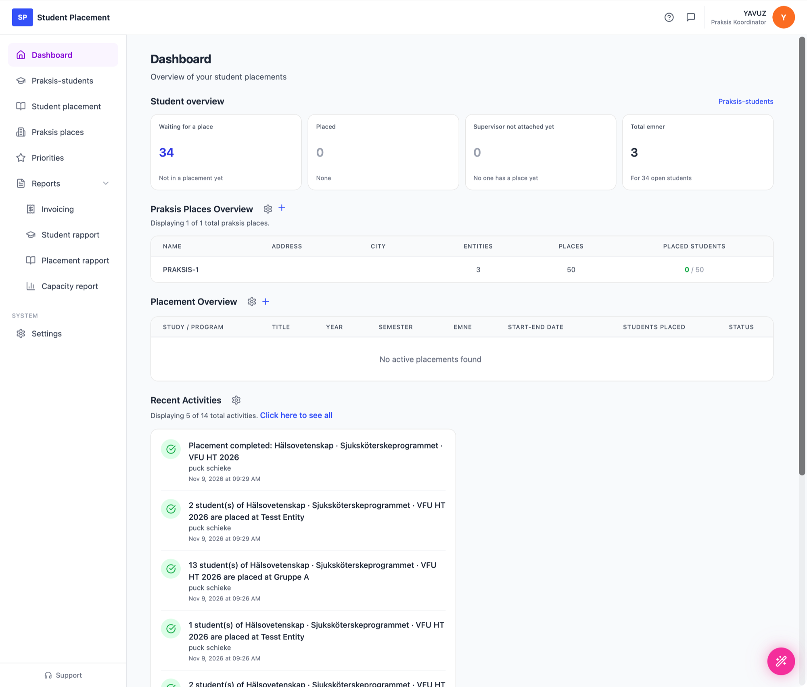
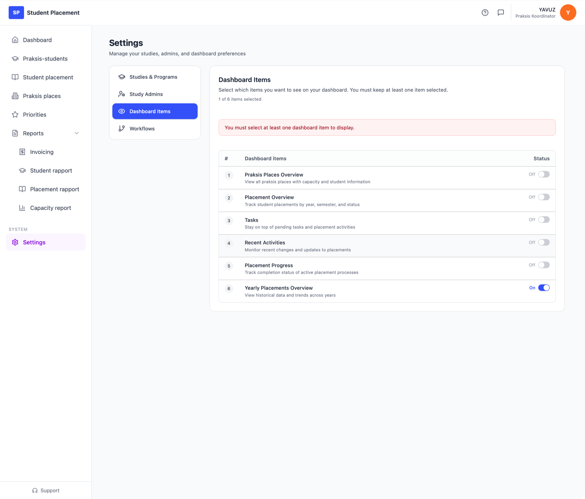

# Testscenario 03 — Inställningar - Instrumentpanelselement

:::info[Scenarioöversikt]

- **Sida:** Inställningar → Instrumentpanelselement
- **Roll:** Placeringskoordinator (PK)
- **Mål:** Välj vilka widgetar som ska visas på Instrumentpanelen och bekräfta att Instrumentpanelen uppdateras.

:::

## Vad den här sidan är

**Instrumentpanelselement** (under Inställningar) styr vilka widgetar som visas på din Instrumentpanel.
 Det finns sex element: **Översikt över praktikplatser**, **Placeringsöversikt**, **Uppgifter**,
 **Senaste aktiviteter**, **Placeringsförlopp** och **Årlig placeringsöversikt**. Korten i
 **Studentöversikt** högst upp på Instrumentpanelen visas alltid. Att slå på eller av ett element träder i
 kraft **omedelbart** — det finns ingen separat sparning. Minst ett element måste förbli påslaget.

---

## Steg

### 1. Börja på Instrumentpanelen

Notera vilka widgetar som visas just nu — bland annat widgeten **Uppgifter**.

<figure>

<figcaption>Instrumentpanel före — widgeten Uppgifter är synlig</figcaption>

</figure>

### 2. Öppna Inställningar → Instrumentpanelselement

Klicka på **Inställningar** i sidofältet och sedan på **Instrumentpanelselement**. Elementen visas i en
 numrerad tabell med en kort beskrivning och ett **På/Av**-reglage i kolumnen **Status**. Ovanför tabellen
 visar en räknare hur många element som är påslagna (t.ex. *6 av 6 element valda*).

<figure>

<figcaption>Instrumentpanelselement — nuvarande urval</figcaption>

</figure>

### 3. Stäng av ett element

Klicka på reglaget för **Uppgifter**. Statusen ändras till **Av**, räknaren sjunker till *5 av 6 element
 valda* och bekräftelsen *"Inställningarna för instrumentpanelen har sparats"* visas. Ändringen sparas
 direkt.

<figure>

<figcaption>Uppgifter avstängd — 5 av 6 element valda</figcaption>

</figure>

### 4. Bekräfta på Instrumentpanelen

Gå tillbaka till **Instrumentpanelen** — widgeten **Uppgifter** visas inte längre.

<figure>

<figcaption>Instrumentpanel efter — widgeten Uppgifter är borta</figcaption>

</figure>

För att visa den igen slår du på **Uppgifter** under Inställningar → Instrumentpanelselement.

---

## Validering — minst ett element

Du kan inte dölja alla widgetar. När bara ett element är påslaget blockeras försöket att stänga av det,
 och ett rött meddelande visas: *"Du måste välja minst ett instrumentpanelselement att visa."*

<figure>

<figcaption>Det sista elementet kan inte stängas av</figcaption>

</figure>

## Tips — visningsinställningar för widgetar

De flesta widgetar på Instrumentpanelen har en egen **kugghjulsikon**. Den öppnar **Visningsinställningar**
 för widgeten — till exempel hur många poster som ska visas (widgeten **Uppgifter** erbjuder *3*, *5* eller
 *10 uppgifter*). Den döljer inte widgeten; använd Instrumentpanelselement för det.

---

<ScenarioFeedback scenarioId="TS-03-dashboard-items" />
