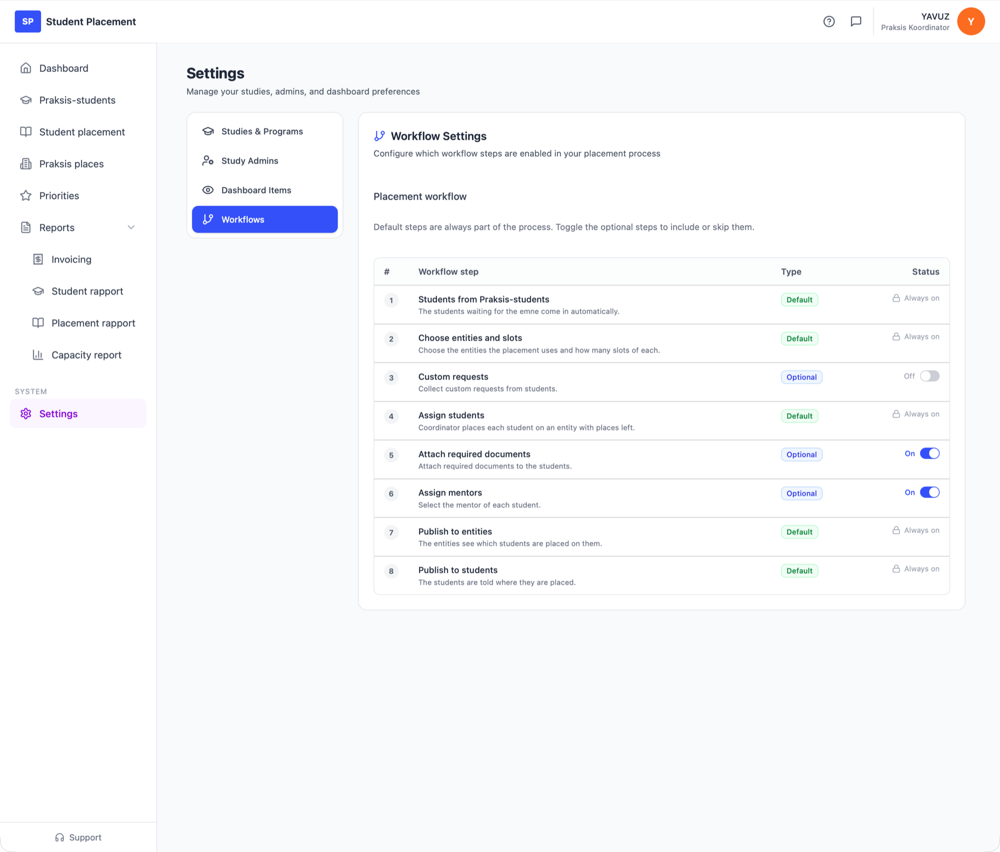
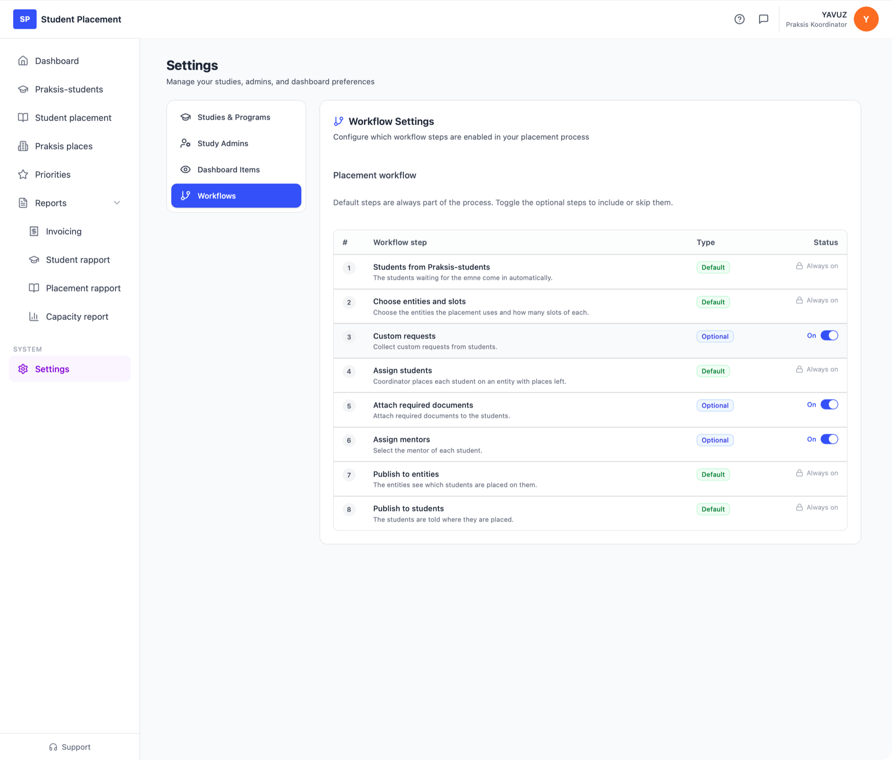

# Testscenario 03b — Inställningar - Arbetsflöden

:::info[Scenarioöversikt]

- **Sida:** Inställningar → Arbetsflöden
- **Roll:** Placeringskoordinator (PK)
- **Mål:** Förstå stegen i placeringsarbetsflödet och slå på eller av ett valfritt steg.

:::

## Vad den här sidan är

**Arbetsflöden** (under Inställningar) — med rubriken **Arbetsflödesinställningar** — styr vilka steg som
 är aktiverade i din placeringsprocess. Tabellen **Placeringsarbetsflöde** listar alla steg i ordning med
 **Typ** och **Status**:

- **Standard**-steg ingår alltid i processen. De visar ett lås och *Alltid på* och kan inte stängas av.
- **Valfria** steg har ett **På/Av**-reglage, så att du kan ta med eller hoppa över dem.

| # | Arbetsflödessteg | Vad det gör | Typ |
|---|---|---|---|
| 1 | **Studenter från Praksis-studenter** | Studenterna som väntar på emnet kommer in automatiskt. | Standard |
| 2 | **Välj enheter och platser** | Välj vilka enheter placeringen använder och hur många platser från varje. | Standard |
| 3 | **Egna önskemål** | Samla in egna önskemål från studenterna. | Valfritt |
| 4 | **Tilldela studenter** | Koordinatorn placerar varje student på en enhet med lediga platser. | Standard |
| 5 | **Bifoga obligatoriska dokument** | Bifoga obligatoriska dokument till studenterna. | Valfritt |
| 6 | **Tilldela handledare** | Välj handledare för varje student. | Valfritt |
| 7 | **Publicera till enheter** | Enheterna ser vilka studenter som är placerade hos dem. | Standard |
| 8 | **Publicera till studenter** | Studenterna får veta var de är placerade. | Standard |

:::warning

De här inställningarna gäller din placeringsprocess, inte en enskild placering. Ändra dem bara när du
 avser det — och om du slår på ett steg bara för att prova, stäng av det igen efteråt.

:::

---

## Steg

### 1. Öppna Inställningar → Arbetsflöden

Klicka på **Inställningar** i sidofältet och välj fliken **Arbetsflöden**. Granska aktuell status för de
 tre valfria stegen — här är **Egna önskemål** **Av**, medan **Bifoga obligatoriska dokument** och
 **Tilldela handledare** är **På**.

<figure>

<figcaption>Arbetsflödesinställningar — 8 steg; Egna önskemål är valfritt och av</figcaption>

</figure>

### 2. Slå på ett valfritt steg

Klicka på reglaget för **Egna önskemål**. Statusen ändras till **På** och bekräftelsen
 *"Arbetsflödesinställningen har sparats"* visas. Det finns ingen separat spara-knapp.

<figure>

<figcaption>Egna önskemål är nu på</figcaption>

</figure>

### 3. Stäng av det igen (valfritt)

Klicka på samma reglage igen för att återställa **Egna önskemål** till **Av**. Bekräftelsen
 *"Arbetsflödesinställningen har sparats"* visas igen.

---

## Slutresultat

Tabellen **Placeringsarbetsflöde** visar ditt val för varje valfritt steg. Standardstegen förblir
 *Alltid på*.

---

<ScenarioFeedback scenarioId="TS-03b-workflows" />
