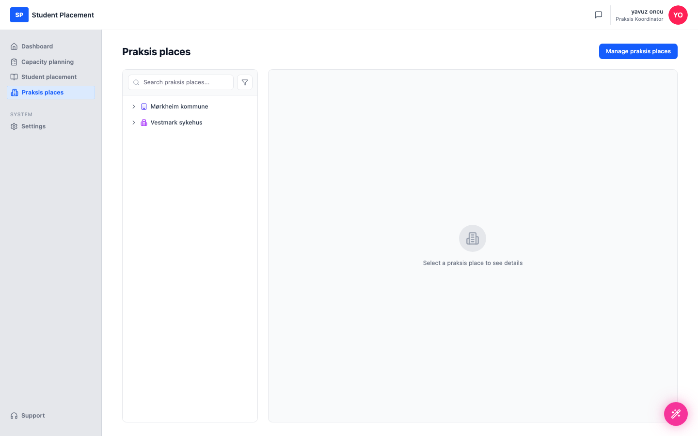
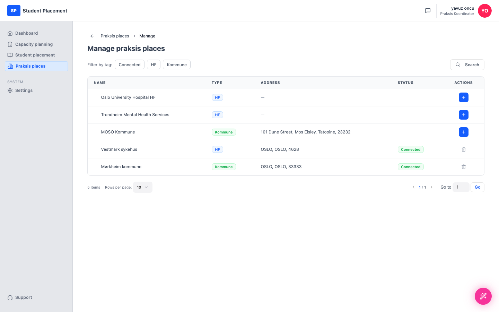
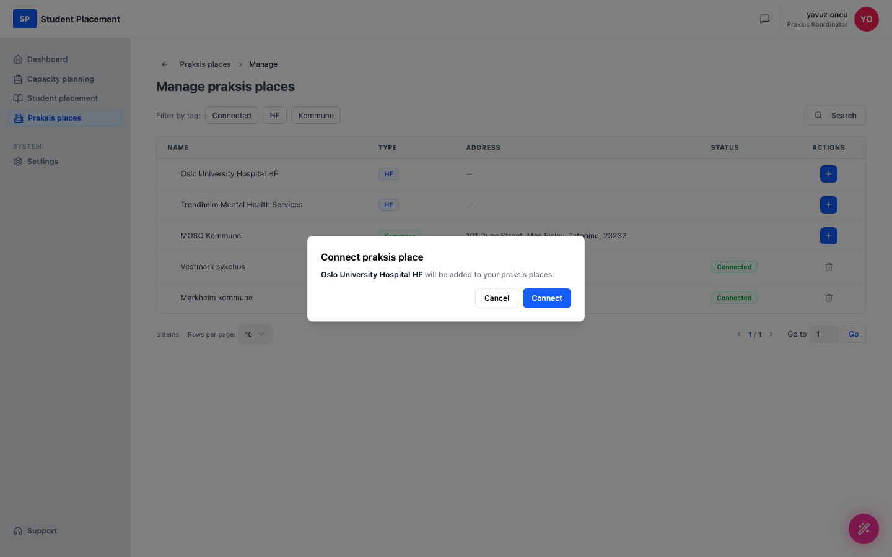
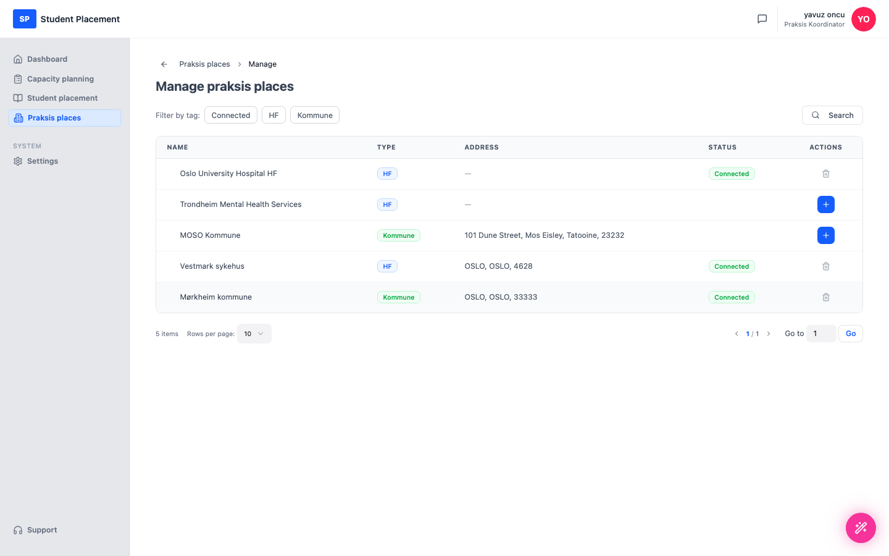

# Testscenario 04 — Anslut en praktikplats till UH

:::info[Scenarioöversikt]

- **Miljö:** Live — sp.mosoinpraxis.com/praksis-places
- **Roll:** Praksis Koordinator
- **Mål:** Anslut en tillgänglig praktikplats till din organisation.

:::

## Vad den här sidan är

Sidan **Praktikplatser** listar de platser som är anslutna till din organisation. **Hantera praktikplatser**
 öppnar hela katalogen, där du kan **ansluta** (lägga till) en plats till din organisation eller ta bort en.

---

## Steg

### 1. Öppna Praktikplatser

Klicka på **Praktikplatser** i sidofältet efter att du loggat in.

<figure>

<figcaption>Praktikplatser — för närvarande anslutna platser</figcaption>

</figure>

### 2. Öppna Hantera praktikplatser

Klicka på **Hantera praktikplatser** (uppe till höger) för att öppna katalogen. Anslutna platser visar en
 Ansluten-etikett; platser du kan lägga till visar ett blått **+** i kolumnen Åtgärder.

<figure>

<figcaption>Hantera praktikplatser — hela katalogen med åtgärder för att ansluta/ta bort</figcaption>

</figure>

### 3. Lägg till en praktikplats (första +)

Klicka på det första **+** i kolumnen Åtgärder (här på **Oslo University Hospital HF**). En bekräftelsedialog
 visas: *"Oslo University Hospital HF läggs till bland dina praktikplatser."*

<figure>

<figcaption>Anslutningsdialog — bekräfta att platsen läggs till</figcaption>

</figure>

### 4. Klicka på Anslut

Klicka på **Anslut** i dialogen för att bekräfta.

---

## Slutresultat

Praktikplatsen läggs till i din organisation — dess rad visar nu Ansluten-etiketten
 och **+** har ersatts av en borttagningsåtgärd (papperskorg).

<figure>

<figcaption>Slutläge — Oslo University Hospital HF är nu Ansluten</figcaption>

</figure>

## Anteckningar för testare

-   Använd chippen **Filtrera efter tagg** (Ansluten / HF / Kommune) eller **Sök** för att hitta en plats.
-   För att ångra använder du **papperskorgsikonen** på en ansluten rad för att koppla bort platsen.
-   Inloggningen är lösenordsfri: begär en kod via e-post och ange den 6‑siffriga koden.

---

<ScenarioFeedback scenarioId="TS-04-connect-praksis-place" />
