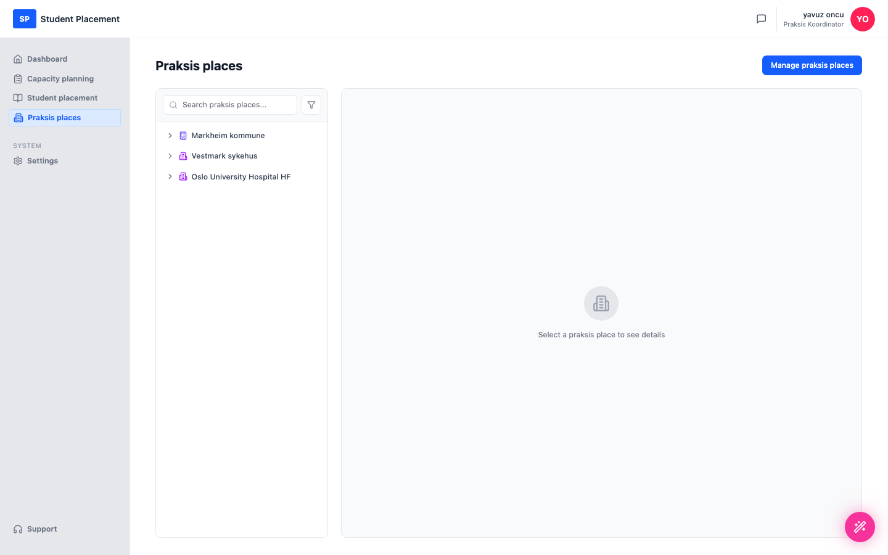
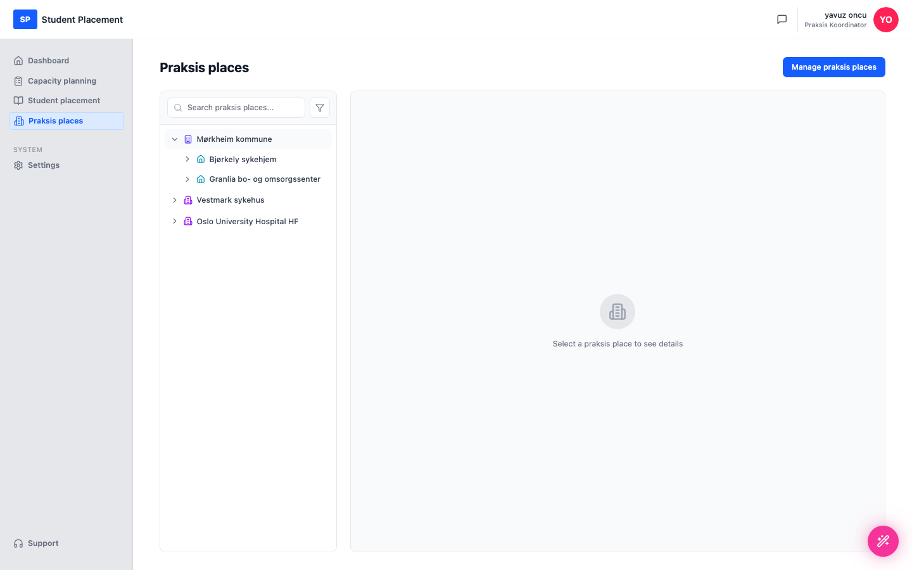
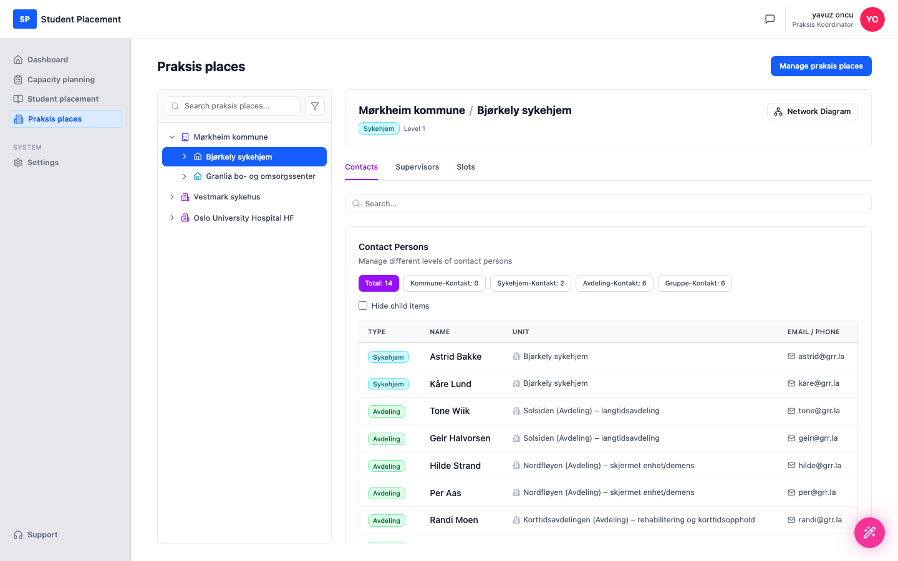
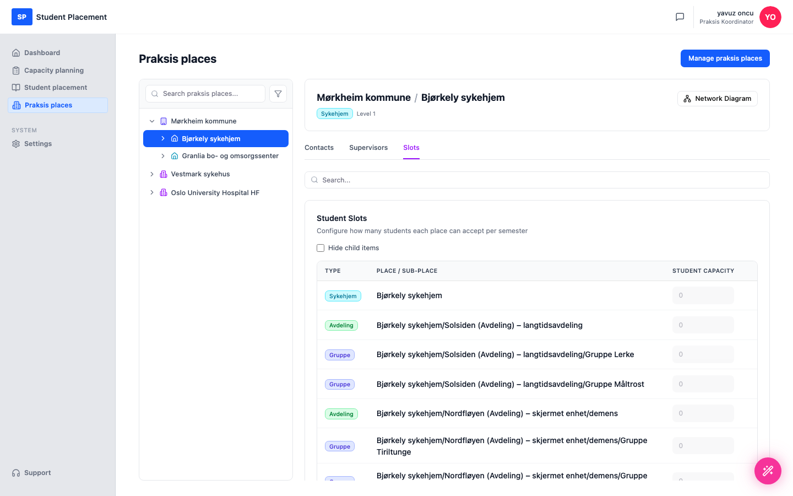

# Testscenario 05 — Utforska en praktikplats

:::info[Scenarioöversikt]

- **Miljö:** Live — sp.mosoinpraxis.com/praksis-places
- **Roll:** Praksis Koordinator
- **Mål:** Bläddra i en praktikplats organisationsträd och granska en enhets kontakter, handledare och studentplatser.
- **Förutsättning:** Inloggad (lösenordsfri e-postinloggning). Minst en praktikplats är ansluten till din organisation.

:::

## Vad den här sidan är

Sidan **Praktikplatser** har ett navigerbart **organisationsträd** till vänster (platser → underplatser →
 avdelningar → grupper). När du väljer en enhet visas dess detaljer till höger i tre flikar:
 **Kontakter**, **Handledare** och **Platser** (studentkapacitet).

---

## Steg

### 1. Öppna Praktikplatser

Klicka på **Praktikplatser** i sidofältet. Vänsterkolumnen listar de anslutna platserna, som alla kan fällas ut.

<figure>

<figcaption>Praktikplatser — organisationsträdet (till vänster)</figcaption>

</figure>

### 2. Fäll ut en praktikplats

Klicka på pilen vid den första platsen (**Mørkheim kommune**) för att fälla ut dess enheter — här
 **Bjørkely sykehjem** och **Granlia bo- og omsorgssenter**.

<figure>

<figcaption>Mørkheim kommune utfälld — dess underplatser visas</figcaption>

</figure>

### 3. Välj en enhet → Kontakter

Klicka på en enhet i trädet — här **Bjørkely sykehjem**. Den högra panelen öppnas på
 fliken **Kontakter**.

<figure>

<figcaption>Kontakter — kontaktpersoner per nivå (Kommune / Sykehjem / Avdeling / Gruppe), med totalsummor</figcaption>

</figure>

**Kontakter** listar de kontaktpersoner som är knutna till varje organisationsnivå, med ett antal per nivå
 (t.ex. *Totalt 14*), enhet samt e-post/telefon. *Dölj underelement* begränsar visningen till enbart den valda enheten.

### 4. Handledare

Byt till fliken **Handledare** för att se enhetens handledare och deras
 studenttilldelningar, med räknare för status (*Active / Inactive / With students*).

<figure>

<figcaption>Handledare — handledare, deras enhet, status och tilldelade studenter</figcaption>

</figure>

### 5. Platser

Byt till fliken **Platser** för att granska den **studentkapacitet** som är konfigurerad för platsen och var och en
 av dess underplatser per termin.

<figure>

<figcaption>Platser — studentkapacitet per plats/underplats</figcaption>

</figure>

---

<ScenarioFeedback scenarioId="TS-05-explore-praksis-place" />
