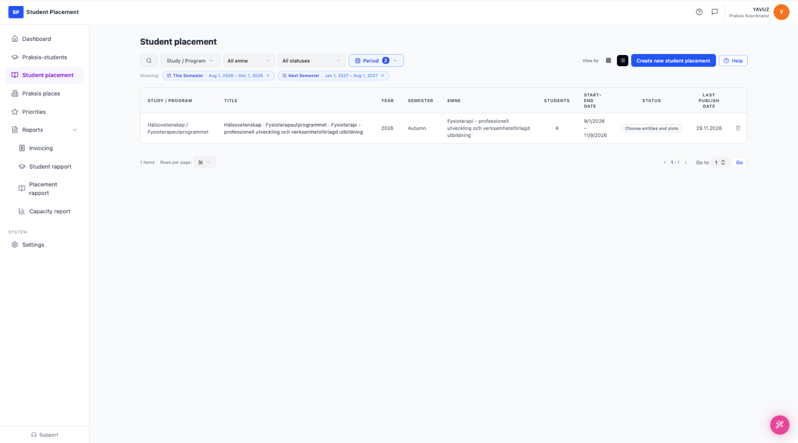
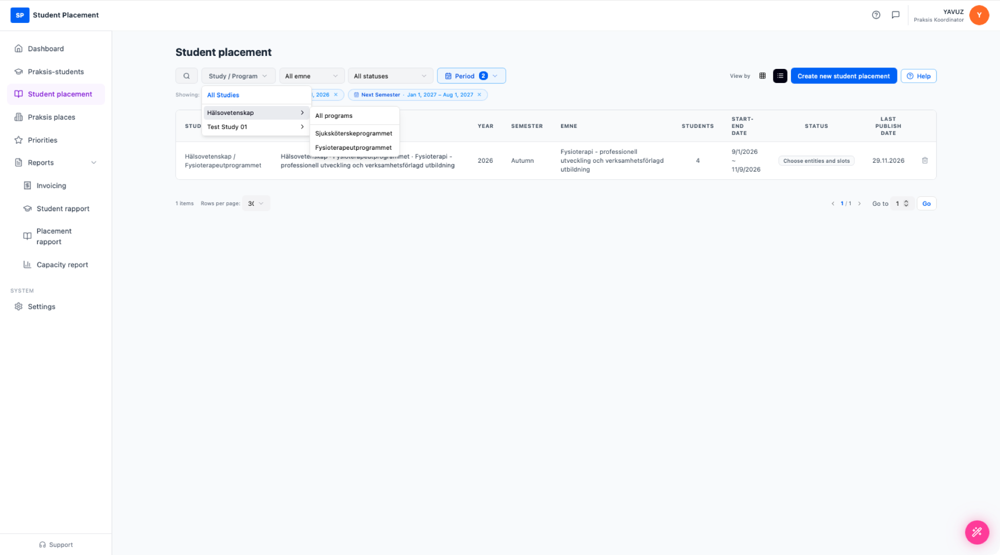
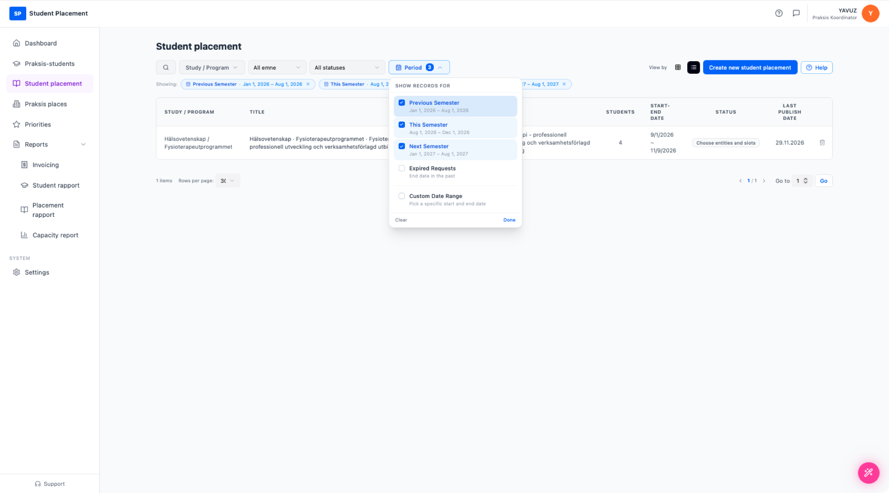
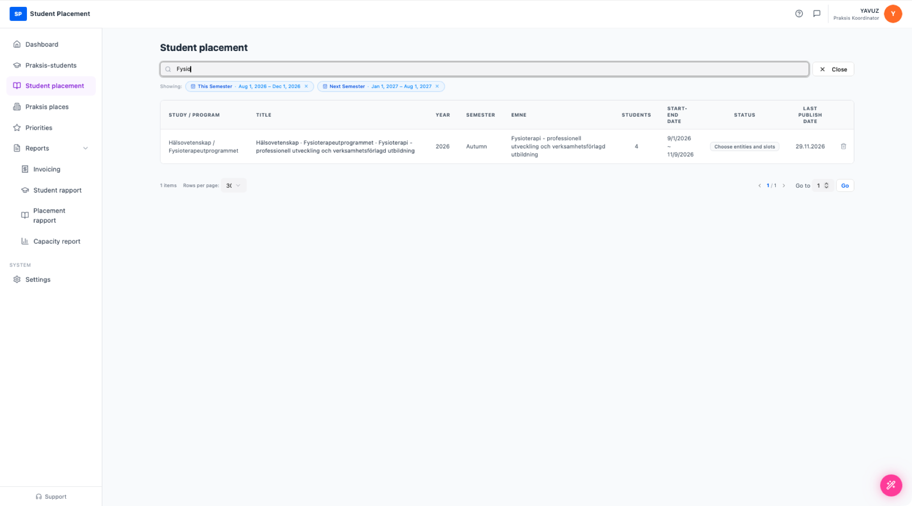
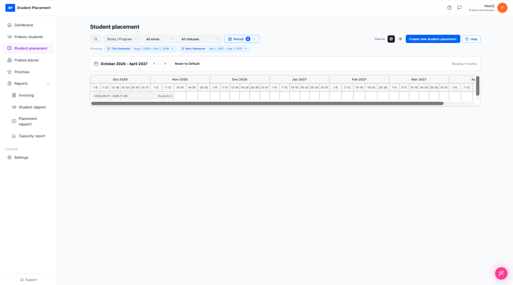

# Testscenario 07 — Studentplacering - Översikt

:::info[Scenarioöversikt]

- **Sida:** Studentplacering
- **Roll:** Placeringskoordinator (PK)
- **Mål:** Lär känna sidan Studentplacering — kolumnerna, filtren, periodväljaren, de två *Visa som*-lägena och de andra åtgärderna.
- **Förutsättning:** Inloggad som PK. Den här genomgången använder den befintliga placeringen **Hälsovetenskap · Fysioterapeutprogrammet · Fysioterapi - professionell utveckling och verksamhetsförlagd utbildning** (hösten 2026, 4 studenter).

:::

## Vad den här sidan är

**Studentplacering** visar alla dina placeringar. En placering tar studenterna som väntar på ett emne (från
 *Praksis-studenter*) genom placeringsarbetsflödet tills de är placerade och publicerade. Från den här sidan
 hittar, filtrerar och öppnar du placeringar och startar nya.

### Verktygsfält

| Kontroll | Vad den gör |
|---|---|
| **Sök** (förstoringsglas) | Öppnar ett sökfält — *sök placeringar efter titel* — som ersätter verktygsfältet tills du klickar på **Stäng**. |
| **Studie / Program** | Meny i två nivåer: **Alla studier**, eller håll över en studie och välj **Alla program** eller ett program. |
| **Alla emnen** | Begränsar listan till ett emne. |
| **Alla statusar** | Begränsar listan till placeringar i ett arbetsflödessteg (se *Status* nedan). |
| **Period** | Väljer vilka tidsperioder som visas; märket visar hur många som är aktiva. |
| **Visa som** | Växlar mellan **Kalendervy** (rutnätsikon) och **Tabellvy** (listikon). |
| **Skapa ny studentplacering** | Startar en ny placering (*steg 1 av 7*). Beskrivs i nästa scenario. |
| **Hjälp** | Öppnar hjälpcentret i en ny flik. |

Under verktygsfältet visar **Visar:** de aktiva perioderna som brickor (t.ex. *This Semester · Aug 1, 2026 –
 Dec 1, 2026*). Klicka på **×** på en bricka för att ta bort perioden.

### Kolumner (tabellvy)

| Kolumn | Innehåll |
|---|---|
| **Studie / Program** | Studien och programmet placeringen hör till. |
| **Titel** | Placeringens titel — som standard byggd av *studie · program · emne*. |
| **År** / **Termin** | När placeringen pågår (t.ex. *2026*, *Autumn*). |
| **Emne** | Emnet som studenterna placeras för. |
| **Studenter** | Antal studenter i placeringen. |
| **Start–slutdatum** | Placeringsperioden (t.ex. *9/1/2026 ~ 11/9/2026*). |
| **Status** | Arbetsflödessteget placeringen befinner sig i (t.ex. *Välj enheter och platser*). |
| **Sista publiceringsdatum** | *Sista publiceringsdatum* som angavs när placeringen skapades. |
| *(papperskorgsikon)* | Tar bort placeringen. |

Klicka var som helst på en rad för att öppna placeringen. Under tabellen ser du antal poster, **Rader per
 sida** och sidnavigering (**Gå till** ett sidnummer).

### Status

Filtret **Alla statusar** visar stegen en placering kan befinna sig i: *Studenter från Praksis-studenter*,
 *Välj enheter och platser*, *Första publicering*, *Koppla praktikplatser till studenterna*, *Bifoga
 obligatoriska dokument*, *Tilldela handledare till studenterna*, *Publicera till enheter*, *Publicera till
 studenter* och *Slutförd*. Vilka valfria steg som används ställs in under *Inställningar → Arbetsflöden*
 (se *Testscenario 03b*).

---

## Steg

### 1. Öppna Studentplacering

Klicka på **Studentplacering** i sidofältet. Sidan öppnas i **Tabellvy** med standardperioderna
 **This Semester** och **Next Semester** (Period-märket *2*). Här visas en placering, med status
 **Välj enheter och platser**.

<figure>

<figcaption>Studentplacering — verktygsfält, aktiva perioder och placeringstabellen</figcaption>

</figure>

### 2. Filtrera på studie och program

Klicka på **Studie / Program** och håll över **Hälsovetenskap**. En undermeny visar **Alla program**,
 **Sjuksköterskeprogrammet** och **Fysioterapeutprogrammet** — klicka på ett för att filtrera listan. Använd
 **Alla emnen** och **Alla statusar** på samma sätt för att begränsa ytterligare.

<figure>

<figcaption>Studie / Program — välj en studie, sedan alla eller ett av dess program</figcaption>

</figure>

### 3. Välj period

Klicka på **Period**. Under **Visa poster för** kan du markera:

- **Föregående termin**, **Denna termin**, **Nästa termin** — med sina datumintervall;
- **Utgångna** — placeringar vars *slutdatum har passerat*;
- **Anpassat datumintervall** — välj ett **Från**- och **Till**-datum (*båda datumen måste väljas innan
  filtret används*). Ett anpassat intervall stänger av de andra valen.

Varje val läggs till som en bricka under **Visar:**. Klicka på **Klar** för att stänga menyn; **Rensa** tar
 bort alla perioder — då visas inga placeringar förrän du väljer en period igen.

<figure>

<figcaption>Period — föregående termin tillagd till de två standardterminerna</figcaption>

</figure>

### 4. Sök på titel

Klicka på **förstoringsglaset**. Verktygsfältet ersätts av ett sökfält — skriv en del av en titel, här
 `Fysio`. Listan visar de matchande placeringarna inom de aktiva perioderna. Klicka på **Stäng** för att få
 tillbaka verktygsfältet.

<figure>

<figcaption>Sök placeringar efter titel</figcaption>

</figure>

### 5. Byt till kalendervy

Under **Visa som** klickar du på **rutnäts**-ikonen. Varje placering ritas som en stapel över de månader den
 pågår, med datum och antal studenter (*2026-09-01 ~2026-11-09 · Students 4*). Rubriken visar det synliga
 intervallet (*October 2026 - April 2027*, *7 månader*); använd **‹ ›** för att flytta och **Återställ** för
 att gå tillbaka. Klicka på **list**-ikonen för att återgå till **Tabellvy**.

<figure>

<figcaption>Kalendervy — placeringar på en månadstidslinje</figcaption>

</figure>

---

## Slutresultat

Koordinatorn vet hur placeringstabellen läses, hur den begränsas på studie/program, emne, status, period och
 titel, hur man växlar mellan tabell- och kalendervy, och var en ny placering startas.

## Anteckningar

-   Filtren och perioden verkar tillsammans — om en placering saknas, kontrollera först brickorna under **Visar:**.
-   Att skapa en placering (**Skapa ny studentplacering**) beskrivs i nästa scenario.

---

<ScenarioFeedback scenarioId="TS-07-student-placement-overview" />
