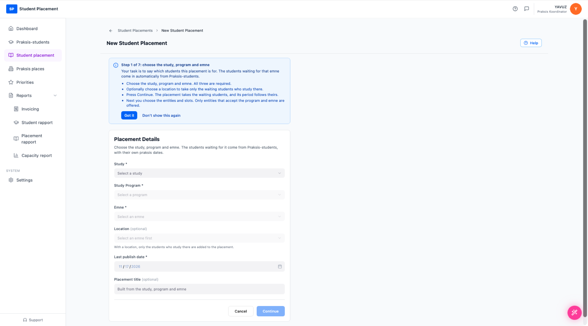
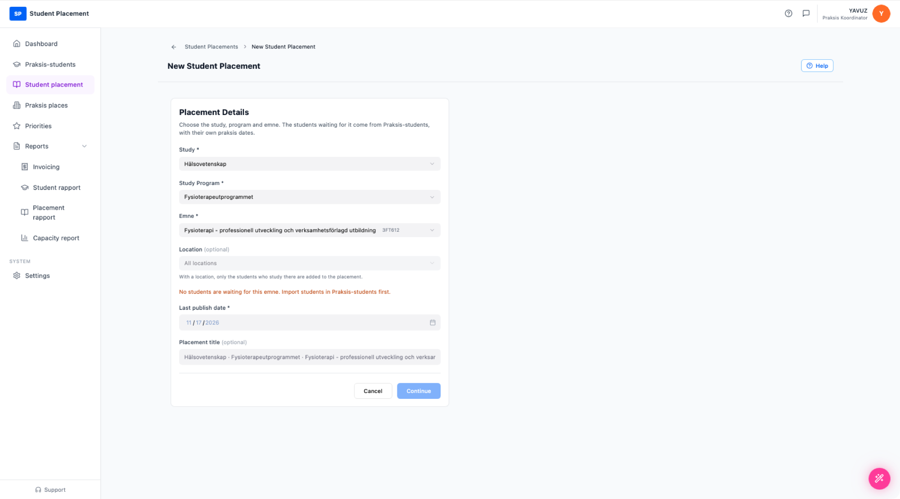
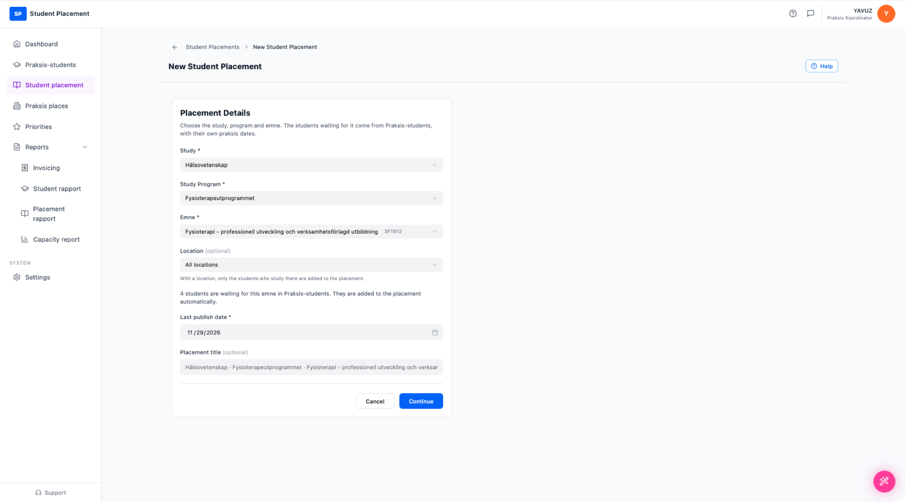

# Testscenario 08 — Studentplacering - Skapa

:::info[Scenarioöversikt]

- **Sida:** Studentplacering → Ny studentplacering
- **Roll:** Placeringskoordinator (PK)
- **Mål:** Skapa en ny studentplacering för ett emne, så att studenterna som väntar på emnet tas in i den.
- **Förutsättning:** Inloggad som PK. Studenter för emnet väntar i *Praksis-studenter* (se *Testscenario 06*). Den här genomgången använder **Hälsovetenskap → Fysioterapeutprogrammet → Fysioterapi - professionell utveckling och verksamhetsförlagd utbildning (3FT612)**, med 4 väntande studenter.

:::

## Vad den här sidan är

**Ny studentplacering** är *steg 1 av 7* i en placering. Du anger **vilka studenter** placeringen gäller
 genom att välja studie, program och emne — studenterna som väntar på emnet i **Praksis-studenter** läggs
 till automatiskt, och placeringsperioden följer deras praktikdatum. Du lägger inte in studenter eller datum
 för hand.

Formuläret **Placeringsuppgifter** har dessa fält:

| Fält | Anmärkningar |
|---|---|
| **Studie** * | Studien. |
| **Studieprogram** * | Aktiveras när en studie har valts; visar studiens program. |
| **Emne** * | Aktiveras när ett program har valts; visar programmets emnen med kurskod (t.ex. *3FT612*). |
| **Ort** (valfritt) | *Alla orter* som standard. Visar de väntande studenternas orter med antal (t.ex. *Umeå · 4 waiting*). Med en ort läggs bara studenterna som studerar där till i placeringen. |
| **Sista publiceringsdatum** * | Måste vara **i dag eller senare**. |
| **Placeringstitel** (valfritt) | Lämna tomt för att använda titeln byggd av *studie · program · emne*, som visas som platshållare. |

En informationsruta överst förklarar steget. Klicka på **Uppfattat** för att stänga den, eller **Visa inte
 igen** för att dölja den för gott.

---

## Steg

### 1. Öppna Ny studentplacering

På sidan **Studentplacering** (se *Testscenario 07*) klickar du på **Skapa ny studentplacering**. Sidan
 **Ny studentplacering** öppnas med informationsrutan *steg 1 av 7: välj studie, program och emne* och det
 tomma formuläret **Placeringsuppgifter**. **Fortsätt** är inaktiverad tills formuläret är ifyllt.

<figure>

<figcaption>Ny studentplacering — steg 1 av 7 med tomt formulär</figcaption>

</figure>

### 2. Välj studie, program och emne

Välj **Studie** `Hälsovetenskap`, **Studieprogram** `Fysioterapeutprogrammet` och **Emne**
 `Fysioterapi - professionell utveckling och verksamhetsförlagd utbildning` (*3FT612*). Under **Ort** visar
 formuläret nu hur många studenter som väntar: *4 studenter väntar på detta emne i Praksis-studenter. De
 läggs till i placeringen automatiskt.*

:::note[Inga väntande studenter?]

Om alla studenter i emnet redan är i en annan placering — eller ingen har importerats — visar formuläret
 *inga studenter väntar på detta emne; importera studenter i Praksis-studenter först*, och **Fortsätt**
 förblir inaktiverad.

<figure>

<figcaption>Inga studenter väntar på emnet — Fortsätt är inaktiverad</figcaption>

</figure>

:::

### 3. Ort, sista publiceringsdatum och titel

Låt **Ort** stå på **Alla orter** för att ta med alla väntande studenter (här är den enda orten
 *Umeå · 4 waiting*). Välj ett **Sista publiceringsdatum** — här `29.11.2026`; det måste vara i dag eller
 senare. Lämna **Placeringstitel** tom för att använda den föreslagna titeln. **Fortsätt** är nu aktiverad.

<figure>

<figcaption>Placeringsuppgifter ifyllda — 4 studenter väntar, Fortsätt är aktiverad</figcaption>

</figure>

### 4. Klicka på Fortsätt

Klicka på **Fortsätt**. Placeringen skapas och öppnas på sin egen sida:

- **Titel:** *Hälsovetenskap · Fysioterapeutprogrammet · Fysioterapi - professionell utveckling och
  verksamhetsförlagd utbildning*
- **Uppgifter:** *2026 · Autumn · 2026-09-01 - 2026-11-09 · 4 students* — perioden kommer från studenternas
  praktikdatum.
- **Last publish: 29.11.2026** — klicka för att ändra sista publiceringsdatum.
- **Statusmärke:** **2/7 Välj enheter och platser** — placeringen går direkt vidare till steg 2.

<figure>

<figcaption>Placering skapad — nu i steg 2/7, Välj enheter och platser</figcaption>

</figure>

---

## Slutresultat

En ny placering finns för emnet, med de 4 väntande studenterna tillagda automatiskt. Den visas i listan
 **Studentplacering** med status *Välj enheter och platser*, och i **Praksis-studenter** ändras studenterna
 från *Väntar* till *I placering*.

## Anteckningar

-   Studenter som redan är i en placering väntar inte längre och tas därför inte in i en annan placering.
    Använd **Ort** för att skapa en placering för bara en del av de väntande studenterna.
-   Att välja enheter och platser (steg 2) beskrivs i nästa scenario.

---

<ScenarioFeedback scenarioId="TS-08-create-placement" />
