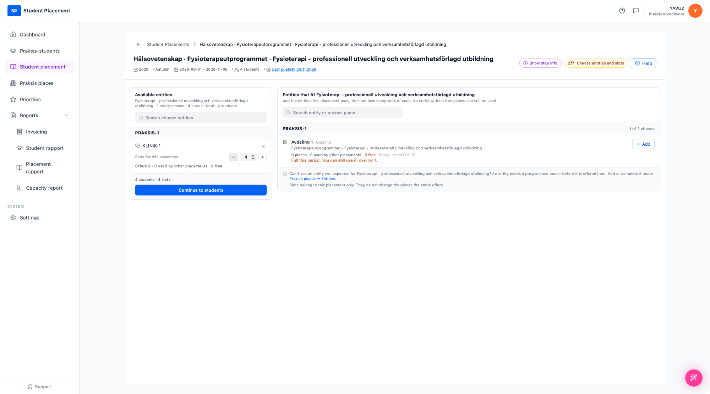
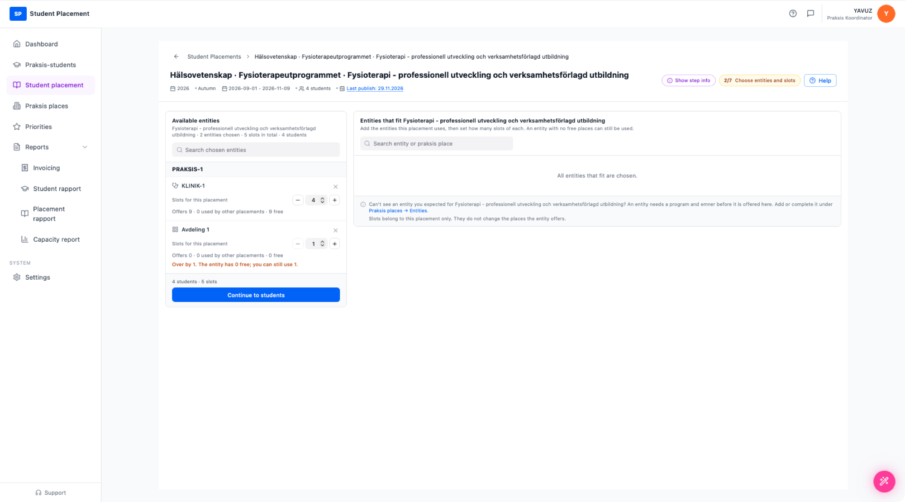
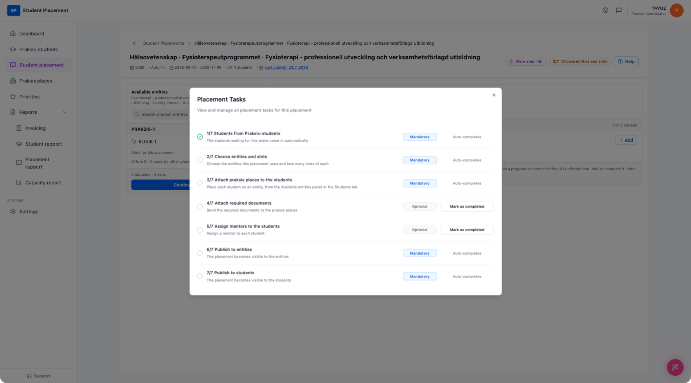

# Testscenario 09 — Studentplacering - Välj enheter och platser

:::info[Scenarioöversikt]

- **Sida:** Studentplacering → *placering* (steg 2/7, *Välj enheter och platser*)
- **Roll:** Placeringskoordinator (PK)
- **Mål:** Välja vilka enheter som tar emot studenter i den här placeringen och hur många platser var och en ger.
- **Förutsättning:** En placering har skapats (se *Testscenario 08*). Den här genomgången fortsätter med **Hälsovetenskap · Fysioterapeutprogrammet · Fysioterapi - professionell utveckling och verksamhetsförlagd utbildning** (4 studenter).

:::

## Vad den här sidan är

Direkt efter att en placering har skapats öppnas den i **steg 2 av 7: välj enheterna för den här
 placeringen**. Sidan har två paneler:

- **Enheter som passar …** (till höger) — alla enheter som tar emot placeringens program och emne, grupperade
  efter praktikställe (t.ex. **PRAKSIS-1** · *0 av 2 valda*). Varje enhet visar typ, program · emne och
  kapacitet: *platser · använda av andra placeringar · lediga* och hur ofta den nollställs (t.ex. *Årligen ·
  nollställs 01-01*). En enhet utan lediga platser visar att den är *full denna period men fortfarande kan
  användas, över med 1*. Använd sökrutan för att hitta en enhet eller ett praktikställe.
- **Tillgängliga enheter** (till vänster) — enheterna du har valt för placeringen, var och en med **Platser
  för den här placeringen** (**−** / antal / **+**) och en ta bort-knapp (**×**). Raden längst ned summerar
  *studenter · platser* och har knappen **Fortsätt till studenter**.

| Begrepp | Betydelse |
|---|---|
| **Places** (enhetens platser) | Det enheten erbjuder totalt, för alla placeringar. |
| **Slots** (placeringens platser) | Hur många av dem den här placeringen använder. De hör bara till den här placeringen och ändrar inte vad enheten erbjuder. |

:::tip

Platserna är vägledande och blockerar aldrig: du kan placera fler studenter än platser, och enheten visar då
 *”over by N”*. Du kan också fortsätta utan enheter och lägga till dem senare med **Ändra enheter**.

:::

Om en enhet du väntar dig saknas behöver den program och emnen först — lägg till eller komplettera den under
 **Praktikställen → Enheter**.

---

## Steg

### 1. Börja i steg 2

Öppna placeringen (eller fortsätt direkt från *Testscenario 08*). Rubriken visar titeln,
 *2026 · Autumn · 2026-09-01 - 2026-11-09 · 4 students*, **Last publish: 29.11.2026** och stegmärket
 **2/7 Välj enheter och platser**. Vänster panel säger att inga enheter har valts ännu. Stäng
 informationsrutan med **Uppfattat** — du kan öppna den igen med **Visa steginfo**.

<figure>

<figcaption>Steg 2 av 7 — enheterna som passar visas till höger</figcaption>

</figure>

### 2. Lägg till en enhet och ange platser

Klicka på **Lägg till** vid **KLINIK-1** (*9 places · 0 used by other placements · 9 free*). Den flyttas till
 **Tillgängliga enheter** och börjar med sina lediga platser (**9**). Klicka på **−** tills platserna är **4** —
 en för varje student. Sammanfattningen visar nu *1 enhet vald · 4 platser totalt · 4 studenter*, och raden
 längst ned *4 studenter · 4 platser*.

<figure>

<figcaption>KLINIK-1 vald — 4 platser för den här placeringen</figcaption>

</figure>

### 3. (Valfritt) Lägg till en enhet utan lediga platser

Klicka på **Lägg till** vid **Avdeling 1** (*0 places · 0 free*). Den läggs till med **1** plats och en
 varning: *över med 1; enheten har 0 lediga men du kan fortfarande använda 1*. Höger panel säger nu att alla
 enheter som passar är valda. Klicka på **×** (*Ta bort Avdeling 1*) för att ta bort den igen — den går
 tillbaka till listan till höger.

<figure>

<figcaption>En enhet utan lediga platser kan fortfarande användas — den visar ”Over by 1”</figcaption>

</figure>

### 4. (Valfritt) Se placeringsuppgifterna

Klicka på stegmärket **2/7 Välj enheter och platser** i rubriken. Dialogen **Placeringsuppgifter** visar alla
 sju stegen med status. Obligatoriska steg *slutförs automatiskt*; valfria steg (*Bifoga obligatoriska
 dokument*, *Tilldela handledare till studenterna*) har knappen **Markera som slutförd**. Stäng dialogen med
 **×**.

<figure>

<figcaption>Placeringsuppgifter — steg 1 är klart, steg 2 pågår</figcaption>

</figure>

### 5. Fortsätt till studenter

Med **KLINIK-1 · 4 platser** vald klickar du på **Fortsätt till studenter**. Placeringen går vidare till
 **3/7 Koppla praktikplatser till studenterna**: vänster panel visar **KLINIK-1** med *4 / 4* lediga platser
 och *0 placerade här*, och tabellen **Studenter** visar de 4 studenterna, alla *inte tilldelade*. Använd
 **Ändra enheter** (överst i vänster panel) för att gå tillbaka och ändra enheter eller platser.

<figure>

<figcaption>Steg 3 av 7 — KLINIK-1 med 4 platser, 4 studenter att placera</figcaption>

</figure>

---

## Slutresultat

Placeringen använder **KLINIK-1** med **4 platser** för de 4 studenterna och är nu i steg **3/7 Koppla
 praktikplatser till studenterna**.

## Anteckningar

-   Att placera studenterna på enheten (steg 3) beskrivs i nästa scenario.

---

<ScenarioFeedback scenarioId="TS-09-choose-entities" />
