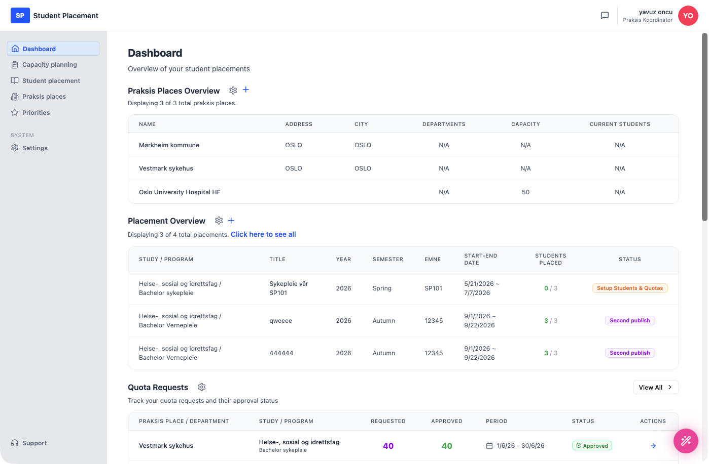
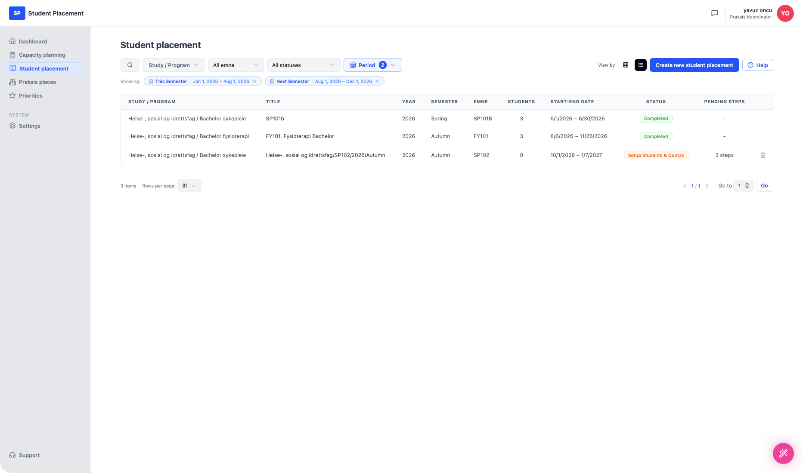
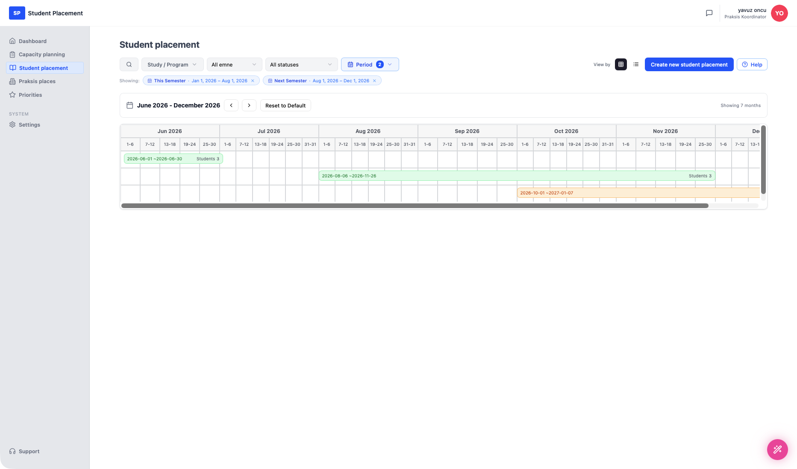
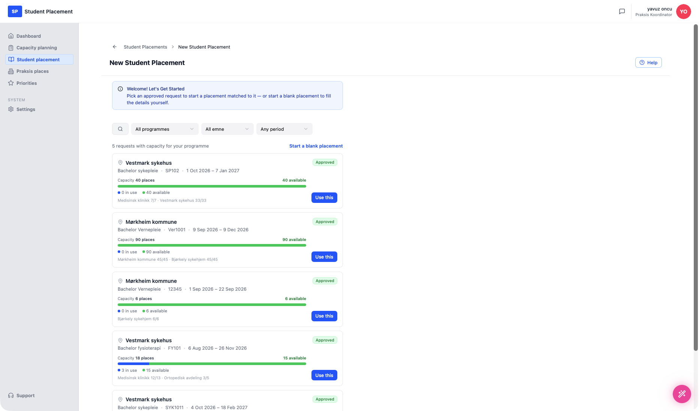
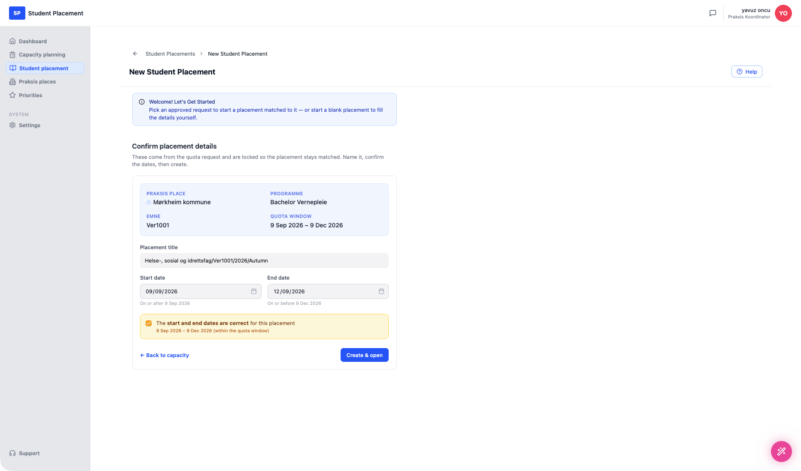
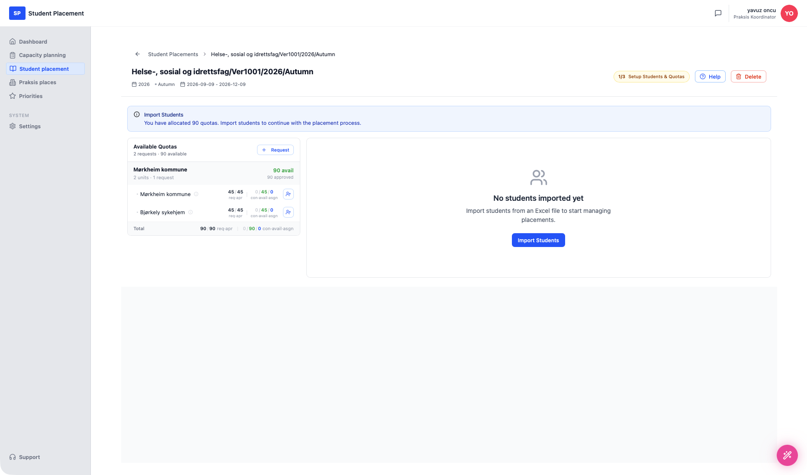

# Testscenario 09 — Student plassering - Skapa

:::info[Scenarioöversikt]

- **Sida:** Student plassering → Ny student plassering
- **Roll:** Placeringskoordinator (PK)
- **Mål:** Skapa en studentplacering från en **godkänd kvotförfrågan**, så att placeringen är kopplad till förfrågan från början.
- **Förutsättning:** Minst en godkänd kvotförfrågan med ledig kapacitet finns (skapad via Kapacitetsplanering). Placeringsformuläret fylls inte längre i manuellt — detaljerna kommer från förfrågan du väljer.

:::

## Vad den här sidan är

**Student plassering** listar alla placeringar för dina program. Överst finns filter (**Studie / program**, **emne**, **status** och en **Period**-väljare — de aktiva perioderna visas som borttagbara chips, t.ex. *This Termin · Jan 1, 2026 – Aug 1, 2026*). **Visa efter**-reglaget växlar mellan två vyer:

- **Tabellvy** — en rad per placering med Studie/program, Titel, År, Termin, Emne, antal Studenter, Start–slutdatum, Status och Väntande steg, plus paginering.
- **Kalendervy** — en tidslinje över månader (t.ex. *June 2026 – December 2026*, "Showing 7 months") där varje placering ritas som en horisontell stapel över sina start–slutdatum, märkt med datumintervall och antal studenter. Pilarna flyttar det synliga fönstret och **Återställ till standard** återställer det.

---

## Steg

### 1. Börja på Instrumentpanelen

<figure>

<figcaption>Utgångspunkt — Instrumentpanelen</figcaption>

</figure>

### 2. Öppna Student plassering

Klicka på **Student plassering** i sidofältet. Listan öppnas i den vy du använde senast — här **tabellvyn**.

<figure>

<figcaption>Student plassering — tabellvy med filter och period-chips</figcaption>

</figure>

Växlar du **Visa efter** till kalendern visas samma placeringar som staplar på en månadstidslinje:

<figure>

<figcaption>Student plassering — kalendervy (placeringar ritade över sina datumintervall)</figcaption>

</figure>

### 3. Klicka på "Skapa ny student plassering"

Sidan **Ny student plassering** öppnas med meddelandet *"Välkommen! Låt oss komma igång — välj en godkänd förfrågan för att starta en placering som är kopplad till den, eller starta en tom placering och fyll i uppgifterna själv."*

Den listar de godkända kvotförfrågningarna med kapacitet för ditt program (här *"5 förfrågningar med kapacitet för ditt program"*), filtrerbara på **program**, **emne** och **period**. Varje kort visar praktikplatsen, programme · emne · period, en **Godkänd**-etikett, en kapacitetsstapel (platser i bruk vs. lediga), fördelningen per enhet och en **Använd den här**-knapp. Du kan också välja **Starta en tom placering** eller **Begär kvot** om inget passar.

<figure>

<figcaption>Ny student plassering — välj en godkänd kvotförfrågan</figcaption>

</figure>

### 4. Välj en kvotförfrågan och klicka på "Använd den här"

Välj den förfrågan du vill basera placeringen på — här **Mørkheim kommune · Bachelor Vernepleie · Ver1001 · 9 Sep 2026 – 9 Dec 2026** (90 lediga platser) — och klicka på **Använd den här**.

### 5. Bekräfta placeringsdetaljerna och skapa

Steget **Bekräfta placeringsuppgifter** visas: *"Dessa hämtas från kvotförfrågan och är låsta så att placeringen förblir kopplad. Ge den ett namn, bekräfta datumen och skapa den."*

- **Praktikplats**, **Program**, **Emne** och **Kvotfönster** visas skrivskyddade.
- **Placeringstitel** är förifylld (här `Helse-, sosial og idrettsfag/Ver1001/2026/Autumn`) och kan redigeras.
- **Startdatum** och **Slutdatum** är förifyllda med kvotfönstret och måste hålla sig inom det (*"Den 9 sep 2026 eller senare"* / *"Den 9 dec 2026 eller tidigare"*).

Bocka i **"Start- och slutdatumen är korrekta för den här placeringen"** — den bekräftar *9 Sep 2026 – 9 Dec 2026 (inom kvotfönstret)* — och klicka på **Skapa och öppna**.

<figure>

<figcaption>Bekräfta placeringsuppgifter — låsta förfrågningsdata, förifyllda datum, bekräftelseruta</figcaption>

</figure>

---

## Slutresultat

Placeringen skapas och öppnas på sin detaljsida: **Helse-, sosial og idrettsfag/Ver1001/2026/Autumn** (2026 · Höst · 2026-09-09 – 2026-12-09) med status **1/3 Ställ in studenter och kvoter**. Eftersom den skapades från förfrågan visar panelen **Tillgängliga kvoter** till vänster redan den kopplade förfrågan — **Mørkheim kommune** med sina enheter (Mørkheim kommune 45/45, Bjørkely sykehjem 45/45, totalt 90 lediga). Höger kolumn uppmanar dig att **Importera studenter**.

Scenariot slutar här — import av studenter täcks i nästa scenario.

<figure>

<figcaption>Efter Skapa och öppna — kopplade kvoter till vänster, Importera studenter-uppmaning till höger</figcaption>

</figure>

---

<ScenarioFeedback scenarioId="TS-09-create-placement" />
