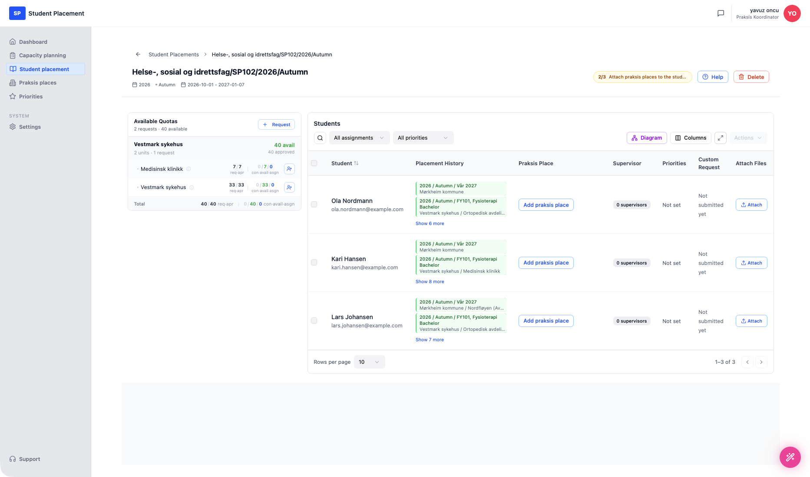
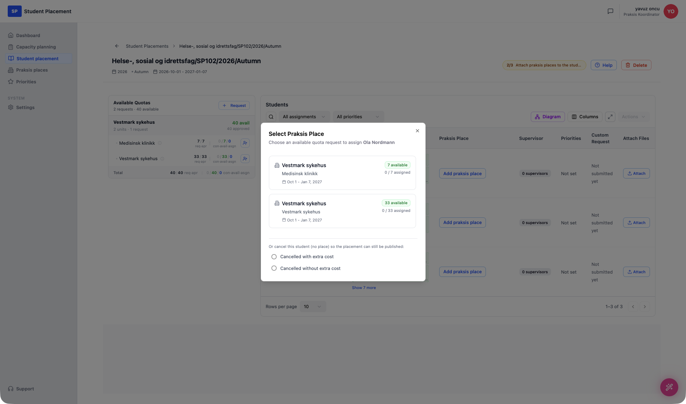
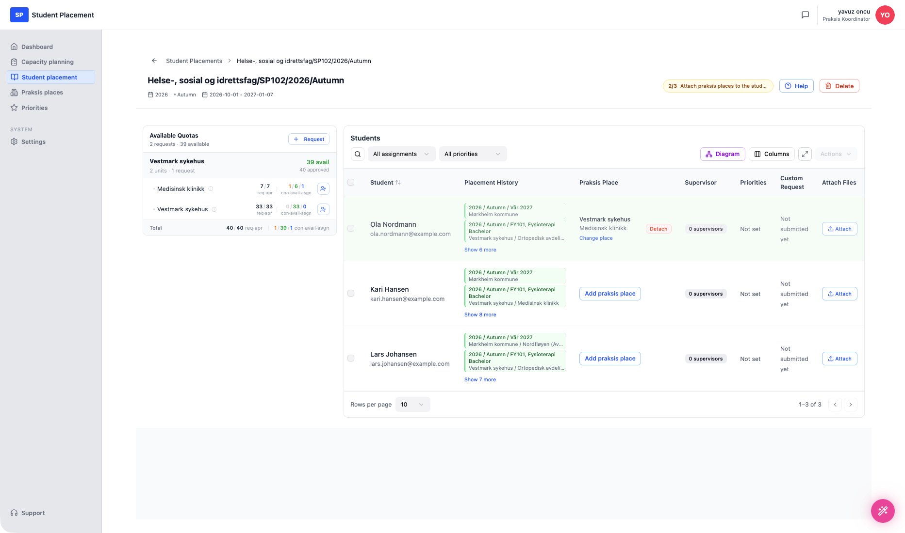
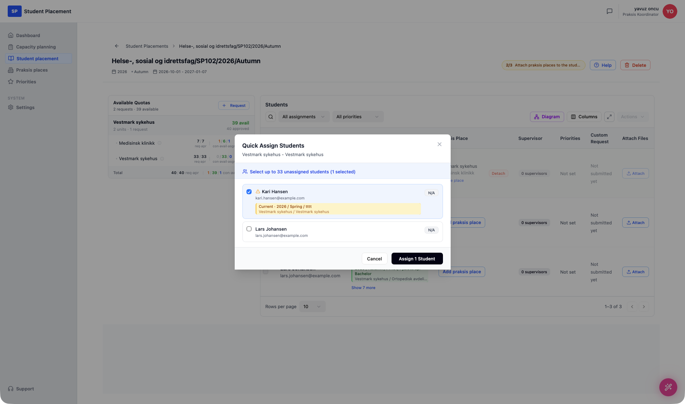
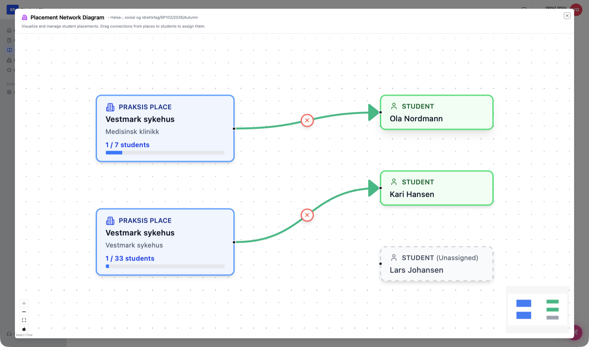
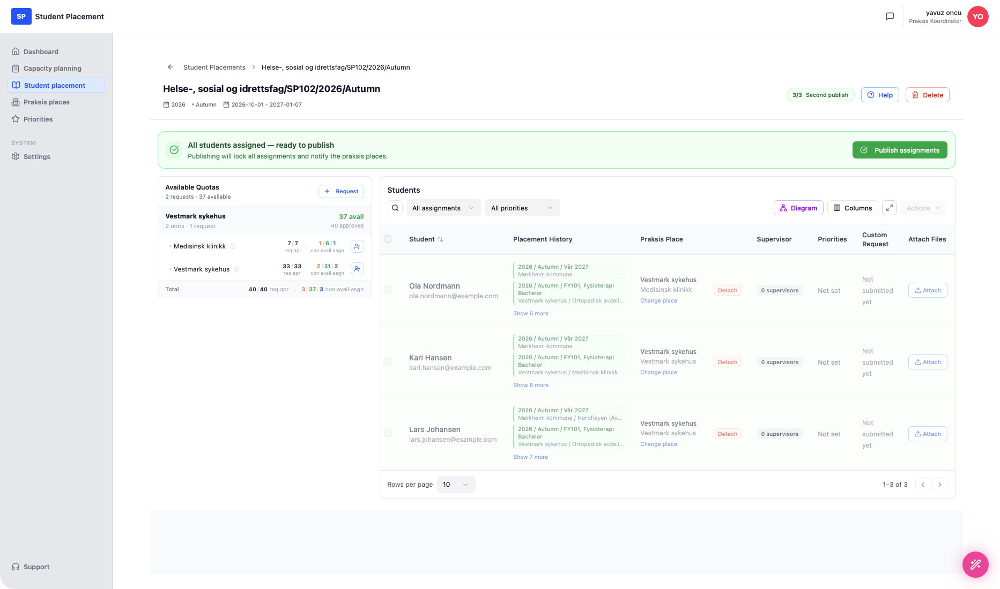

# Testscenario 10 — Student plassering - Fördela studenter

:::info[Scenarioöversikt]

- **Sida:** Student plassering → *(en placering)*
- **Roll:** Placeringskoordinator (PK)
- **Mål:** Fördela de importerade studenterna över de tillgängliga kvoterna (praktikplatserna), så att varje student har en plats för sin praktik.
- **Förutsättning:** En placering finns med importerade studenter och minst en godkänd kvot. Denna genomgång använder **Helse-, sosial og idrettsfag/SP102/2026/Autumn** med **3 importerade studenter**.

:::

## Om import av studenter

Studenter läggs till en placering före det här steget. De kan **importeras från en Excel-fil** eller **hämtas automatiskt från det nationella studentregistret** — **FS** i Norge eller **Ladok** i Sverige. För den här demonstrationen importerades **3 mockstudenter** (Ola Nordmann, Kari Hansen, Lars Johansen).

## Förstå den här sidan

Placeringens detaljsida har två länkade paneler:

- **Tillgängliga kvoter** (vänster) — **platserna studenter kan tilldelas**. Varje godkänd förfrågan grupperas per praktikplats och delas upp per enhet, med värdena **req · apr** (begärt / godkänt) och **con · avail · asgn** (bekräftat / tillgängligt / tilldelat). **+ (Tilldela studenter)**-ikonen på en enhet öppnar en snabbtilldelningspanel. **Totalt**-raden summerar hela kvoten.
- **Studenter** (höger) — **personerna som ska placeras** för sin praktik. Varje rad visar studenten, placeringshistoriken, den tilldelade **Praktikplats** (eller en **Lägg till praktikplats**-knapp när ingen är angiven), handledare, prioriteringar, anpassad förfrågan och filbilagor. Ovanför tabellen finns en sökruta, filtren **Alla tilldelningar** / **Alla prioriteringar** och knapparna **Diagram**, **Kolumner**, expandera och **Åtgärder**.

En förloppsetikett högst upp (t.ex. **2/3 Koppla praktikplatser till studenterna**) visar hur långt placeringen har kommit i arbetsflödet. Allteftersom studenter tilldelas uppdateras kvotvärdena till vänster i realtid.

Det finns **tre sätt att tilldela en student en plats**, alla visade nedan.

<figure>

<figcaption>Placeringssidan — Tillgängliga kvoter (vänster) och de 3 importerade studenterna (höger)</figcaption>

</figure>

---

## Steg

### 1. Öppna placeringen

Klicka på **Student plassering** i sidofältet och välj **Helse-, sosial og idrettsfag/SP102/2026/Autumn**.

### 2. Tilldela första studenten — "Lägg till praktikplats" (studenttabellen)

I **Studenter**-tabellen klickar du på **Lägg till praktikplats** på **Ola Nordmann**s rad. En **Välj praktikplats**-dialog listar de tillgängliga kvotförfrågningarna (med tillgänglighet och antal tilldelade). Den erbjuder också att *avboka* studenten — med eller utan extra kostnad — så att placeringen fortfarande kan publiceras om ingen plats passar.

Välj en plats — här **Vestmark sykehus · Medisinsk klinikk** — för att tilldela Ola.

<figure>

<figcaption>"Lägg till praktikplats" — välj en kvotförfrågan för studenten</figcaption>

</figure>

Studentens rad visar nu den tilldelade platsen med **Byt plats** / **Koppla bort**, och Tillgängliga kvoter-värdena uppdateras (enheten går till *1 tilldelad*).

<figure>

<figcaption>Ola tilldelad Medisinsk klinikk — kvotvärdena uppdaterade till vänster</figcaption>

</figure>

### 3. Tilldela andra studenten — "+"-ikonen i Tillgängliga kvoter

I panelen **Tillgängliga kvoter** klickar du på **+ (Tilldela studenter)**-ikonen på en enhet — här **Vestmark sykehus**. En **Snabbtilldela studenter**-panel öppnas med de otilldelade studenterna. Bocka i **Kari Hansen** och klicka på **Tilldela 1 student**.

<figure>

<figcaption>Snabbtilldela — välj otilldelade studenter för en enhet och tilldela i bulk</figcaption>

</figure>

### 4. Tilldela sista studenten — Diagram-vyn

Klicka på **Diagram** (ovanför studenttabellen) för att öppna **Nätverksdiagram för placering**. Den visar praktikplatser till vänster och studenter till höger; befintliga tilldelningar ritas som förbindelselinjer (var och en med ett **×** för att ta bort den), och otilldelade studenter visas som streckade kort. Du tilldelar en student genom att **dra en förbindelse från en plats till studenten**.

Här är **Lars Johansen** den återstående otilldelade studenten — att koppla honom till **Vestmark sykehus** slutför fördelningen.

<figure>

<figcaption>Diagram-vy — dra från en plats till en student för att tilldela (Lars fortfarande otilldelad)</figcaption>

</figure>

---

## Slutresultat

När alla tre studenterna är tilldelade visar förloppsetiketten **3/3**, och ett grönt banner visas: **"Alla studenter är tilldelade — redo att publicera. Publicering låser alla tilldelningar och meddelar praktikplatserna."** En **Publicera tilldelningar**-knapp blir tillgänglig. Varje studentrad visar sin tilldelade plats, och panelen Tillgängliga kvoter återspeglar **3 tilldelade**.

Scenariot slutar här — studenterna är helt fördelade och placeringen är redo att publiceras.

<figure>

<figcaption>Alla 3 studenterna placerade — redo att publicera</figcaption>

</figure>

---

:::note[Nästa steg]

Om **"Första publicering"** är aktiverat i **Inställningar → Arbetsflöden**, fortsätt med scenariot **"11 · Student plassering - Samla in studentönskemål"**. I det här fallet måste du publicera placeringen till studenterna för att samla in deras önskemål. Annars kan du inte fortsätta placeringsprocessen.

:::

<ScenarioFeedback scenarioId="TS-10-distribute-students" />
