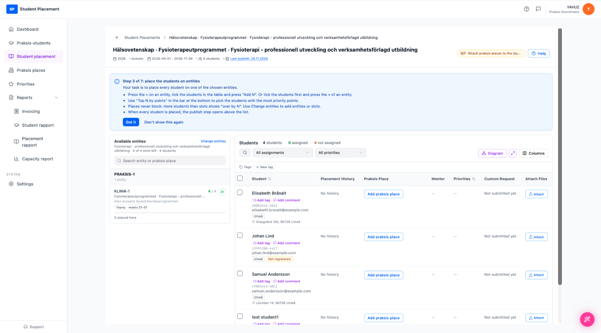
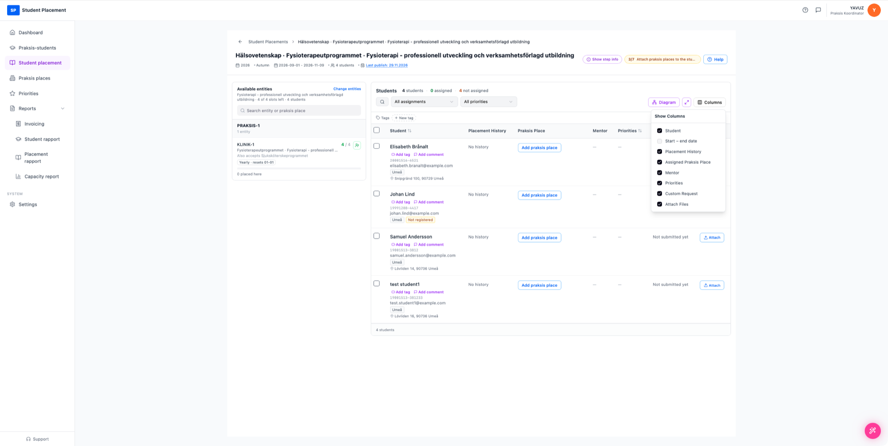
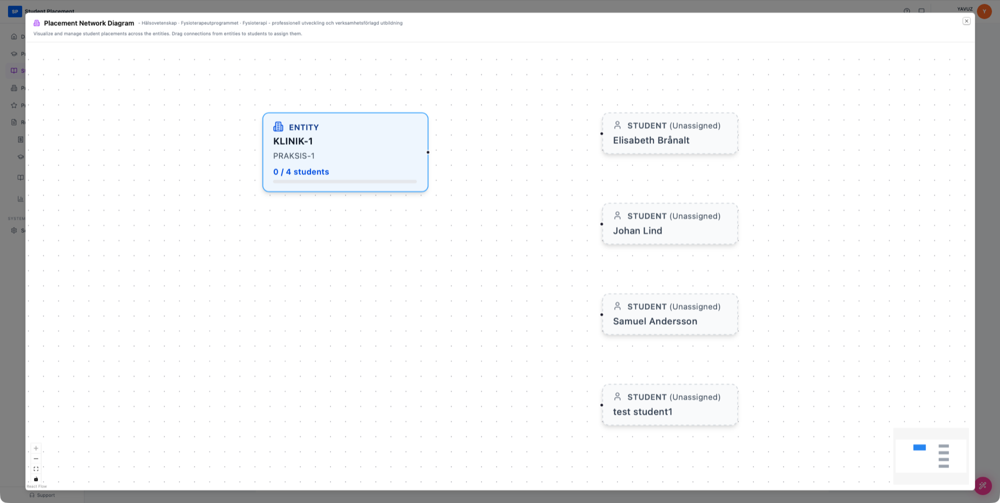
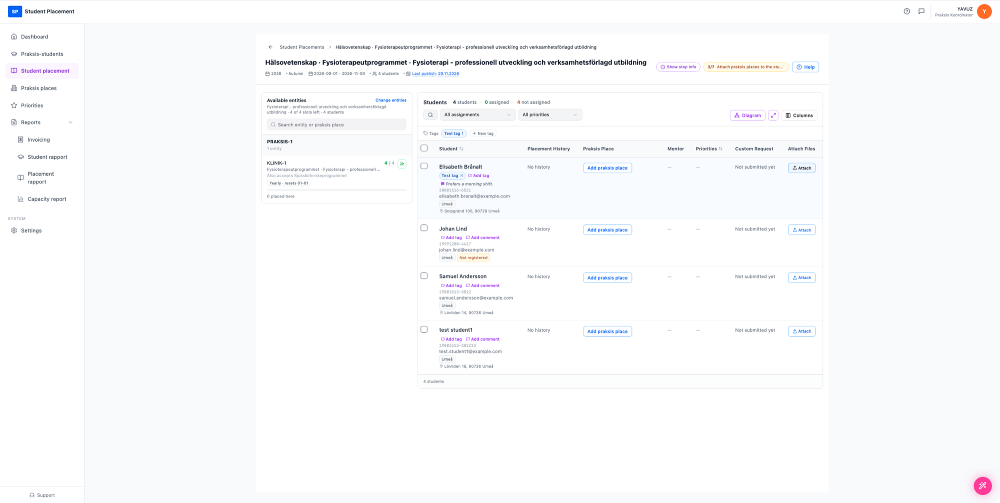
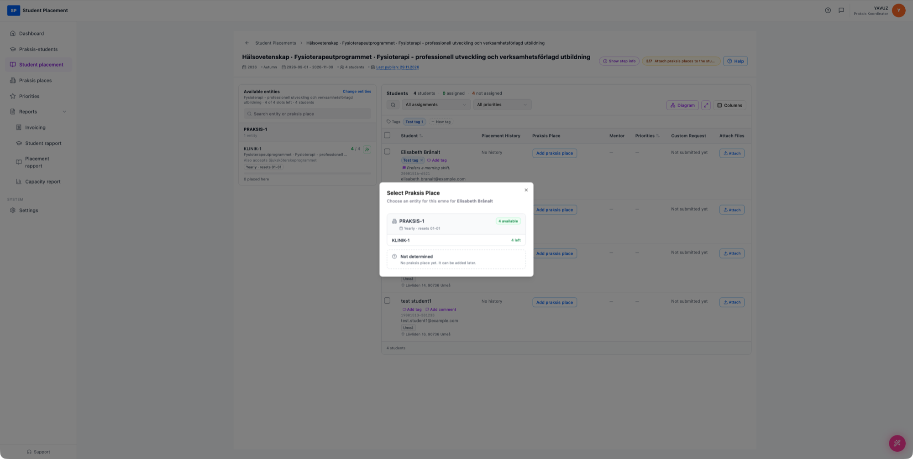
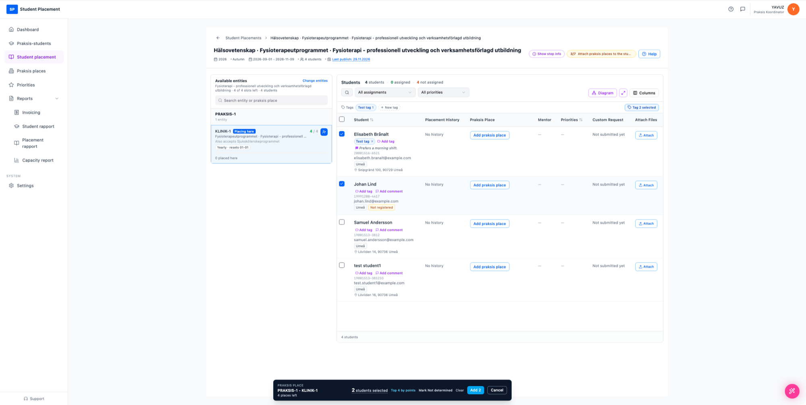
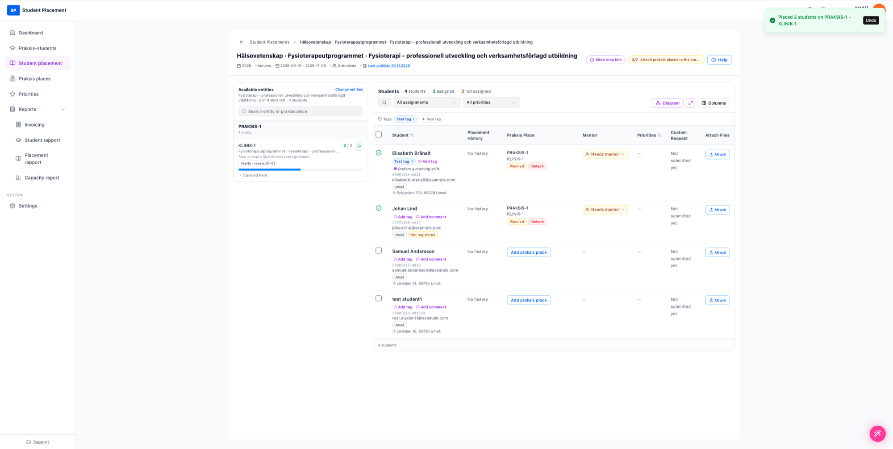
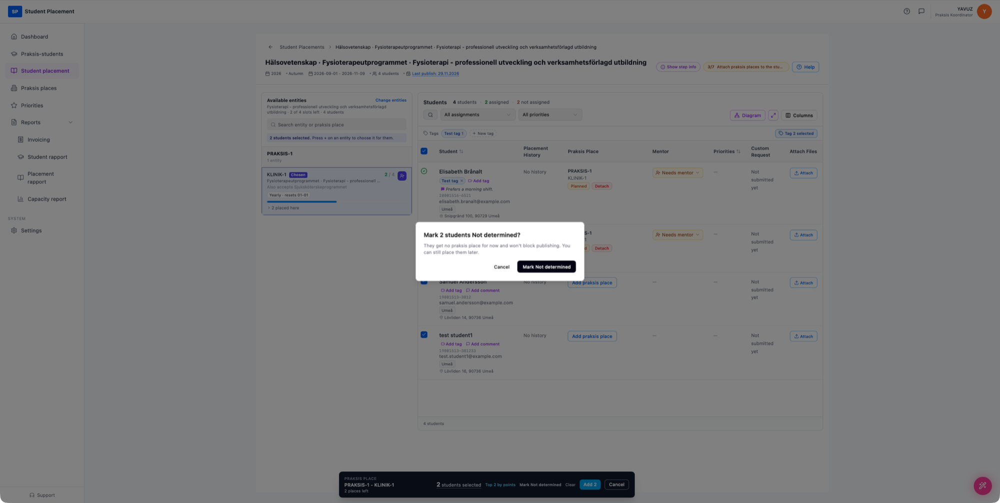
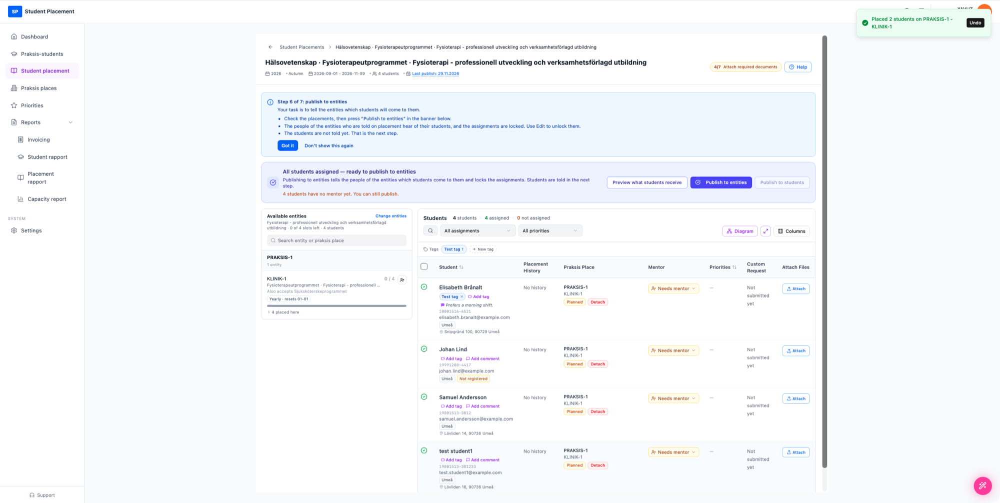

# Testscenario 10 — Studentplacering - Placera studenterna

:::info[Scenarioöversikt]

- **Sida:** Studentplacering → *placering* (steg 3/7, *Koppla praktikplatser till studenterna*)
- **Roll:** Placeringskoordinator (PK)
- **Mål:** Placera varje student i placeringen på en av de valda enheterna — och lära känna verktygen på sidan: filter, kolumner, diagram, etiketter, kommentarer och placeringsraden.
- **Förutsättning:** Enheter och platser har valts (se *Testscenario 09*). Den här genomgången fortsätter med placeringen på **KLINIK-1 · 4 platser** och dess 4 studenter.

:::

## Vad den här sidan är

I steg 3 får studenterna sin praktikplats. Informationsrutan sammanfattar: *steg 3 av 7: placera studenterna
 på enheter — din uppgift är att placera varje student på en av de valda enheterna.*

Sidan har två paneler.

### Tillgängliga enheter (till vänster)

Varje enhet som valdes i steg 2, grupperad efter praktikställe, med:

- lediga platser (t.ex. **4 / 4**) och en stapel som visar hur många som är tagna;
- en **+**-knapp (*Placera studenter på KLINIK-1*) — börjar placera studenter på enheten;
- **N placerade här** — fälls ut till en lista över studenterna på enheten, var och en med **×** för att ta
  bort dem, plus **Ta bort alla**;
- en sökruta (*Sök enhet eller praktikställe*) och **Ändra enheter** för att gå tillbaka till steg 2.

### Studenter (till höger)

Sammanfattningen *4 studenter · 0 tilldelade · 4 inte tilldelade* — klicka på *tilldelade* eller *inte
 tilldelade* för att bara visa de studenterna. Verktygsfältet har:

| Kontroll | Vad den gör |
|---|---|
| **Sök** (förstoringsglas) | Sök på namn, personnummer, adress eller studentanteckning. **Stäng** ger tillbaka verktygsfältet. |
| **Alla tilldelningar** | *Tilldelade*, *Inte tilldelade*, *Inte bestämd*, eller ett praktikställe (t.ex. *PRAKSIS-1*). |
| **Alla prioriteringar** | *Med prioritet* / *Utan prioritet*. |
| **Diagram** | Öppnar **Placeringsnätverksdiagram** (se steg 2 nedan). |
| **Expandera** (pilikon) | Döljer enhetspanelen så att tabellen får hela bredden; klicka igen för att visa den. |
| **Kolumner** | Visar eller döljer kolumner: *Student*, *Start–slutdatum* (av som standard), *Placeringshistorik*, *Tilldelad praktikplats*, *Handledare*, *Prioriteringar*, *Egna önskemål*, *Bifogade filer*. |
| **Etiketter** | Visar etiketterna med antal studenter (klicka på en för att visa de studenterna), och **Ny etikett**. |

Varje studentrad visar namnet med **Lägg till etikett** och **Lägg till kommentar**, personnummer, e-post,
 studieort (och *Inte registrerad* när det gäller) och hemadress, följt av dessa kolumner:

| Kolumn | Innehåll |
|---|---|
| **Placeringshistorik** | Tidigare placeringar (*Ingen historik* om inga). |
| **Praktikplats** | **Lägg till praktikplats** — eller, när studenten är placerad, praktikställe och enhet med *Planerad* och **Koppla från**. |
| **Handledare** | När studenten är placerad: **Behöver handledare** — en meny med enhetens kontakter och *Lägg till en person…*. |
| **Prioriteringar** | Studentens prioritet, om någon. |
| **Egna önskemål** | *Inte inskickat ännu* tills studenten skickar ett. |
| **Bifogade filer** | **Bifoga** — öppnar en filväljare för att ladda upp en fil för studenten. |

---

## Steg

### 1. Titta på steg 3

Öppna placeringen (eller fortsätt från *Testscenario 09*). Märket visar **3/7 Koppla praktikplatser till
 studenterna**. KLINIK-1 visar *4 / 4* och *0 placerade här*; alla 4 studenter är *inte tilldelade*.

<figure>

<figcaption>Steg 3 av 7 — enheter till vänster, studenter till höger</figcaption>

</figure>

### 2. (Valfritt) Utforska visningsverktygen

- Klicka på **Kolumner** för att välja vilka kolumner som visas.

<figure>

<figcaption>Kolumner — Start–slutdatum är dolt som standard</figcaption>

</figure>

- Klicka på **Diagram**. **Placeringsnätverksdiagrammet** visar enheten (*KLINIK-1 · PRAKSIS-1 · 0 / 4
  students*) och varje student (*STUDENT (Unassigned)*). Dra kopplingar från enheter till studenter för att
  tilldela dem. Använd zoom- och *anpassa vy*-knapparna nere till vänster; stäng med **×**.

<figure>

<figcaption>Placeringsnätverksdiagram — dra från en enhet till en student för att tilldela</figcaption>

</figure>

- Klicka på **Expandera** (pilikon) för att dölja enhetspanelen; klicka igen för att visa den.

### 3. Ge en student en etikett och lägg till en kommentar

1. Klicka på **Ny etikett**, skriv `Test tag` och klicka på **Skapa etiketten ”Test tag”**. Den visas vid
   *Etiketter* med antalet *0*.
2. På **Elisabeth Brånalt** klickar du på **Lägg till etikett** och väljer **Test tag**. Etiketten visas under
   namnet (ta bort den med **×**), och antalet blir *1*.
3. Klicka på **Lägg till kommentar**, skriv `Prefers a morning shift.` och klicka på **Spara**. Kommentaren
   (max 1000 tecken, synlig bara för personer vid universitetet) visas nu under namnet.

<figure>

<figcaption>Elisabeth Brånalt med ”Test tag” och en kommentar</figcaption>

</figure>

### 4. Placera en student med ”Lägg till praktikplats”

På Elisabeths rad klickar du på **Lägg till praktikplats**. Dialogen **Välj praktikplats** visar
 **KLINIK-1 · 4 left** under PRAKSIS-1, och **Inte bestämd** — *ingen praktikplats ännu; den kan läggas till
 senare*. Klicka på **KLINIK-1**.

<figure>

<figcaption>Välj praktikplats — välj en enhet, eller Inte bestämd</figcaption>

</figure>

Ett meddelande bekräftar att Elisabeth har tilldelats KLINIK-1. Raden visar nu **PRAKSIS-1 · KLINIK-1** med
 *Planerad* och **Koppla från**, och knappen **Behöver handledare** visas. Klicka på **Koppla från** för att ta
 bort henne igen — det sker direkt.

### 5. Placera flera studenter från enhetens +

1. I vänster panel klickar du på **+** vid **KLINIK-1**. Enheten markeras *Placerar här*, och en rad visas
   längst ned: *PRAKSIS-1 - KLINIK-1 · 4 places left · 0 students selected*. Stäng informationsfönstret med
   **Uppfattat**.
2. Markera **Elisabeth Brånalt** och **Johan Lind**. Raden visar *2 studenter valda* med **Topp 4 efter
   poäng**, **Markera som inte bestämd**, **Rensa**, **Lägg till 2** och **Avbryt** — och knappen **Etikettera
   2 valda** visas vid etiketterna.

<figure>

<figcaption>Placeringsraden — 2 studenter valda för KLINIK-1</figcaption>

</figure>

3. Klicka på **Lägg till 2**. Meddelandet om att 2 studenter har placerats på PRAKSIS-1 - KLINIK-1 har en
   **Ångra**-knapp. KLINIK-1 visar nu *2 / 4* och **2 placerade här** — klicka för att se vilka som är
   placerade där.

<figure>

<figcaption>2 tilldelade · 2 inte tilldelade — KLINIK-1 har 2 platser kvar</figcaption>

</figure>

### 6. Placera resten — markera först, sedan +

Du kan också göra tvärtom: markera **Samuel Andersson** först. Vänster panel ber dig trycka på **+** på en
 enhet för att välja den för studenten. Klicka på **+** vid **KLINIK-1** — enheten markeras *Vald*, och raden
 visar *2 platser kvar*.

Klicka på **Topp 2 efter poäng** — den väljer studenterna med flest prioritetspoäng, så många som det finns
 platser kvar (här de två sista studenterna).

:::note[Markera som inte bestämd]

**Markera som inte bestämd** ger de valda studenterna *ingen praktikplats för tillfället*. Den frågar först: ska
 2 studenter markeras som inte bestämda? De får ingen praktikplats nu och blockerar inte publicering, och de kan
 fortfarande placeras senare. I den här genomgången klickar vi på **Avbryt**.

<figure>

<figcaption>Markera som inte bestämd — ber om bekräftelse</figcaption>

</figure>

:::

Klicka på **Lägg till 2**.

### 7. Alla studenter är placerade

Alla 4 studenter är tilldelade, och KLINIK-1 visar *0 / 4*. En banderoll visas ovanför listan: *alla studenter
 tilldelade — redo att publicera till enheter*, med anmärkningen *4 studenter har ingen handledare ännu, men du
 kan ändå publicera*, och knapparna **Förhandsgranska vad studenterna får**, **Publicera till enheter** och
 **Publicera till studenter** (inaktiverad tills du har publicerat till enheterna).

**Förhandsgranska vad studenterna får** visar placeringen som en student kommer att se den — enhet, datum och
 kontakter — och varnar om enheten saknar information (t.ex. aktivitetsbeskrivning), som du kan fylla i under
 **Praktikställen → Enheter**.

<figure>

<figcaption>Alla studenter tilldelade — publiceringssteget öppnas ovanför listan</figcaption>

</figure>

---

## Slutresultat

Alla 4 studenter är placerade på **KLINIK-1** (*Planerad*), och placeringen är redo att publiceras till
 enheterna.

## Anteckningar

-   Platserna blockerar aldrig: du kan placera fler studenter än platser — enheten visar då *”over by N”*.
-   **Koppla från** tar bort en student direkt, utan att fråga.
-   Handledare och publicering beskrivs i nästa scenarier.

---

<ScenarioFeedback scenarioId="TS-10-place-students" />
