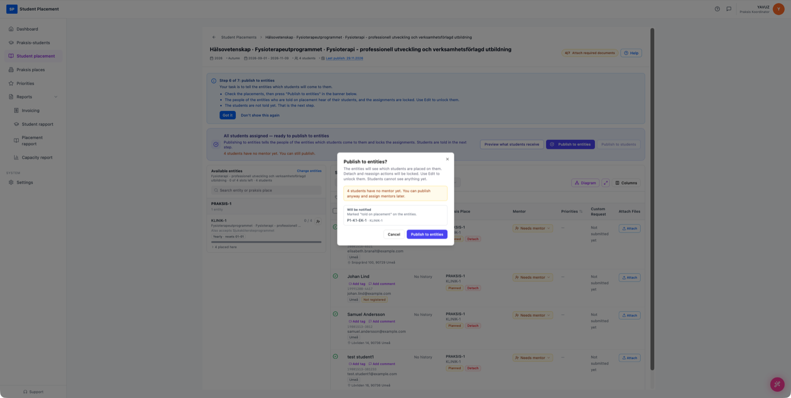
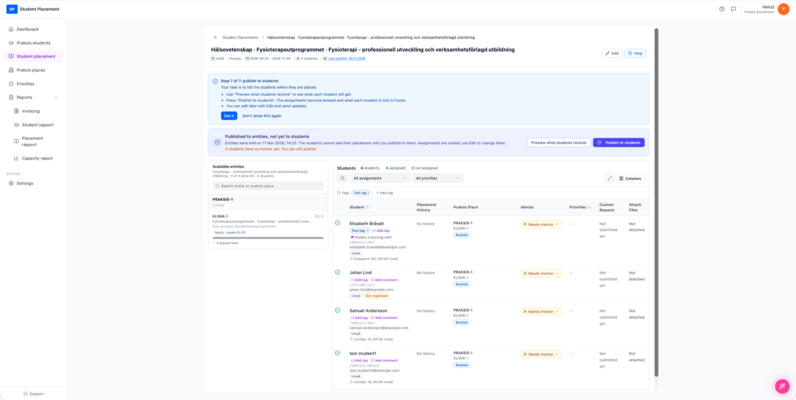
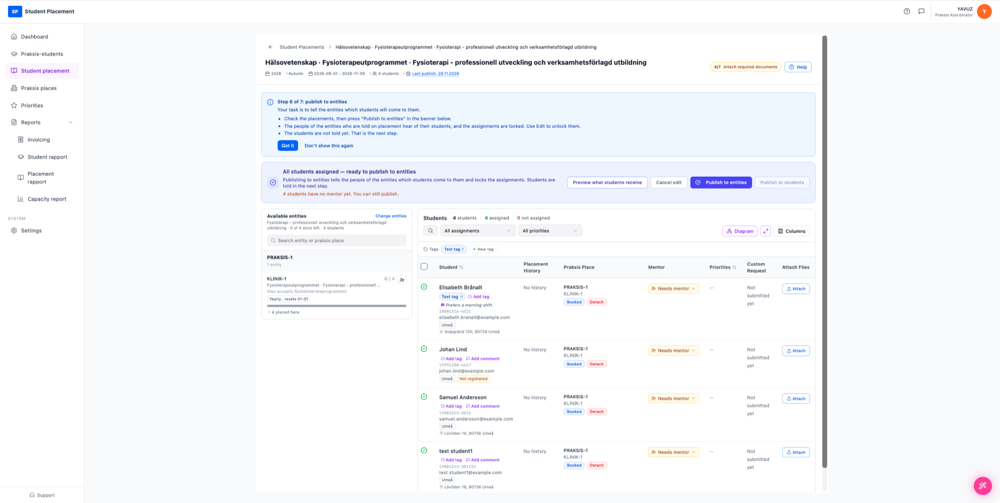
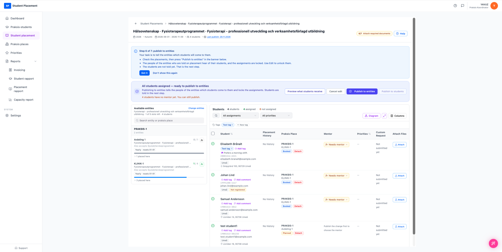
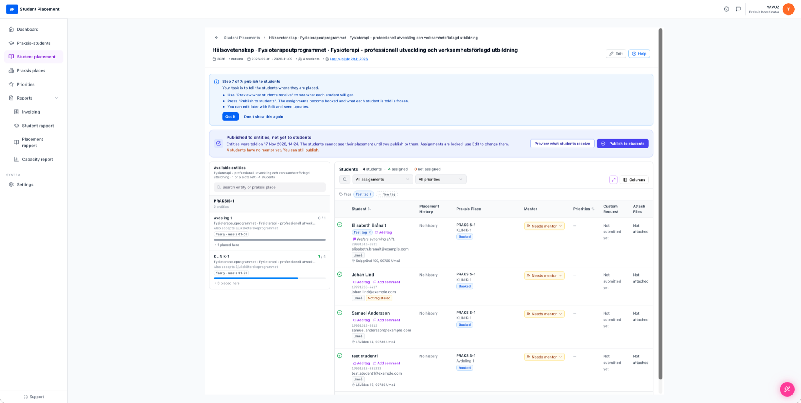

# Testscenario 10b — Studentplacering - Publicera till enheter och redigera

:::info[Scenarioöversikt]

- **Sida:** Studentplacering → *placering* (publicera till enheter)
- **Roll:** Placeringskoordinator (PK)
- **Mål:** Publicera placeringen till enheterna, sedan använda **Redigera** för att ändra en tilldelning och publicera ändringen igen.
- **Förutsättning:** Alla studenter är placerade (se *Testscenario 10*). Den här genomgången fortsätter med de 4 studenterna på **KLINIK-1**.

:::

## Vad den här sidan är

När alla studenter har en plats visas en banderoll ovanför studentlistan: *alla studenter tilldelade — redo att
 publicera till enheter*. **Publicering till enheter** berättar för enheterna vilka studenter som kommer till
 dem:

- **enhetskontakterna** kan nu se tilldelningarna — vilka studenter som är placerade på deras enhet;
- tilldelningarna **låses** (*Bokad*) — **Koppla från** och omtilldelning stängs av tills du trycker på
  **Redigera**;
- **studenterna får inte veta något ännu** — det är nästa steg, **Publicera till studenter**.

Handledare krävs inte: *4 studenter har ingen handledare ännu, men du kan ändå publicera.*

---

## Steg

### 1. Publicera till enheter

Klicka på **Publicera till enheter** i banderollen. En bekräftelse öppnas: enheterna kommer att se vilka
 studenter som är placerade hos dem, **Koppla från** och omtilldelning låses (använd **Redigera** för att låsa
 upp), och studenterna ser ingenting ännu. Under **Kommer att aviseras** visas kontakterna som är markerade
 *”told on placement”* på enheterna — här **P1-K1-EK-1 · KLINIK-1**. Klicka på **Publicera till enheter**.

<figure>

<figcaption>Publicera till enheter? — visar vem som aviseras</figcaption>

</figure>

### 2. Kontrollera den publicerade placeringen

Meddelandet *Publicerad till enheter* visas och banderollen ändras till **Publicerad till enheter, ännu inte
 till studenter** — enheterna fick besked 17 nov. 2026 kl. 14.23; studenterna ser inte placeringen förrän du
 publicerar till dem, och tilldelningarna är låsta (använd **Redigera** för att ändra dem).

- Alla studenter är nu **Bokade** på KLINIK-1; **Koppla från** och **Bifoga** är borta (*Inte bifogad*).
- **Ändra enheter**, **Diagram** och stegmärket är dolda; en **Redigera**-knapp visas i rubriken.
- Banderollen har **Förhandsgranska vad studenterna får** och **Publicera till studenter**.

<figure>

<figcaption>Publicerad till enheter, ännu inte till studenter — tilldelningarna är bokade och låsta</figcaption>

</figure>

### 3. Lås upp med Redigera

Klicka på **Redigera** (uppe till höger). Placeringen låses upp direkt: **Koppla från**, **Ändra enheter**,
 **Diagram** och stegmärket kommer tillbaka, och banderollen visar **Avbryt redigering** bredvid **Publicera
 till enheter**. Använd **Avbryt redigering** för att lämna utan ändringar.

<figure>

<figcaption>Redigera — tilldelningarna kan ändras igen</figcaption>

</figure>

### 4. Gör en ändring

I det här exemplet flyttar vi **test student1** till en annan enhet:

1. Klicka på **Ändra enheter**, **Lägg till** **Avdeling 1** (den får 1 plats) och klicka på **Fortsätt till
   studenter** — se *Testscenario 09*.
2. På **test student1** klickar du på **Koppla från**, sedan **Lägg till praktikplats** och väljer
   **Avdeling 1**. Ett meddelande bekräftar tilldelningen.

Den ändrade studenten visar **Planerad** (inte publicerad ännu), medan de andra förblir **Bokade**.
 Handledarkolumnen för den ändrade studenten säger att ändringen måste publiceras innan handledare kan väljas.

<figure>

<figcaption>test student1 flyttad till Avdeling 1 — Planerad tills ändringen publiceras</figcaption>

</figure>

### 5. Publicera ändringen

Klicka på **Publicera till enheter** igen och bekräfta. Banderollen återgår till **Publicerad till enheter,
 ännu inte till studenter** med ny tid, och **test student1** är nu **Bokad** på **Avdeling 1**.
 Tilldelningarna är låsta igen.

<figure>

<figcaption>Ändringen är publicerad — alla tilldelningar är bokade och låsta igen</figcaption>

</figure>

---

## Slutresultat

Enheterna har fått besked om sina studenter — 3 på **KLINIK-1** och 1 på **Avdeling 1** — och
 enhetskontakterna kan se tilldelningarna. Studenterna har inte fått besked ännu; placeringen är redo för
 **Publicera till studenter**.

## Anteckningar

-   Bara kontakter som är markerade *”told on placement”* på en enhet visas under **Kommer att aviseras**. I det
    här exemplet hade Avdeling 1 ingen sådan kontakt, så bara P1-K1-EK-1 (KLINIK-1) visades — kontrollera
    enhetens kontakter under **Praktikställen → Enheter** om någon borde aviseras.
-   Publicering till studenter beskrivs i nästa scenario.

---

<ScenarioFeedback scenarioId="TS-10b-publish-to-entities" />
