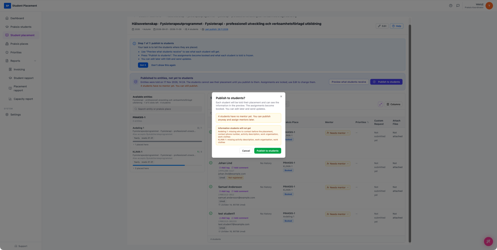
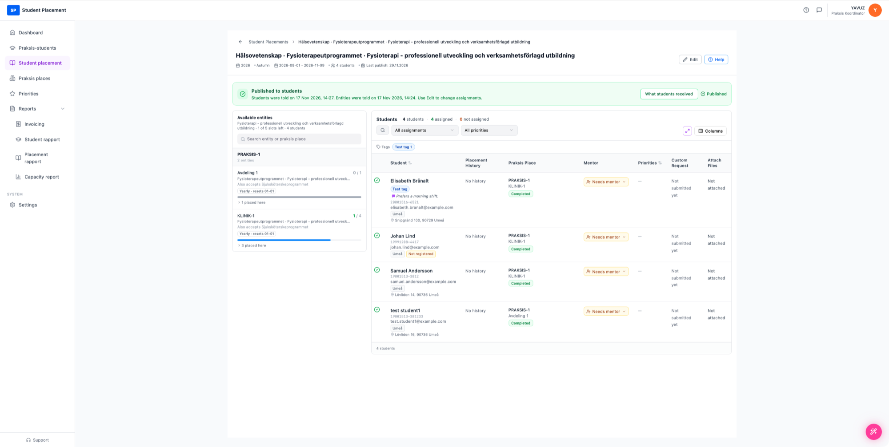
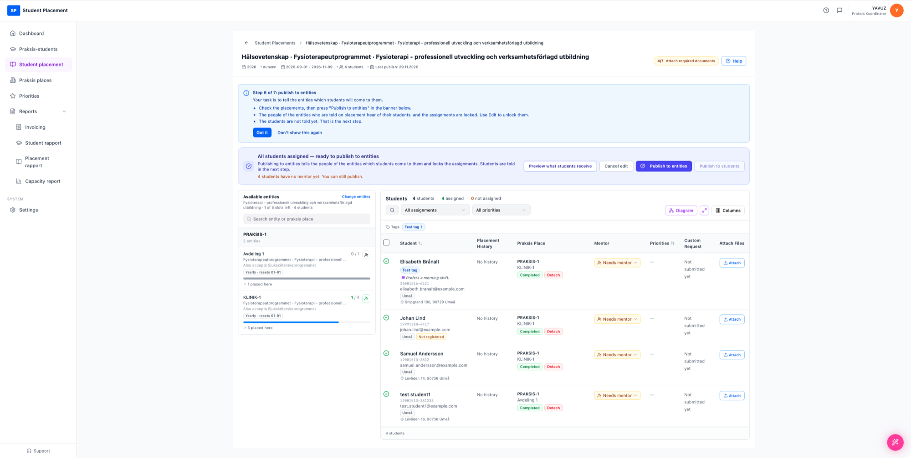
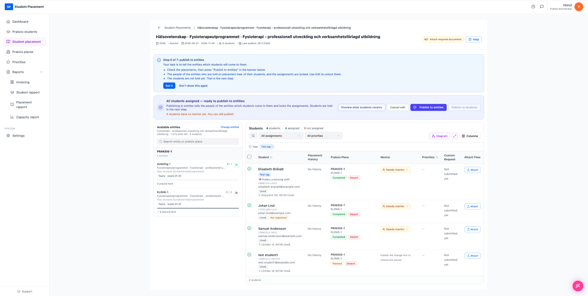
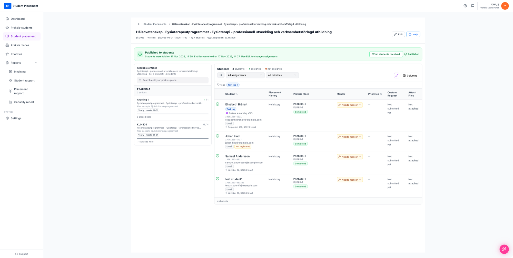

# Testscenario 10c — Studentplacering - Publicera till studenter och redigera

:::info[Scenarioöversikt]

- **Sida:** Studentplacering → *placering* (steg 7/7, publicera till studenter)
- **Roll:** Placeringskoordinator (PK)
- **Mål:** Berätta för studenterna var de är placerade och sedan använda **Redigera** för att ändra en tilldelning och skicka uppdateringen till enheter och studenter.
- **Förutsättning:** Placeringen är publicerad till enheter (se *Testscenario 10b*). Den här genomgången fortsätter med 3 studenter på **KLINIK-1** och **test student1** på **Avdeling 1**.

:::

## Vad den här sidan är

Efter publicering till enheter visar informationsrutan *steg 7 av 7: publicera till studenter*. **Publicering
 till studenter** berättar för varje student var de är placerade — det de får är det som **Förhandsgranska vad
 studenterna får** visar. Tilldelningarna visar sedan **Slutförd**, och placeringen markeras **Publicerad**.

Du kan fortfarande ändra placeringen efteråt: **Redigera** låser upp den, och du publicerar ändringen till
 enheterna och sedan till studenterna igen.

---

## Steg

### 1. Publicera till studenter

I banderollen *Publicerad till enheter, ännu inte till studenter* klickar du på **Publicera till studenter**. En
 bekräftelse öppnas: varje student får besked om sin placering och kan se informationen i förhandsgranskningen;
 tilldelningarna blir bokade, och du kan redigera senare och skicka uppdateringar.

Under **Information studenterna inte får** visas vad varje enhet saknar — här *Avdeling 1: saknar vem som ska
 kontaktas före placeringen, kontakttelefon, aktivitetsbeskrivning, arbetsorganisation, arbetskläder* och
 *KLINIK-1: saknar aktivitetsbeskrivning, arbetsorganisation, arbetskläder*. Du kan ändå publicera; fyll i detta
 under **Praktikställen → Enheter**. Klicka på **Publicera till studenter**.

<figure>

<figcaption>Publicera till studenter? — visar information studenterna inte får</figcaption>

</figure>

### 2. Kontrollera den publicerade placeringen

Meddelandet *Publicerad till studenter* visas. Den gröna banderollen **Publicerad till studenter** visar när
 studenterna och enheterna fick besked (17 nov. 2026 kl. 14.27 och 14.24), och att du använder **Redigera** för
 att ändra tilldelningar.

- Alla studenter visar **Slutförd**.
- Banderollen har **Vad studenterna fick** (placeringen som studenten ser den, markerad *Publicerad* med datum)
  och märket **Publicerad**.
- Bara **Redigera** finns kvar i rubriken; etiketter och kommentarer kan inte längre läggas till.

<figure>

<figcaption>Publicerad till studenter — alla tilldelningar är slutförda</figcaption>

</figure>

### 3. Redigera efter publicering

Klicka på **Redigera**. Placeringen låses upp direkt, precis som efter publicering till enheter: **Koppla
 från**, **Ändra enheter**, stegmärket och **Avbryt redigering** kommer tillbaka, och banderollen erbjuder
 **Publicera till enheter** igen. **Publicera till studenter** är inaktiverad (*publicera till enheter först*)
 tills enheterna har fått ändringen.

<figure>

<figcaption>Redigera — placeringen är upplåst igen</figcaption>

</figure>

### 4. Gör en ändring

Flytta **test student1** tillbaka till **KLINIK-1**: klicka på **Koppla från**, sedan **Lägg till praktikplats**
 → **KLINIK-1**. Studenten visar **Planerad**, de andra förblir **Slutförda**.

<figure>

<figcaption>test student1 tillbaka på KLINIK-1 — Planerad tills den publiceras</figcaption>

</figure>

### 5. Skicka uppdateringen — först enheter, sedan studenter

1. Klicka på **Publicera till enheter** och bekräfta. Banderollen återgår till *Publicerad till enheter, ännu
   inte till studenter*; test student1 är **Bokad**.
2. Klicka på **Publicera till studenter**. Bekräftelsen visar återigen saknad information (nu bara KLINIK-1).
   Klicka på **Publicera till studenter**.

Banderollen visar **Publicerad till studenter** med de nya tiderna, och alla 4 studenter är **Slutförda** på
 **KLINIK-1**.

<figure>

<figcaption>Uppdateringen är publicerad till enheter och studenter</figcaption>

</figure>

---

## Slutresultat

Studenterna har fått besked om sin placering. Efter redigeringen är alla 4 studenter **Slutförda** på
 **KLINIK-1**, och både enheterna och studenterna har den senaste versionen.

## Anteckningar

-   En redigering skickas alltid ut i samma ordning som första gången: **Publicera till enheter**, sedan
    **Publicera till studenter**.
-   Handledare behövs inte för att publicera. Att tilldela handledare beskrivs i nästa scenario.

---

<ScenarioFeedback scenarioId="TS-10c-publish-to-students" />
